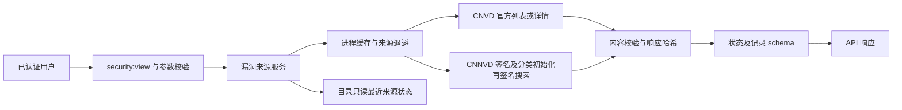

# CNVD 与 CNNVD 后端设计

## 分层与数据流

复用 HTTPX，不新增依赖、数据库表或迁移。每来源一把锁抑制重复并发；两来源查询最多并行两个工作线程。128 项有界进程缓存按来源、查询词和数量索引，失败会清除该来源旧查询缓存，避免历史成功遮盖新失败。状态重启即清空，不能称为持久同步记录。

## 接口契约

| API | 行为 |
|---|---|
| `GET /api/security/vulnerability-sources` | 实际查询两库最新页，按缓存/退避返回状态和请求证据 |
| `GET /api/security/vulnerability-records?q=&source=all&limit=10` | `q` 最多 200 字符；来源仅 all/cnvd/cnnvd；每来源 limit 为 1–20 |
| `GET /api/security/rule-catalog` | 复用最近来源状态，不隐式联网；进程首次查询前为 not_checked |

检索响应 `data` 含 `query/sources/records`。记录包含来源编号、标题、官方详情链接、CVE、等级原文、时间、匹配范围及证据 URL/哈希。两库同时查询时总数最多为每来源 limit 的两倍。包裹响应的成功只表示本平台已完成查询处理，须逐来源检查 `status/connected`。

`last_query` 只可在本次直接检索响应中表示该请求；共享目录和失败退避状态将其清空，不能据空字符串认定上次做的是空词检索。`checked_at` 为 UTC，`cached` 表示返回缓存/退避观察（目录只读已存观察时为 true，未查初态为 false），`last_success_at` 仅在实际漏洞记录验证通过时更新。

## 异常策略

固定官方 origin，不跟随重定向，连接超时 5 秒、读超时 10 秒，响应上限 1 MiB。HTTP 429 记 rate_limited；521/403 等记 blocked；网络失败、超时、编码错误及无效 JSON/HTML 独立呈现。CNNVD 必须同时通过 HTTP、业务码与 records/total/编号字段校验。签名不落盘，不公开 Cookie 或令牌。

成功观察超过 300 秒后目录返回 stale、connected=false；失败退避优先于旧成功缓存。CNVD 空壳与验证码页不能算空查询成功。未知等级保持源字段原文，不猜测数字枚举，不沿用官网对未知等级默认低危的展示逻辑。

## 官网初始化修复

CNNVD 每个查询在同一 HTTPX 客户端中执行 sign → POST vulTypeList（无 body）→ sign → POST searchVul。服务端通过正常 Set-Cookie 初始化 pv_code；不生成或求解反爬 Cookie。初始化每一步保留证据，但只以最终搜索记录认定取数成功。编号同时校验官网当前 YYYY-N 与历史 YYYYMM-N 格式，描述优先读实测 vulDesc。

结构完整的零结果返回 empty、connected=false，不更新最后取数成功时间；采用 300 秒查询缓存且不触发来源失败退避。available 仅实际记录；available/empty 被动观察超过 300 秒均为 stale。失败仍保留 HTTP/业务码并使旧成功失效。

## 官方行业子库回退扩展（2026-10-22）

主线程提供的新官方来源已从生产出口验证：ai.cnvd.org.cn 首页返回人工智能行业漏洞表格；ics.cnvd.org.cn 当前只确认应用壳，不能视为取数。最小方案仅在 CNVD 主站实测 HTTP 521 后读取固定 AI 子库首页，不翻页、不求解挑战、不使用登录凭据。

API 保持 source=cnvd；增加 coverage_scope=ai_sector、coverage_label，query_scope=ai_sector_latest_page 或 ai_sector_latest_page_filter，并显式保留 primary_status=blocked、primary_http_status=521。记录使用官方 href 编号及 title 属性中的完整标题，危害级别原文及表格“时间”写入 source_date，不将该字段推断为发布日期；evidence_url 为实际可读行业列表，详情链接仍可能受主站限制。空匹配仍 empty/false，不代表 CNVD 全库无匹配。

主站 521 观察按至少60秒退避共享，不因回退成功及换关键词立即重试主站；复用证据须标记 cached。回退仅代表人工智能行业首页记录接通，状态说明始终保留范围和主站限制。无新增配置、依赖、路由或权限。
