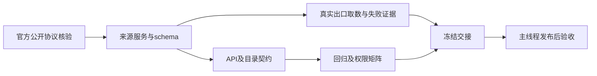

# CNVD 与 CNNVD 原子任务

| 任务 | 输入与依赖 | 输出与验收 | 状态 |
|---|---|---|---|
| 官方协议核验 | 官网公开页面、JS、正式文档 | 多个官方资源交叉核对路径/签名/字段，保留真实错误 | 完成并收口 |
| 来源服务与schema | 已核实协议、现有HTTPX | 严格字段、证据、缓存、退避、失败和过期状态 | 完成 |
| API与目录 | 服务/schema/现有security:view | 两条只读API及目录复用，非法请求不联网 | 完成 |
| CNNVD正常初始化修复 | 官网页面与JS、出口对照 | 同客户端普通Cookie、分类无body、逐请求签名，实际records | 完成 |
| CNVD行业限定回退 | 主库521、AI官网真实六列表格 | 仅521触发AI首页；行业范围、完整title、来源日期、主库失败保留 | 完成 |
| ICS正常通道评估 | 官网JS声明的公开读接口 | 业务500 token is empty如实记录，未绕凭据继续 | 完成，未接通 |
| 回归与路由权限 | 上述限定写集 | 1228 passed；同11文件组409 passed；Ruff通过 | 完成 |
| 文档与冻结 | 当前证据与测试 | 更新方案、交接、生产核验和哈希清单，不提交/部署 | 完成 |
| 发布后验收 | 主线程最终CI、生产发布 | 真实API及前端范围/错误显示、浏览器核验 | 主线程负责 |

依赖按图顺序，前端由Luna并行且不改后端。新环境变量、凭据、依赖、锁文件和数据迁移均为零。所有success夹具与真实上游证据分开。
