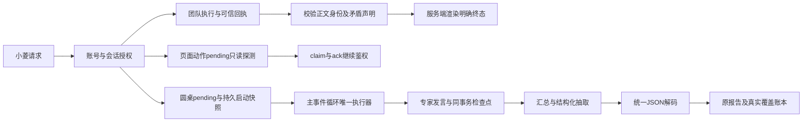

# 运行链路修复设计

沿用现有小菱团队、页面动作、圆桌和覆盖账本，不新增旁路执行入口。版本仍为4.1.20，不增加数据库迁移。

## 团队终态

输入必须是服务端验证过的 `trusted_terminal_team_snapshot`，含正整数团队编号及白名单终态。用户正文和模型输出不能建立信任。先拒绝错误编号与明确矛盾声明，再通过既有 `COMPLETION_GUARD_FORCED_OUTPUT_KEY` 渲染“团队 N 已完成／执行失败／已阻塞／已取消／已超时”。模型负责说明证据，强制输出进入现有持久化流程，不重放业务工具。

正文识别按分句区分团队终态与报告、成员、测试、子任务等局部结果。对自然语言的判定是有限规则；不能宣称穷尽任何改写。

## 页面动作

客户端生成run ID或接到创建事件时，服务端检查点可能尚未提交。`GET /agent-browser/pending` 的40400属于恢复探测中的可重试结果，继续reject但免除全局错误弹窗；40901沿用既有行为。claim/ack及其他请求行为不变。后续轮询只有读到同账号、同会话、同surface的真实动作才执行。跨账号、跨会话和不存在运行继续拒绝。

## 圆桌状态与恢复

创建时先持久化pending，启动参数持久化到私有 `_recovery`；公开进度剥离 `_recovery`、`_checkpoint` 等私有字段，避免返回源码与内部画像。预检和注册失败须立即收口，不能留下假运行。

主循环执行前重新检查账号、项目权限、登录版本和父运行取消状态。构造、投递和执行异常同步关闭会话及仍运行的同账号报告。人工停止记为cancelled并禁止自动恢复；服务中断记为interrupted，重启后按可信快照恢复。

恢复必须校验原会话账号、项目、文件，原报告账号／项目／类型，原ReviewTaskFile和冻结代码SHA-256。沿用原报告及剩余专家计划、模型调用预算、发言顺序；发言与检查点同事务提交。已持久化的汇总及结构化抽取应复用，不能从第一轮重新调用模型。外部模型响应与本地事务之间无法提供分布式exactly-once保证，未保存的响应不能作为可恢复承诺。

## JSON与覆盖真实性

`load_json_object` 统一处理合法对象、围栏、字符串外尾逗号及severity四级中文裸枚举；只修语法，不补发现、不补截断字符串、不改证据。拒绝重复字段、非有限数、额外JSON、截断及歧义内容。

HTTP JSON模式在完整响应处使用同一解码器。完整但不可解析的响应执行有限重试，截断保持失败；调用用量与失败尝试均保留。后续业务仍执行issues契约与覆盖验证，解析成功不自动等于全覆盖。

## 集成门禁

相关单测、前端lint／类型／构建、后端Ruff与编译、独立故障复核、CI、精确SHA全量发布及原文件真实浏览器验收依次执行。保留发布前备份和隔离恢复证据，前后端版本、镜像、健康端点、迁移与发布账本须一致。
