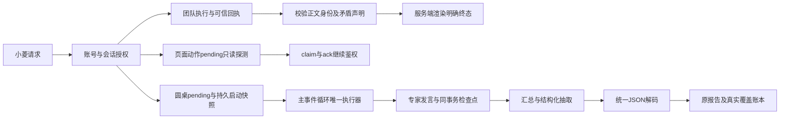

# 运行链路修复设计

沿用现有小菱团队、页面动作、圆桌和覆盖账本，不新增旁路执行入口。原任务目录保留4.1.20标识；2026-10-23集成基线为已发布4.1.21，本轮不回退版本、不增加数据库迁移。

## 团队终态

输入必须是服务端验证过的 `trusted_terminal_team_snapshot`，含正整数团队编号及白名单终态。用户正文和模型输出不能建立信任。先拒绝错误编号与明确矛盾声明，再通过既有 `COMPLETION_GUARD_FORCED_OUTPUT_KEY` 渲染“团队 N 已完成／执行失败／已阻塞／已取消／已超时”。模型负责说明证据，强制输出进入现有持久化流程，不重放业务工具。

正文识别按分句区分团队终态与报告、成员、测试、子任务等局部结果。对自然语言的判定是有限规则；不能宣称穷尽任何改写。

## 页面动作

客户端生成run ID或接到创建事件时，服务端检查点可能尚未提交。`GET /agent-browser/pending` 的40400属于恢复探测中的可重试结果，继续reject但免除全局错误弹窗；40901沿用既有行为。claim/ack及其他请求行为不变。后续轮询只有读到同账号、同会话、同surface的真实动作才执行。跨账号、跨会话和不存在运行继续拒绝。

## 圆桌状态与恢复

创建时先持久化pending，启动参数持久化到私有 `_recovery`；公开进度剥离 `_recovery`、`_checkpoint` 等私有字段，避免返回源码与内部画像。预检和注册失败须立即收口，不能留下假运行。

主循环执行前重新检查账号、项目权限、登录版本和父运行取消状态。构造、投递和执行异常同步关闭会话及仍运行的同账号报告。人工停止记为cancelled并禁止自动恢复；服务中断记为interrupted，重启后按可信快照恢复。

恢复必须校验原会话账号、项目、文件，原报告账号／项目／类型，原ReviewTaskFile和冻结代码SHA-256。沿用原报告及剩余专家计划、模型调用预算、发言顺序；发言与检查点同事务提交。已持久化的汇总及结构化抽取应复用，不能从第一轮重新调用模型。外部模型响应与本地事务之间无法提供分布式exactly-once保证，未保存的响应不能作为可恢复承诺。

## JSON与覆盖真实性

`load_json_object` 统一处理合法对象、围栏、字符串外尾逗号及severity四级中文裸枚举；只修语法，不补发现、不补截断字符串、不改证据。拒绝重复字段、非有限数、额外JSON、截断及歧义内容。

HTTP JSON模式在完整响应处使用同一解码器。完整但不可解析的响应执行有限重试，截断保持失败；调用用量与失败尝试均保留。后续业务仍执行issues契约与覆盖验证，解析成功不自动等于全覆盖。

## 集成门禁

相关单测、前端lint／类型／构建、后端Ruff与编译、独立故障复核、CI、精确SHA全量发布及原文件真实浏览器验收依次执行。保留发布前备份和隔离恢复证据，前后端版本、镜像、健康端点、迁移与发布账本须一致。

## 动态星图与运行视图

复用现有团队列表/详情接口及账号会话隔离，新增公共串行轮询：SSE开始即刷新，随后1秒同步，停止、切换和卸载撤销旧代际。新增独立可见的AgentTeamLiveGraph，在创建时显示等待真实成员，读到账本后绘制小菱到各成员的连线、成员状态和当前任务，运行边动画遵循减少动画偏好。原详情及审计入口继续复用。

审查详情页保留AppLayout滚动事实源，根容器按内容增长；宽屏工作台不压缩到零高度。操作手册严格嵌入在创建文档前验证来源标签、向量数量及有限数值，失败保持旧文档可检索。

## 2026-10-22 续修设计

结构化响应仅修复已登记 severity/issue_type 枚举的缺引号，完整跳过证据字符串，严格拒绝截断、重复键及多对象。DeepSeek 结构化 HTTP 重试耗尽后复用源码范围二分恢复；每个子范围执行前继续核验授权，完整范围成功后才汇总，失败调用用量保留。沿用32次调用和8层深度预算。

数据库安全采样在 SQL 内裁剪 MEDIUMBLOB 至160字节并 HEX 传输；采用5秒 SELECT 预算、容器10秒 TERM 及2秒 KILL 看门狗、宿主20秒预算。明确返回字段/行数截断和无法确认终止状态；该措施不表示 MySQL 总体内存有硬上限。

## 2026-10-22 日志源状态保护续修

2ea88fcc发布后的真实业务socket采样失败：1小时、1条样本请求仍耗时5344毫秒并触发MySQL ERROR3024。只读核验确认general_log=OFF、log_output=TABLE，CSV历史日志为863024936字节，最后内容修改时间为2026-08-19；查询计划为全表扫描和排序。这证明当前采样不应继续扫描已关闭的旧日志源，不能据此认定历史OOM唯一根因。

先以只读元数据查询核验general_log与log_output，再采样正文。OFF、未输出TABLE、NONE优先、元数据损坏或读取失败均返回明确不可用，保留history_not_scanned；不返回威胁为零或空样本统计，不擅自开启全量日志。源状态核验和正文共享宿主20秒预算；原SQL5秒、容器10秒TERM及2秒KILL限制保留。该约束按MySQL8官方日志目的地语义实现：log_output不代表启用，NONE优先于其他目的地。

消费者兼容旧执行器仅ok=false的回执，标准化为degraded并纳入巡检errors，整轮success=false；查询状态保留reason_code、history_not_scanned及来源元数据，不可用计数返回null。保留其他数据源继续执行及原有权限边界。

## 登录态续修设计

团队计划先校验成员引用，再进行风险判定与持久化。静态审查和圆桌由review_orchestrator复用正式服务并保存记录，不触发服务器操作。用户拒绝精确工具调用后，检查点保存该调用rejected、同批剩余调用not_executed及确定性停止说明，结束该轮。

临时成员压缩分片为16000字符、最多32片，输出最多16384 token；输入摘要额外保留嵌套状态和错误码，遍历上限20000节点/128标记，超限明确阻塞。PDF段落使用Latin字体测量ASCII文本，仅中文段切换CID字体。历史沙箱导出先验证归属、原件完整性及报告关联，再补评分节，并分别暴露原件哈希和下载哈希。

## 2026-10-22 CVSS 主权重评分追加需求

用户明确要求代码审查、小菱圆桌、远程网站测试、黑盒、白盒及全包模式引用 CVSS 并占主要权重。

- 复用已有 CVSS 3.1 向量校验与计算库；不依据漏洞名称或模型裸分伪造 CVSS。
- 新版平台综合分采用 70% × (100 − 10 × 最高有效 CVSS 基础分) + 30% × 原质量/测试规则分，四舍五入到整数；单项 CVSS 越高越严重，平台总分越高越好。
- 最高基础分避免低危数量稀释高危；发现数量继续进入原规则项。沙箱实测检查分是上限，避免未查出漏洞掩盖失败测试。
- 缺少全部有效向量时保留原规则分，明确 CVSS 权重尚未生效；部分缺失时不得高于原规则分，披露有效/缺失数量。不得将缺失向量当作零分漏洞。
- 远程渗透只计已确认发现；未确认与已证伪发现单列。部分范围仅对已审/已测范围出分，不称全覆盖。
- 新运行写入版本与完整评分明细；历史报告保持原方法。详情、列表、HTML/PDF/Word、领域报告和小菱摘要采用同一来源并复算。
- 验收覆盖有效向量、模型裸分、非法向量、部分缺失、空发现、已证伪、失败检查、历史兼容与导出一致性。

以上为本会话授权范围内的实现决定；未更改账号边界、运维审批、租约或完成证据守卫。

## 2026-10-23 导航与评分收尾

纯导航识别保留完整否定分句与后续肯定业务分句的边界；缺失站点执行合同在团队监督审批前通过既有解析器拒绝，模型可修正参数，审批不能授权未定义动作。合法高风险合同仍经指纹审批。

未知严重度保留为未分级，并使评分不可用；圆桌主提示词、领域报告导出与新评分明细使用同一 CVSS 策略。导出每条发现时以合法向量复算基础分，不能相信与向量不符的裸分。

## 2026-10-23 页面团队桥收尾

`agent:site_operator` 复用现有 `operate_current_page` 动作账本，真实租约绑定父 Responses 运行；动作 `call_id` 记录团队、任务、attempt 与完整租约 SHA-256。claim、ACK、pending 和 worker 等待都按 team→task 锁序读取当前租约；cleanup 或换代后，queued 动作取消，executing 动作记为不确定且不重放。控件交互继续校验当前账号的同任务指纹审批。

创建页面团队后父工具等待最新终态，使用已有有界等待设置；每轮结束 MySQL 快照。先核验父运行身份和停止状态，再返回团队终态。父运行停止但团队已完成时保留账本并返回冲突，不复活父运行；仍活动的团队在取消、超时和读取故障时按既有收尾函数终止。页面观察维持 client_observed、server_verified=false，业务写入须独立回读。

## 父运行停止意图的页面动作门禁

页面 bridge 在 run 状态终止或 checkpoint.stop_requested=true 时统一拒绝派发、pending、claim、ACK。只收敛同账号、run、session、surface 的活动动作：queued→cancelled，executing→indeterminate，已完成账本保留。团队动作租约核验同时检查父运行身份、会话、surface 与停止意图；dispatcher 发出前检查、返回后重新读取父运行，防止晚到客户端观察伪报完成。

## 团队创建与风险执行分离

创建入口仅承担计划校验、成员/账号边界与持久化。监督分类保留为审计和调度依据；创建回执不授予任务执行权。调度器在每个任务的实际执行前核验当前任务指纹授权，未满足时保留blocked与具体原因。普通问答走temporary answer_question实际成员链。

## 2026-10-23 圆桌检查点时间契约

运行内存的模型审计元数据保留datetime；持久检查点仅将`deferred_logs[].meta.create_time`转为ISO8601。恢复时只解码该已知字段，保持其它字段不变。已提交的发言、剩余计划、模型调用预算、日志ID和主持总结仍由同一检查点恢复，避免重发已记账调用。未知不可序列化对象继续拒绝，不能用字符串化掩盖数据损坏。
