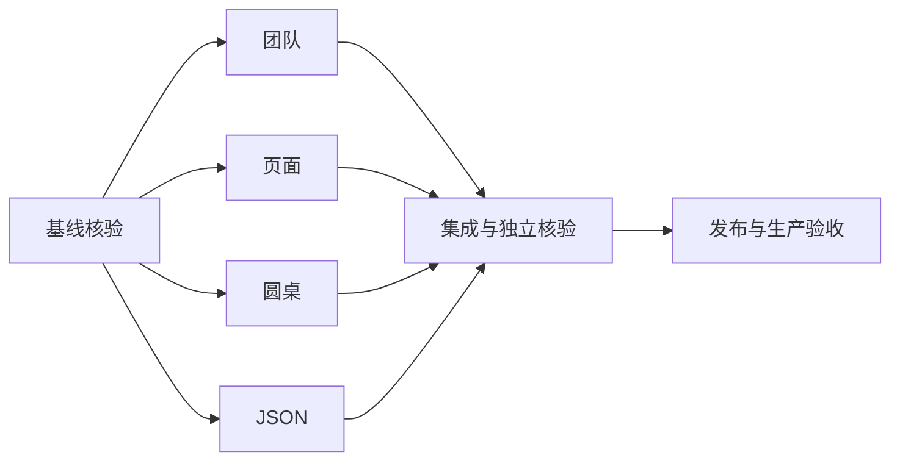

# 修复任务与依赖

|任务|输入|输出/验收|依赖|
|---|---|---|---|
|团队终态|可信回执与输出|状态展示不依赖模型固定措辞，矛盾仍拒绝|基线核验|
|页面运行|动作、账号、会话|真实运行绑定，隔离回归通过|基线核验|
|圆桌|用户请求与项目|正常启动/停止/恢复回归通过|基线核验|
|JSON|结构化模型响应|可恢复语法修复，不伪造覆盖|基线核验|
|集成发布核验|四项补丁|测试、构建、生产与浏览器证据|前四项|

## 扩展任务分解

|任务|输入与约束|输出与验收|并行分工|
|---|---|---|---|
|动态星图|现有团队账本，禁止预设成员|两端SSE结束前可见真实节点、任务与状态，隔离/停止回归|主线程|
|审查滚动|现有AppLayout，不改共享布局|自然内容高度、工作台最低高度；生产运行态滚动|Luna|
|国内漏洞源|官方来源与现有适配器|真实后端采集/匹配/状态及来源测试|Plato|
|圆桌与入口|冻结输入、账号、人工停止边界|CI回归及剩余旁路收敛|Arendt|
|成员停止|现有lease/dispatcher|取消等待调用，迟到结果不持久化|Godel|
|汇总核验|成员持久化依赖证据|逐条对账与未覆盖披露|Hume|
|种入嵌入|旧手册保持可检索|禁止hash降级冒充成功替换|主线程|
|资源清理|精确候选与27镜像保护集|安全释放空间，保留数据/备份/回滚|Meitner|

依赖：各补丁与锁同步 → 集成/独立复核 → 全CI → 生产全量发布 → 真实点击与Luna复核 → 证据和知识闭环。

## 2026-10-22 续修任务

1. 按原始响应回放补已登记枚举格式缺陷；输入为70条记录中的45条非空响应，输出为脱敏回放清单，合法结果不变、截断严格拒绝。
2. JSON异常重试耗尽进入现有源码范围恢复；验证行号、完整覆盖、授权和 usage 保持。
3. 有界数据库采样及独立 watchdog；验证损坏记录失败关闭和三层时间预算，重启宿主执行器加载。
4. 冻结精确提交并通过完整业务CI和CodeQL后全量发布；复核备份恢复、前后端/账本SHA、迁移、健康和资源。
5. 真实浏览器仍需有效登录；自动化与只读生产证据分别记录，不将空登录页视为业务验收通过。

## 日志源状态保护

输入：2ea88fcc生产socket失败回执和日志源只读状态。输出：元数据前置门禁、不可用明确回执、共享宿主预算；复用现有执行器socket和消费者降级。验收：OFF/FILE/NONE/损坏/超时均不扫描正文，正常TABLE仍有界采样；精确新SHA CI后完整发布；生产OFF场景只记快速降级通过，不记非空样本采集通过。
