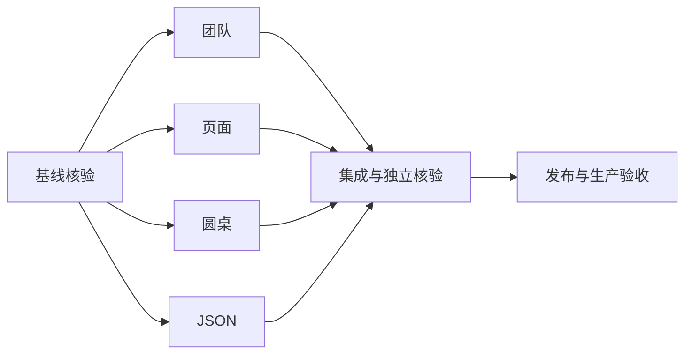

# 修复任务与依赖

|任务|输入|输出/验收|依赖|
|---|---|---|---|
|团队终态|可信回执与输出|状态展示不依赖模型固定措辞，矛盾仍拒绝|基线核验|
|页面运行|动作、账号、会话|真实运行绑定，隔离回归通过|基线核验|
|圆桌|用户请求与项目|正常启动/停止/恢复回归通过|基线核验|
|JSON|结构化模型响应|可恢复语法修复，不伪造覆盖|基线核验|
|集成发布核验|四项补丁|测试、构建、生产与浏览器证据|前四项|

