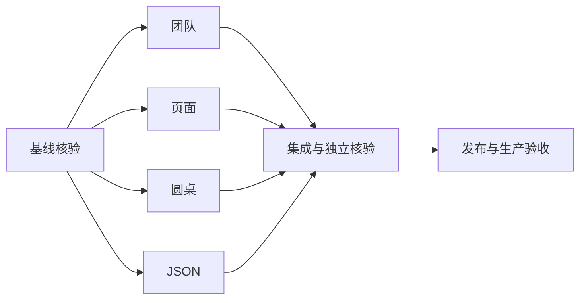

# 修复任务与依赖

|任务|输入|输出/验收|依赖|
|---|---|---|---|
|团队终态|可信回执与输出|状态展示不依赖模型固定措辞，矛盾仍拒绝|基线核验|
|页面运行|动作、账号、会话|真实运行绑定，隔离回归通过|基线核验|
|圆桌|用户请求与项目|正常启动/停止/恢复回归通过|基线核验|
|JSON|结构化模型响应|可恢复语法修复，不伪造覆盖|基线核验|
|集成发布核验|四项补丁|测试、构建、生产与浏览器证据|前四项|

## 扩展任务分解

|任务|输入与约束|输出与验收|并行分工|
|---|---|---|---|
|动态星图|现有团队账本，禁止预设成员|两端SSE结束前可见真实节点、任务与状态，隔离/停止回归|主线程|
|审查滚动|现有AppLayout，不改共享布局|自然内容高度、工作台最低高度；生产运行态滚动|Luna|
|国内漏洞源|官方来源与现有适配器|真实后端采集/匹配/状态及来源测试|Plato|
|圆桌与入口|冻结输入、账号、人工停止边界|CI回归及剩余旁路收敛|Arendt|
|成员停止|现有lease/dispatcher|取消等待调用，迟到结果不持久化|Godel|
|汇总核验|成员持久化依赖证据|逐条对账与未覆盖披露|Hume|
|种入嵌入|旧手册保持可检索|禁止hash降级冒充成功替换|主线程|
|资源清理|精确候选与27镜像保护集|安全释放空间，保留数据/备份/回滚|Meitner|

依赖：各补丁与锁同步 → 集成/独立复核 → 全CI → 生产全量发布 → 真实点击与Luna复核 → 证据和知识闭环。

## 2026-10-22 续修任务

1. 按原始响应回放补已登记枚举格式缺陷；输入为70条记录中的45条非空响应，输出为脱敏回放清单，合法结果不变、截断严格拒绝。
2. JSON异常重试耗尽进入现有源码范围恢复；验证行号、完整覆盖、授权和 usage 保持。
3. 有界数据库采样及独立 watchdog；验证损坏记录失败关闭和三层时间预算，重启宿主执行器加载。
4. 冻结精确提交并通过完整业务CI和CodeQL后全量发布；复核备份恢复、前后端/账本SHA、迁移、健康和资源。
5. 真实浏览器仍需有效登录；自动化与只读生产证据分别记录，不将空登录页视为业务验收通过。

## 日志源状态保护

输入：2ea88fcc生产socket失败回执和日志源只读状态。输出：元数据前置门禁、不可用明确回执、共享宿主预算；复用现有执行器socket和消费者降级。验收：OFF/FILE/NONE/损坏/超时均不扫描正文，正常TABLE仍有界采样；精确新SHA CI后完整发布；生产OFF场景只记快速降级通过，不记非空样本采集通过。

## 状态传播续修与独立复核

|任务|输入约束|输出与验收|执行|
|---|---|---|---|
|采集未知值|来源异常、缺字段、显式空值；复用现有状态API|SSH/Nginx/Flytrap未知计数为null，成功和明确退役样本保持|Hilbert|
|调度终态|持久回执success=false/partial_failure=true|本轮failed且后续调度仍可运行|主线程|
|历史状态统一|保留原数据库行和result_json|治理列表、运行历史、安全中心总览及时间线一致；运行中和待审批不被改写|主线程，Luna复核|
|精确重新发布|仅新候选SHA的完整CI|备份与109表隔离恢复、镜像/账本/执行器/健康对账|主线程|
|生产自然观察|新账本切换时间后的有界只读查询|明确记录动作来源和内层失败；监控轮次无成功矛盾，来源关联限制保留|主线程，Luna复核|

真实登录态点击仍是独立验收层，不使用上述测试和服务身份探针替代。

## 登录态验收续修分工

|任务|负责|输入与输出|验收|
|---|---|---|---|
|只读圆桌与拒绝语义|Luna Popper|旧生产真实请求与团队372/管理员拒绝证据；修改团队校验和运行时|参数错误不审批；静态圆桌可启动；拒绝后不再调用模型或剩余工具|
|临时复核与前端|Luna Kepler|截断调用日志、动态星图与滚动代码；修复有界压缩和必要展示|保留来源与状态；组建期间可见；隔离与停止回归|
|报告与导出|Luna Chandrasekhar|本轮下载217与沙箱报告；修复字体与历史评分补充|17问题29分真实核对；保留原件与导出字节校验|
|服务器空间|Luna Kierkegaard|同设备旧备份副本；受控哈希核对后硬链接去重|前后df、哈希与物理节省可核对，保留权威备份|
|整合发布与真实重验|主线程|最终干净SHA与全部修改；完整CI/all发布和三账号点击|精确SHA、备份恢复、镜像环境与16项逐项证据|

上述任务在原完整发布授权内执行，无新增架构范围。运行记录、凭据与原始敏感日志不进入版本提交。

## 登录验收新增状态机续修

2026-10-22 用户补充真实报错“消息不能从 dead_letter 转为 failed”。继续完整发布前需复现并修正投递终态与业务终态冲突，验证重复回执、租约过期、人工取消及晚到结果。圆桌抽取同时保留无效条目诊断，限次修复失败不得出分；嵌入失败保留已有远端向量。所有验证绑定最终候选 SHA。

## 2026-10-22 页面桥与对话框续修

本轮生产基线为2eb834a219e2ee33c1e4bf54605d72012123412d。用户再次反馈“页面操作运行不存在”，要求对话框支持调节大小、内部响应式让位、避免竖排与动画重叠、答复简洁且重点突出。保持普通用户、审查员、管理员既有权限边界，修正合法页面发现与导航映射，不能用增加普通用户管理员权限消除报错。页面恢复必须等账号、surface、session和run在服务端一致；迟到确认服从终态及账号切换。圆桌当前读须保留并发终态。候选补丁以新SHA完整CI、生产发布、真实点击证据验收；旧SHA证据不得替代。

## 2026-10-22 CVSS 主权重评分追加需求

用户明确要求代码审查、小菱圆桌、远程网站测试、黑盒、白盒及全包模式引用 CVSS 并占主要权重。

- 复用已有 CVSS 3.1 向量校验与计算库；不依据漏洞名称或模型裸分伪造 CVSS。
- 新版平台综合分采用 70% × (100 − 10 × 最高有效 CVSS 基础分) + 30% × 原质量/测试规则分，四舍五入到整数；单项 CVSS 越高越严重，平台总分越高越好。
- 最高基础分避免低危数量稀释高危；发现数量继续进入原规则项。沙箱实测检查分是上限，避免未查出漏洞掩盖失败测试。
- 缺少全部有效向量时保留原规则分，明确 CVSS 权重尚未生效；部分缺失时不得高于原规则分，披露有效/缺失数量。不得将缺失向量当作零分漏洞。
- 远程渗透只计已确认发现；未确认与已证伪发现单列。部分范围仅对已审/已测范围出分，不称全覆盖。
- 新运行写入版本与完整评分明细；历史报告保持原方法。详情、列表、HTML/PDF/Word、领域报告和小菱摘要采用同一来源并复算。
- 验收覆盖有效向量、模型裸分、非法向量、部分缺失、空发现、已证伪、失败检查、历史兼容与导出一致性。

以上为本会话授权范围内的实现决定；未更改账号边界、运维审批、租约或完成证据守卫。

## 页面桥最终集成任务

- 输入：当前账号的父运行、已审批团队合同、真实 task lease；输出：同账号动作账本与最新团队终态。禁止身份、URL、run ID 或审批覆盖，页面任务限一次尝试。
- 验收：租约换代及 cleanup 阶段不能认领/ACK；取消交叉 completed 不返成功；等待超过旧150秒不静默结束；数据库失败保持可追踪。
- 前端并行任务：星图默认适配可用宽度，提供总览与可访问缩放；测试窄浮窗，保持标签不重叠。
- 发布依赖：开发依赖 Black 安全补丁，最终提交完整 CI、CodeQL 和依赖审计通过后才能发布。

## 2026-10-23 最终阻断闭环

- 页面停止意图：补丁前 pending/claim/ACK/dispatcher 共4项红；修复后含晚到完成观察8项通过，108项页面桥/旧bridge/stream回归执行中。
- 团队免创建确认：移除Responses和service双层创建确认，保留执行期授权，补高风险及未分类创建回归。Luna负责对应三服务及测试，主线不并行编辑。
- 普通问答：增加真实团队账本、真实成员调用、同轮读取和完成守卫集成测试；上线后普通账号实际问答复核。
- 发布：最终SHA完整CI（含依赖审计）及CodeQL通过后all发布；前端构建、镜像、账本、备份恢复和真实点击均绑定同一SHA。

## 最终候选编号与首次挂载回归

生产4.1.21已由其他发布生效，本轮收尾候选使用4.1.22，避免同版本不同内容。新增复现：星图空状态挂载后才创建团队，根元素出现时必须绑定ResizeObserver；消失后重建也须恢复监听。定向回归、最终SHA完整CI和生产验收尚待完成。
