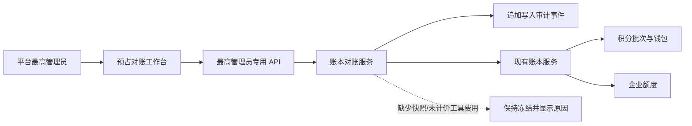
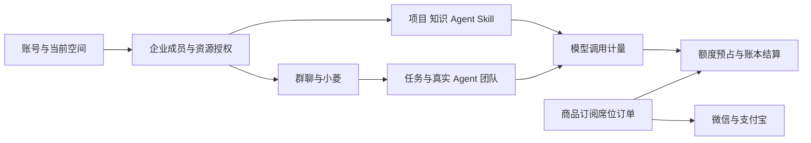
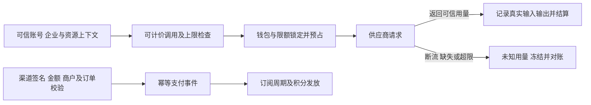
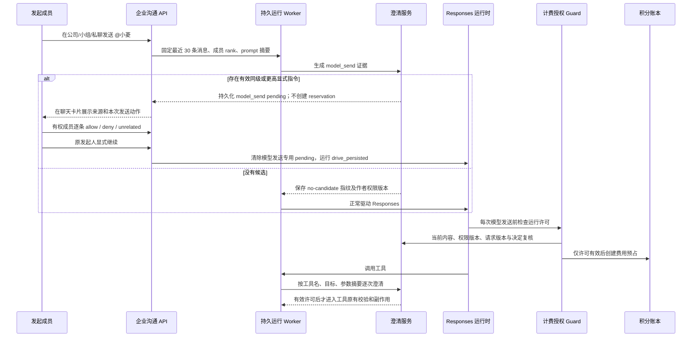

# 设计：企业与计费体系

## C4 模型与工具账本独立复核（设计与实现状态）

**范围说明**：本节只指 `reserved/unknown` 模型与工具预占的人工账本复核。会员或企业席位订单退款使用单独的退款复核委任表、接口与页面，属于 D2 下的 **D2-R** 子项；两种委任互不授予权限，不能把其中一种复核身份当作另一种。

**已复现的阻断**：现有 C4 提案和决定接口均依赖 `require_super_admin`，该依赖通过 `is_super_admin_user` 和 `is_unique_super_admin` 要求活跃账号的用户名为 `admin`、旧角色为 `super_admin` 且存在一致的 RBAC 绑定；决策服务又禁止提案人审核本人提案。在隔离 SQLite + FastAPI 的真实授权依赖链中，仅替换登录身份和数据库连接，最高管理员提案返回 200、本人审批 409，另一拥有 `super_admin` 角色和绑定但用户名为 `admin2` 的账号审批 403。现有测试使用依赖替身人工放行两个“最高管理员”，其通过不证明真实角色下可完成双人审批。上述证据是本地合成账号，不是生产验收。

**目标和边界**：保留唯一平台最高管理员及其提案职责，允许该账号明确委任另一名有效的**平台管理员**担任 C4 独立复核人；不改变企业管理员权限，不允许自批。没有合法独立复核人、证据不足或授权过期时，预占继续冻结。候选方案仅针对 C4 模型/工具预占人工审核；不自动扩大到支付退款、交易账单、费率发布或其他管理员操作。两个不同账号也不能单凭技术校验证明背后是两名不同自然人，运营验收需要单独确认人员身份。

**最小授权模型**：新增一张按被委任账号唯一的 C4 专用授权表，记录 user ID、有效状态、授予/撤销人及时间；初始迁移不插入授权、不推断现有管理员可复核，历史账单和审计保持原样。由唯一最高管理员通过独立管理入口授予或撤销，受委任人必须是其他活跃的平台 `admin`，且旧角色与 RBAC 身份一致；grant/revoke 与现有 `AuditLog` 在同一事务留审计。基础角色固定，不新建角色；`check_permission` 与 `check_permission_grant` 对平台管理员有默认绕过，不能仅新增普通角色权限并据此判断委任。企业成员的 `admin` 是另一作用域，不具备此权限。

**会话与身份失效**：`auth_service.login/logout` 每次递增 `User.token_version`，不能将其固定为持久委任版本，否则正常重新登录即失权。每次复核使用当前有效会话，并在写入事务中以当前锁定读取复核用户状态、平台角色及显式授权。用户禁用、软删除或平台角色降级时，须在同一事务中使委任失效并审计；重新启用或重新升职不自动恢复，需要最高管理员重新授权。落地前逐一审计 `user_service.toggle_status/set_role/delete_user`、`rbac_service.assign_roles_to_user`、`admin_agent_tools` 批量删除及其他实际角色/状态写入口，使用统一撤销函数，不能仅靠状态查询挡住一次请求而允许随后重启用时自动复权。密码变更及普通登录不自动撤销持久委任；现有 token 校验继续处理会话失效。

**接口与事务草案**：保留 C4 原提案入口仅唯一最高管理员；决定入口仅在服务端允许明确获委任的有效复核人，服务层再次验证提案人和审核人不同、提案仍待审、预占仍为 unknown 且费用证据满足原快照。为复核人提供最小待审核列表和明细，仅返回审核所需的提案、脱敏计费快照和证据引用，不泄露 prompt/Key，也不开放全部超级管理员工作台或其他金融操作。审批事务将被委任人的当前账号/角色/授权锁定，再沿现有钱包→reservation→提案/事件顺序锁定；授权撤销或降级先提交时审批拒绝，审批先获得相同锁时撤销等待。需通过真实 MySQL RR 验证所有相关写入的锁序，不能仅凭代码排列声称无死锁。现有 C4 对账依然使用原费率快照与既有双人事件，不对 unknown 自动扣费、释放或重试。

**验收要求**：真实依赖链测试使用唯一 `admin`、获明确委任的平台管理员、未获委任的平台管理员、普通用户及企业管理员：最高管理员提案成功、本人审批拒绝、获委任人审批成功、其他人 403。覆盖授权管理仅最高管理员、重复授权/撤销、撤销后拒绝、登录/登出后授权仍可用、禁用/降级后重启用或重升职不自动恢复；敏感内容最小可见、提案状态变化后拒绝、重复并发决策最多结算一次。真实 MySQL 测试覆盖旧快照、角色撤销/授权撤销与审批的两种先后顺序及锁等待。仅成功 mock 的 actor ID 或被替换掉的 `require_super_admin` 依赖不能作为通过证据。

**实现状态（2026-11-09）**：模型/工具账本 C4 授权、待审核入口、两人决议、身份撤权与 UI 已在本地实现，见迁移 104、验收记录及当前任务表。真实模型/工具账单、生产账号、生产迁移与发布仍未验收。D2-R 手工退款复核使用迁移 109 的独立授权，不复用本节的 C4 委任。

**迁移兼容边界**：迁移 119 对新写入的人类 `@小菱` 消息要求有效的发送时权限快照，并锁定其指令内容、作者和会话归属；迁移前的历史消息仍保留 `NULL` 快照并按现有兼容规则读取。旧后端进程不能在迁移触发器生效后继续发送 `@小菱` 消息；生产发布须先排空旧写入进程并准备支持 head 119 的应用，若迁移后回滚到旧应用，旧版本的 `@小菱` 发送会失败关闭。该兼容窗口尚未在生产发布中验收。

## 模型账本人工对账工作台

### 数据与服务边界

- 查询层列出 `reserved/unknown`，并可按 `reviewed` 浏览所有已有人工审计事件的预占（包括已结算/已释放的历史）；只返回必要计费元数据、付款主体 ID、当前预占金额、快照完整性、已有 usage 与待复核提案，绝不读取对话/提示词内容。
- 对账服务只把提案视为候选，不改账。第二名不同的最高管理员审批时，在钱包→预占→积分批次/企业额度的账本锁序内重新验证状态与证据；结算调用现有 `billing_ledger_service.settle`，释放调用经双人审批的 `release_not_sent` 安全路径。
- 结算金额由原费率快照和经审核 Token usage 计算。没有快照/身份、请求键已终结、Search/Fetch 计数缺失或为正数、Token 格式错误、账单超上界或存在其他未决提案均拒绝；只有供应商明确报告 Search/Fetch `0/0` 才能视为无该类费用。
- 外部证据只保存来源引用、SHA-256、可选 provider request ID 和审核说明；原始文件与对话不入库。服务不声称能验证外部证据真实。
- 审计事件记录 reservation ID、提案轮次、操作者、操作、可选 resolution、证据摘要、usage、派生费用、理由和时间；提案、批准、拒绝与可归属到已存在 reservation 的业务规则阻断均追加事件，包括已有 reservation 但尚无提案的审批请求。阻断事件仅保存服务端原因、操作者、reservation 和可选提案关联；已存在提案时可记录其动作类别但不复制 provider request ID、Token、金额、证据引用或哈希；无提案时 resolution 为空。阻断事件不保存失败请求正文、不改变账本或待审批状态。认证拒绝、无法关联 reservation 的请求和格式错误不进入此财务事件表。服务/API 不提供事件更新或删除入口；此为应用层追加约束，不防止有数据库写权限的运维直接改表。提案创建与批准/拒绝、账本变更处于同一 DB 事务。

### 失败与竞态处理
- 提案、批准、拒绝都由最高管理员授权；`reserved` 可能是正在等待 provider 的活动请求，因此仅展示、不允许提案；只有 `unknown` 可进入对账。同一人不可自批，数据库锁下复查待审状态和操作者，确保两个并发审批只有一个生效。
- 原 reservation 已被后台自动结算/释放时，批准返回冲突并记录阻断事件；第二位管理员仍可拒绝过期提案以关闭待审项，拒绝不改变既有账本终态。
- 缺少历史快照不允许填入当前价格；只能拒绝结算提案或记录“仍冻结”状态。
- 任何金额计算错误、数据库异常或事件写入失败都回滚整笔批准，不允许出现“记了批准但钱包没更新”或反向部分提交。
- 销售锁保持关闭；本功能只处理平台内部未结账本，不执行 provider、微信或支付宝网络请求。

## 分层
- 身份、企业成员、组角色与项目资源关系分开判断；按企业和当前权限执行。
- 企业群、个人会话和小菱执行上下文分离，临时授权限定资源、动作、时间和结果范围。
- 所有供应商调用经过按上下文归属的计费闸门；账本不可由客户端直接修改，通知幂等并可对账。
- 订单、权益、积分、费用与退款独立存储；业务原子写入、外部支付采用幂等和补偿。

## 失败语义
未授权拒绝，额度不足停止后续调用；未知 usage 待核对，不伪造零成本。人为停止不可自动重启。停订超过宽限期后暂停执行功能，保留聊天和资料编辑。

企业小菱每次模型调用先在同一账务事务中锁定当前运行/检查点行、预占企业钱包额度并写入 `provider_attempt_pending_reconciliation`。上游调用只能在预占事务提交后开始。运行租约过期时，只要此标记尚未被包含新供应商响应的检查点清除，运行进入待核对且不可重试；标记不代表请求已送达或供应商已收费。发送授权每轮都查询本运行是否已有 `reserved/unknown` reservation，未决时拒绝后续 provider attempt。请求路径保持运行/检查点行在钱包/预占之前，结算回调不再反向获取运行锁。自动恢复与按“未发送”释放必须等待供应商结果查证或可审计的人工证据。

`response.cancelled` 是供应商响应终态，需与缺失终帧、HTTP 传输异常区分。收集器保存其完整响应和 usage；运行时按未完成失败记录，不执行其中的部分工具调用或发布部分助手文本。若 usage 无效，reservation 保持未知并继续阻断重试。用户主动取消 API 只有在调用者拥有会话内容读取权时才附带运行的待核对标记；无内容读取权的企业管理者只获得最小运行状态。

C4 批准 `release_not_sent` 后，小菱不会自动重放。直接模型调用只有在当前父代次的全部 reservation 已终态、释放均有两名不同平台最高管理员的关联审批、父租约过期时，才开放用户显式恢复。企业资产子调用还要求：父 Responses 已完成并持久化、checkpoint 中可精确定位该资产调用、父模型 reservation 已结算、子调用租约过期，且该子调用所有 reservation 均已由双人复核确认未发送。直接资产的 call ID 必须出现在父 transcript；团队子调用 ID 不写入父 transcript，恢复时仅从 transcript 中可验证的团队父 tool-call 及步骤序号确定性派生。只有此时状态才开放显式重试；重试创建新的父代次子调用幂等键，旧账单行保留。已结算但结果未缓存、缺少可关联 checkpoint、活动租约、未知账单、取消或权限抑制均继续拒绝恢复。子调用完成/失败结果和 parent pending marker 在同一事务中持久收敛；旧代次保存和发送仍由父 generation 与子 execution token fencing。

## 全站空间上下文

- 一个 Prism 用户身份保留个人空间，并可加入多个企业空间；当前空间是每个浏览器会话的界面上下文，不另建互斥的 `account_type`。企业成员可切回个人空间，公开开发者论坛只在个人空间呈现。
- 前端 `workspace` store 为当前登录会话保存 `personal | enterprise` 页面模式和最近选择的企业 ID；偏好仅放在 `sessionStorage`，账号或认证令牌变化即重置，页面刷新时只恢复同一会话。
- 路由 `meta.workspace` 是页面模式契约。开发者论坛、个人知识库和个人 Token 用量标记为个人空间；企业沟通页标记为企业空间。企业模式下侧栏、管理员侧栏、功能搜索和小菱导航统一隐藏个人入口，路由守卫拒绝个人页直达，转回个人空间后恢复。
- 最近企业 ID 只是界面恢复提示。企业页每次仍调用 `/enterprises/mine`，只恢复服务端返回的有效成员企业；后续公司 API 仍自行检查企业成员、角色和资源范围。
- 空间模式不是授权凭证。企业 API 仍按当前账号、企业成员、角色和资源范围授权；公开论坛 API 按登录账号开放，因为用户可以在个人空间使用论坛。界面隐藏和路由拦截用于保持页面上下文一致，不宣称是服务器端账号级论坛封禁。

## 企业聊天列表契约

- 会话列表只从服务端已按当前企业成员、小组成员和私聊参与者过滤的会话 ID 中查询最新消息；预览通过每批最多 500 个会话 ID 的聚合查询读取，不为每个会话单独请求。响应增加可选的消息 ID、最多 160 字符摘要、发送者和时间，不改消息存储，也不改变详情 API。
- 列表按最后消息时间排序；无消息会话按创建时间排序。客户端用真实消息生成“发送者：摘要”并显示最近活动时间；空会话显示“暂无消息”。搜索匹配会话名称和当前摘要，不重复显示会话类型。
- 40360 表示当前小菱计费尚未就绪，页面明确显示该状态，不提示等待后自动重试。聊天消息仍可发送和保留。
- UX 显示真实会话活动，DX 复用现有列表 API 和可选字段，AX 只暴露已获授权会话的最后一条消息。

## 个人渗透项目绑定证据门

绑定服务始终在项目锁内核验执行证据，不由持久运行路径的 staging 开关决定是否检查。当前/未知执行拒绝绑定；旧执行没有父线程、子活动和沙箱终止证明时保持 `unknown`，不能仅凭 `cancelled` 状态、重启或超时推断终止。没有运行记录且没有启动时间的未启动草稿/申请可继续绑定。历史运行记录的人工核查与审计释放路径仍未交付，旧运行不能因此自动放行。

## 身份和授权契约

账号与企业成员关系分别保存；同一账号可以加入多个企业。平台角色不代表企业成员关系。服务端每次访问校验账号状态、企业成员状态、目标资源所属企业及当前资源权限。企业 owner 可委任管理员；企业管理员管理企业成员、席位和小组；小组长只能管理本人负责小组的普通成员，不能委任组长、改动同级组长或改动企业管理员。公司管理员是否能读小组聊天取决于是否实际加入该小组，而非管理身份本身。私聊只允许两名参与者读取。

企业项目仍需同时判断企业成员关系、项目所属企业、责任小组、显式项目授权与动作；平台管理员不自动获得项目正文。绑定入口只允许企业成员把自己创建的个人项目纳入企业，绑定时原子创建项目归属和创建人的 editor 授权；企业项目不可重复绑定。项目组成员默认 reviewer（可查看和执行），组长为 leader（可管理组内普通成员授权），owner/admin 继承企业项目管理权；跨组成员须显式授权，授权可调整为 viewer/reviewer/editor。组长只能改本组普通成员权限。移除企业成员时，同一事务停用该账号在企业内的所有显式项目授权；同一账号以后重新加入只恢复新授予的组默认权限，旧显式权限须由管理员重新授予。项目解绑、成员移除或显式撤权后，后续请求按当前授权失败关闭。旧项目文件和报告沿用父项目授权；企业绑定项目报告按当前项目 view 权限共享，但不向他人开放删除。平台管理员仍不能借平台身份越过租户边界。已批准远测申请及其执行任务固定绑定企业/小组/项目和范围摘要；企业 owner/admin 可以审批自己提交的企业申请，组长只能审批本组其他成员且不得自批，个人审查员角色不自动获得企业审批权。审批时与启动前复核申请者、审批者当前企业角色和项目 execute 权限，执行每阶段再次校验。企业暂停、计费/退款挂起或订阅宽限结束后，所有角色（含 owner/admin）均不能执行项目任务；owner/admin 仍保留查看与管理/续费入口。旧的无项目审批记录可以拒绝或取消，不能批准或执行。

企业空间的远测工作台让成员从当前可执行项目提交固定范围申请，并让 owner/admin 或对应小组组长按当前范围处理；目标只能是 HTTPS 域名根地址，批准不会自动触发探测，只有申请人主动启动时才进入现有只读远测执行器。角色变更后，后端重新验证当前企业角色和项目 execute 权限，个人审查员权限不能替代企业审批资格。

## 企业 Agent/Skill 版本发布契约

- 企业资产草稿仅作者可读写，版本按企业和草稿递增；请求键按申请人/草稿操作幂等。草稿不映射到旧 `CustomAgent`、`AgentProfile` 或可执行 Skill 注册表。
- 发布申请写入独立 `EnterpriseAssetPublication`，复制明确版本的类型、标题、JSON 配置、版本 ID/号和 SHA-256；申请摘要绑定范围、企业、申请人、草稿和版本，审批者看到的正文来自这份快照。批准前重算摘要，并用当前锁定读确认申请人账号/成员状态及源草稿/版本。企业内申请要求至少另一名有效 owner/admin；待审申请阻止删除源草稿，离职申请可拒绝但不可批准。
- `scope=enterprise` 表示企业所有有效成员可读；只由另一名 owner/admin 决策。`scope=global` 表示所有登录账号可读；只由平台唯一最高管理员决策。唯一最高管理员本人不得提交全局申请，且不能自批。企业管理员不得审批全局申请。批准操作先锁企业，再锁申请；与成员撤销使用相同企业行锁顺序，以避免 MySQL 可重复读下旧成员快照被用于审批。
- 待审项仅由有权且不是申请人的审批者列出；申请人只能看到自己的申请。待审允许申请人撤回；拒绝后需新建申请。已批准项可由申请人/企业管理员（企业范围）或平台最高管理员（全局范围）撤销。终态不复活，重发需产生新的版本申请。
- 目录只读取 `approved` 状态，撤销立即停止目录返回；每次目录序列化前校验快照摘要。小菱可以按名称只读搜索企业与全局目录的固定版本元数据，不读取资产提示词。目录/API 的 `execution_available=false` 表示用户不能从资产页或旧 Agent Profile/Agent Studio 直接启动；企业小菱另有独立受限工具。目录中的 `xiaoling_runtime_config_compatible` 只表示已批准配置符合 schema v1 与字节上限，不代表企业计量、订阅、额度、权限或平台模型当前可用。目录响应仅含共享资产必要字段，不回传申请人/审批人 ID、审批理由和草稿/版本内部 ID。解析器只接受无工具 Prompt Agent 与 `llm_transform` Skill，并按 publication ID、精确版本、SHA-256、发布状态和当前租户/成员校验。旧 Agent Profile、Agent Studio、任意工具/工作流仍不连接。

## 企业发布资产的嵌套调用协议

企业小菱调用发布资产使用独立的 `EnterpriseAssistantAssetInvocation` 持久记录：唯一键为父运行与模型 tool `call_id`，并固定记录发起用户、publication/version、内容摘要、输入摘要和稳定的 invocation ID。先落库再请求模型；完成结果在父检查点写回之前已缓存，因此父运行恢复时同一 tool call 只读缓存，不再产生模型请求。配置/限额检查失败且未创建账单预占时可把该次调用记为失败；存在任意 `reserved/unknown` 或 `settled` 预占而没有已缓存结果时一律进入待对账，不允许为同一调用生成新计费键重放。活跃子调用租约阻止并行重放；过期且没有任何账单预占时才允许以新 fencing token 认领。

子调用只接受当前解析器的无工具 Prompt Agent 或 `llm_transform` Skill；运行 prompt 上限 4000 UTF-8 字节、单次 task 上限 2500 字节，并在计费预占前按 8000 字节可信请求预算精确校验序列化内容及协议余量。模型和供应商由平台企业助手配置决定，禁止出版物自选模型、API Key、工具、委派、工作流或外部网络。每次请求使用企业钱包及固定父发起人归属，继承小组/月额度，并在请求前和 provider response 结果缓存前重新确认企业/成员、父运行 generation/stop 状态、订阅、publication approved 状态、精确版本与 SHA-256；撤销、撤权或暂停后的结果会被抑制，但已发生的上游费用仍须按账本处理。子调用结束先持久化结果，再交还父运行，由父检查点写入工具输出。平台运维对 `unknown/settled-no-result` 的账单需先查上游记录；目前不存在自动解封流程。
- 企业内发布暂不支持按小组可见；发布者需要将内容视为企业级信息。平台只读取显式提交全局审批的快照，不获得申请企业的私有草稿和会话正文读取权限。

## 旧项目知识来源的绑定与撤权

- 个人知识库只同步未绑定企业的项目代码与审查问题；历史个人副本在项目绑定事务中软删除文档并删除切片。列表、统计和 RAG 检索均以当前项目绑定再次过滤，避免历史副本绕过新归属。
- 旧全局 Agent 知识库的 `project` 来源仅可抓取未绑定企业的项目。项目入库在调用外部嵌入服务前锁定项目、复核文件/来源和当前企业绑定；抓取读取与入库之间发生绑定时，入库拒绝且不发送嵌入请求。项目绑定会同事务停用对应抓取来源、软删除旧文档并清理向量切片。
- 管理员批量重嵌入先读取不含正文的来源元数据，再按 Project、EnterpriseProject、文档/切片顺序锁定并使用当前企业绑定，避免 MySQL `REPEATABLE READ` 的旧快照把刚绑定来源继续发给远端。`response_run:` 私人运行笔记不进入管理员批量重嵌入。
- 普通个人项目仍可按既有行为进入旧全局 Agent 知识库；一旦绑定企业，其旧副本即删除并停止继续抓取。旧 Agent Studio 资产仍按作者账号私有，企业共享必须新建企业资产并走发布审批；不会推断或自动迁移历史草稿。
- 企业知识库含企业范围文字条目与附件。附件仅企业 owner/admin 可上传/删除，所有有效成员可搜索和下载；附件不支持小组/项目 scope。仅允许 UTF-8 TXT/Markdown、DOCX 和可提取文字的 PDF，扫描件/OCR、加密 PDF 不支持。单文件不超过 8 MiB、提取文字不超过 50 万字符、PDF 不超过 120 页、企业活动切片最多 10,000；DOCX 限制 ZIP 成员/解压字节/压缩比，PDF/DOCX 在 12 秒、CPU 与内存受限的子进程解析。所有附件复用现有恶意内容扫描并沿用生产 fail-closed 策略。原始文件存 MEDIUMBLOB、提取文本 MEDIUMTEXT、片段及本地向量按企业隔离存储；向量使用 `local:hash-v1` 确定性词项/字符特征，不请求外部 embedding、不产生模型 Token 费用、不属于语义模型向量。附件删除会清空 blob、抽取正文、chunks、向量和 active chunk count。运行提示和显式搜索工具会注入命中片段，并把附件 ID/版本固化到检查点；每次模型预占前 current-read 复核附件仍 active 且版本未变，撤权后不向上游发送后续调用。已有聊天消息与历史小菱检查点按企业会话留存策略保留，不把附件删除描述为聊天历史擦除。未来真语义向量、OCR 或细粒度 scope 必须单独定价并定义外发、账单主体、撤权及生命周期。

## 企业持久化注册 Agent 团队边界与实现状态

企业小菱当前仅支持已审批、无工具 Prompt Agent/`llm_transform` Skill 的串行资产协作。真正的注册运行时 Agent 团队不能复用个人 `AgentTeam` 队列：现有实体以 `user_id` 为唯一 owner，服务仅允许 `user/admin` surface，创建时绑定个人会话和个人 Responses 父运行；调度器每次执行按创建者个人 `agent:chat`、账号状态和个人项目授权复核；模型计费 scope 仅取团队 owner 的个人钱包；取消、重试、事件投影与结果通知也绑定个人父运行/会话。只向旧表增加 `enterprise_id` 会留下账单、worker 授权、队列可见性和结果写回的个人假设。

安全的实现应建立企业专用持久队列与状态机，不扩展个人 `AgentTeam` 的可见范围。企业团队快照至少固定：企业、会话、小组、发起人、父企业小菱运行、原始指令消息、解析后的计划摘要、发起时的权限证据、付费主体类型/ID、所用已发布资产版本或受控 Agent 地址及版本、风险/审批结果、模型与工具计价版本。任务/成员/事件表通过企业团队 ID 关联，输入、依赖、重试次数、租约 fencing、结果引用和审计事件使用现有工作图语义，但不能向个人 AgentMesh 或个人通知表写入企业正文。F3-A 迁移已添加组合唯一键/外键：任务的 member 与 team 必须配对，审批/事件的 team、enterprise、conversation 必须一致，审批/事件中 task/member 也必须归属同一 team；这些关系不只依赖服务层过滤。

每次 claim、执行前、外部副作用前、计费预占前、回传结果前，worker 都须用独立当前读复核：企业仍 active，发起人/当前访问者仍为有效成员，原会话与小组仍属于同一企业，任务授权/项目授权/审批仍有效，固定资产仍 approved 且版本摘要一致，消息线程没有被较高/同级新 `@小菱` 指令取代，run/team/task 租约及 generation 仍匹配。权限高低只参与冲突和审批路由，不向发起任务的成员继承审批人权限。高风险任务必须由有该资源当前权限的授权人审批具体计划摘要；平台发布审批和企业执行审批仍是不同权限。

查询权限分为“运营摘要”和“会话详情”：企业 owner/admin 可看到全企业团队状态/任务数/用量归因摘要，但不能因为管理身份读到未加入的小组群或员工私聊正文/团队结果；组长可见自己当前负责小组的团队摘要和该小组可访问会话中的详情；普通成员默认只列本人发起的团队，团队详情与结果必须逐次通过 `enterprise_chat_service.get_conversation`，因此退出小组/私聊对端身份变更会立即失去正文读取权。company channel 的历史和团队结果仍按公司成员权限公开。平台 super_admin 不得绕过企业和会话边界。跨企业/跨会话猜测团队 ID 统一返回 NotFound，避免资源存在性探测。

计费只能使用团队快照中的 `enterprise_id` 和 `group_id` 作为企业钱包及企业/小组额度作用域，成员只能作为 usage attribution；不能回退扣发起人个人钱包。reservation key 至少绑定 enterprise team/task/attempt/provider attempt，未知或已预占但无可恢复结果时冻结，不自动重试。团队结果通过企业父运行的专用持久 `tool_call_id` 回执幂等写回，只在原企业会话的当前授权投影中可见；管理者与组长的团队列表/用量另按公司或小组范围查询，普通成员不能通过猜测 ID 读取别的会话任务。取消时先 fence 父运行和所有子任务，再阻止新外部调用；已产生账单保持原账，不以任务取消伪造退款。

分阶段交付契约：F3-A 企业团队/成员/任务/审批/事件模型与迁移及租户组合约束；F3-B 企业授权服务、当前权限复核和组/成员最小摘要查询；F3-C dispatcher 租约/取消/恢复和企业钱包逐次预占结算；F3-D 企业小菱 `create/get/cancel/retry` 工具、计划审批快照与消息回执；F3-E 管理/组长/成员可见范围、企业聊天浮层进度展示和跨账号验收。F3-A/B/C 已实现数据库范围约束（含会话独立存在、小组归属）、当前授权摘要 API、租约状态机、企业钱包预占结算、计划调用/Token/团队预算限制和取消发送 fencing。F3-D 已接入小菱创建/查询/取消/重试工具、幂等回执、白名单注册 Agent 执行器、queued 周期消费者及企业钱包计量；当前只开放无工具、无外部副作用的 `language_detector` 和 `code_reviewer` 文本任务。`security_sentinel` 依赖已持久化项目/文件/任务记录，与该队列仅接收文本输入的授权合同不兼容，故不进入执行白名单。F3-E 已有企业聊天进度面板：按当前会话授权摘要过滤团队、按选中团队读取详情、显示进度/安全重试状态，并让发起人或当前企业/小组控制者操作；私聊不因管理员角色扩大控制权。F3-E 初次交付时面板/聊天集成定向测试 41 项、前端全量 Vitest 187 个文件/2663 项通过；本轮刷新同步后的最新结果为 45 项定向、2667 项全量通过；多角色真实浏览器验收仍需完成。预算检查与预占事件原子提交；最终授权事务与当前模型请求持有共同运行/租约行锁，取消先取得锁则旧请求不发送并释放预占，已开始请求结束后取消才返回。任一阶段都须拒绝跨企业猜 ID、错误付款主体、撤权后旧 lease、未审批高风险计划、未知账单自动重放及迟到结果覆盖。隔离 MySQL 8.0.45 从 `deploy/mysql/init.sql`/`seed.sql` 基线执行迁移 `001→094` 已通过，并确认五张团队表的 ORM 列一致；仍缺真实 provider 执行、生产数据和多账号浏览器验收。测试通过不代表已部署或可开售。

### `security_sentinel` 项目扫描的企业准入门槛

> 2026-11-07 实施状态更新：以下设计门槛除“报告前端体验、实际 provider 费用验收、Sentinel 专用 MySQL 并发矩阵和生产/真实账号验收”外，均已在本地代码中落实。服务端已绑定项目、复核当前权限、隔离 ProjectSourceArchive 旧写路径、以不可变制品原子写入完整/不完整报告，并将任务调用上限传入 Sentinel 扫描预算；`security_sentinel` 已加入企业执行白名单但仅限项目只读扫描。旧段落中的“尚未接入/继续关闭”是实施前审计记录，不代表当前代码状态。验收证据见 ACCEPTANCE 与 TODO。

不得只把 `security_sentinel` 加进执行白名单。企业团队的当前任务输入是文本，而哨兵必须扫描服务端已持久化且有权访问的项目/文件/任务；企业任务必须将单一 `project_id` 固化进团队计划摘要和权限快照，不接受模型在任务 JSON 中自报资源 ID。首版仅允许单项目扫描，不接收 `file_id`/`task_id` 覆盖项目范围；小组会话只能扫描归属于同一责任小组的企业项目。

迁移 097 已把可空 `project_id` 固定到企业团队，并以 `(enterprise_id, project_id)` 复合外键禁止跨租户引用；旧团队保持 `NULL` 兼容。当前服务在建队、领取、每次模型发送授权、成功完成及结果读取前复查项目绑定、责任小组与发起人的 execute 权限；列表/详情还把当前项目 view 与会话结果范围求交。该基础仍未接入 `security:scan` 团队准入、报告保存和制品读取端点，故哨兵继续关闭。项目范围还必须在报告保存前重校验：企业仍 active、项目仍绑定同企业、当前发起人仍有项目 execute 与 `security:scan` 权限、该项目仍在当前小组/授权范围内、团队任务 lease/generation 仍有效。角色优先级只用于指令冲突处理，不把组长或管理员的项目权限转给普通员工。哨兵结果读取必须同时通过“当前会话/团队结果可见”与“当前项目 view 授权”，两者取交集；owner/admin 仍须满足活动项目绑定和项目 view，组长只在项目责任组范围内可查看，群聊可见权不能代替源项目授权。

哨兵当前只在 `ProjectSourceArchive` 存在时持久化该归档的“当前审计结果”；普通 CodeFile 项目没有等价的完整报告存储，归档结果也不是不可变的逐运行报告 ID。不能只将现有 `audit_run_id` 填进团队结果：首个完整企业版本应为 CodeFile 和归档两种项目统一建立不可变项目报告制品，至少绑定 `enterprise_id/project_id/team_id/task_id/attempt/source_sha256/audit_run_id` 并保留完整性状态；报告下载接口按当前项目授权校验，Team 详情只返回受限摘要和制品 ID。原归档审计的 `begin`、heartbeat `touch`、`finish` 三类写操作也必须受企业 task lease/generation fencing 约束，或在企业运行时停用原归档写路径并由持有有效 lease 的 dispatcher 一次性提交制品。旧 worker 在超时、取消或显式重试后不能开始、续租、结束或覆盖报告。Team 结果当前上限为 200 KB，而哨兵持久化结果允许到 16 MiB，故报告正文不能塞入团队任务 JSON。

扫描调用须逐 provider request 受企业钱包预占/结算，并有单任务模型调用、Token 与积分硬上限；`full/static_full/triage`、自适应拆分、验证、dataflow 和重试请求都计入同一个实际调用上限。团队当前每任务默认 3 次、配置最多 20 次，哨兵默认语义预算 256 次，不能把大预算当作已受团队门控。达到任一预算上限、结果截断或覆盖不足时，团队任务不得进入成功 `completed`：现有状态机可先将其置为 `failed`，并保存 `coverage_status=incomplete`、已覆盖范围和终止原因；若新增独立 `incomplete` 终态，须同步迁移、API、前端和用量统计。显式重试必须确认旧 attempt 的 provider 费用已结清或经对账、旧 `audit_run_id` 已终态，并为新 attempt 产生新制品；禁止重复起审而账单未知。

当前企业团队只允许 `language_detector` 与 `code_reviewer`；哨兵缺少以上项目绑定、资源授权、报告 fencing、结果投影和有界扫描合同，保持 fail closed。哨兵自身已有项目执行权与 `security:scan` 检查，但这不替代企业团队的租户范围、生命周期和结果可见性校验。

## 沟通与社区接口

- `/api/enterprises/mine` 列当前账号加入的企业；目录只公开同企业在职成员的显示名和账号标识，分页读取。
- `/api/enterprises/{id}/conversations` 按企业关系开公司群、小组群和私聊；消息首次读取最近一页，以 `before_id` 读取旧消息、`after_id` 接收新消息。消息客户端请求键以会话和发送者隔离，重试同内容不重复写入。
- 企业帖子、回复、公告各使用当前企业权限；帖子和公告以 `before_id` 读取旧内容，回复以 `after_reply_id` 顺序读取。创建使用按企业、作者和操作隔离的客户端请求键，后端保存摘要以识别同键不同内容；撤权后重试必须拒绝。
- 产生请求键时捕获登录凭据，发送前再次校验；切换账号、企业或权限后丢弃迟到结果并清除页面旧内容。管理写入结果未知时停止重复操作，先刷新核对。
- `/assistant-runs` 只接受本人在当前企业会话发送且包含 `@小菱` 的消息。工具白名单包括同企业文字知识搜索、创建仅本人可见且不可执行的 Agent/Skill 草稿、按精确 ID 运行受支持的已发布 Prompt Agent/`llm_transform` Skill，以及提出企业公告申请；公告发布必须由不同的 owner/admin 针对哈希绑定的完整标题和正文审批。资产子调用使用独立账本与幂等结果缓存。运行先原子持久化 queued 状态、检查点、角色快照和占位消息，再由独立数据库 session 执行；当前会话活动运行列表可在刷新后恢复任务，状态接口可返回 `call_id`，支持补充信息、显式重试和取消。数据库保存检查点及租约 fencing；应用内周期 worker 与 HTTP 后台任务共用 queued 原子认领，服务重启后可自动消费尚未开始的 queued 任务。运行中父运行租约过期任务仍要求用户显式恢复：模型上游可能已扣费、但响应检查点尚未落库时自动重放会产生重复调用；`reserved/unknown` 账单必须先对账。
- 每次运行及每个工具入口重验企业/成员/小组关系、角色快照、订阅、同范围本月额度及企业钱包；模型只使用平台级配置。公司会话角色顺序为 owner > admin > 当前小组 leader > member；仅组内的组长 rank 生效。快照由服务端查询，不接受消息自述角色。该 rank 仅指导冲突上下文，不提升最初 `@小菱` 作者的操作权限；同级冲突要求模型调用 `ask_user` 停下，但目前是提示约束而非形式化冲突检测器。模型调用在企业 `billing_scope` 内预占并按可信供应商 usage 结算；未知费用、超界 usage、未完成对账均不自动重试或发布结果。取消通过递增 fencing generation 阻止旧 worker 覆盖状态。
- 企业文字条目和全企业附件只在当前企业权限内检索，不跨入个人知识库。附件支持 UTF-8 文本/Markdown、DOCX 和可提取文字的 PDF，按文件/抽取/片段上限、本地 hash-v1 特征检索、恶意内容扫描与隔离解析器执行；OCR、组/项目范围、外部语义 embedding 尚未开放。真实 Agent 团队协作和更多写工具也尚未开放。企业小菱仅能运行已批准、schema v1、无工具的 Prompt/`llm_transform` 固定版本；草稿和不兼容资产不运行。结果仍通过原会话消息权限读取；公告审批人可以看到提交审批的精确内容，但不会因审批权自动获得原小组聊天历史权限。
- 前端企业沟通采用左会话栏/右消息流；桌面可将聊天弹为非模态浮窗，背景仍可操作，支持拖动、鼠标/键盘缩放、Esc/按钮收回和焦点归还；窄屏使用全屏聊天。浮窗不是权限边界，所有读取和运行状态仍由服务端逐请求授权。

## 积分与交易数据流

账本以整数毫积分存储，订单金额以分存储。一次请求可能由企业钱包和经授权的个人钱包共同支付；Token 按业务归属统计一次，已扣金额按实际钱包明细拆分。未知及待结算调用单列，禁止用金额反推 Token。个人 Agent Responses 和企业小菱当前工具运行时已接可信个人/企业钱包；企业小菱运行绑定发起员工、企业/小组/月额度、服务端角色快照和持久检查点。模型输入拒绝未计价多模态、状态引用和未知结构；唯一收费视觉例外为 DeepSeek Flash Responses 的内联 PNG/JPEG/GIF/WebP data URL 图片，服务端复验实际文件魔数、声明 MIME、单图 1.5 MB、本地累计原始图片 28 MiB、供应商 600 张与图片维度限制；按供应商公开的每图最多 1,024 输入 Token 加稳定 JSON UTF-8 文本上界与协议余量预占，恢复结算必须同时通过供应商 usage 字段和预占上界检查。未知 usage、超界用量和工具价格缺失时保持待核对。估算上界尚未按供应商 tokenizer 和完整协议封装校准；个人及企业路径都只是全站调用的一部分，不构成全站计费闭环或不亏损证明。工具服务价格仍未入账，审查/圆桌/独立 Agent 团队及其他调用路径尚未闭环。支付宝和微信的预下单、验签、查单、关单、退款适配器均已有本地实现；商户沙箱、退款业务闭环及资金对账未验。`BILLING_SALES_CODE_GATE_OPEN=False` 代码级锁使接口继续关闭。

模型公开计价 API 与账本结算共用 `billing_ledger_service.public_rate_catalog()`，模型别名和实际结算费率从同一份有理数费率目录生成；接口只返回 `billable_models` 白名单内当前可收费模型的费率，不可收费的 Pro 参考价不会作为可购买报价公开。迁移 098 后 `pricing_version` 指向已生效目录的完整版本，版本事实包含客户费率、供应商成本、汇率与来源时间、生效时间；API 同时返回余额单位、费率单位、逐模型请求向上取整规则及模型白名单。迁移 092 为每笔新预占持久化价格版本及输入/输出精确分数，迁移 093 增加供应商身份版本、供应商、规范化端点主机和凭据来源快照。计费闸门在预占前检查实际请求模型与 payload 一致，只允许平台管理的 `system/global` 凭据、官方 `https://api.deepseek.com` 端点和当前已批准的 Flash 别名。用户 BYOK、自定义兼容端点和 `deepseek-v4-pro` 路由/结算口径未核清，均在平台收费作用域的 HTTP 前拒绝。有效用户/全局配置若因密钥解密、轮换提交或端点校验失败而回退系统配置，会标记为不可计费；收费 scope 在 HTTP 前拒绝，避免静默切到平台 Key 后从用户钱包扣款。仅当 `billing_commercial_metering_ready=False` 时，保留既有无计量 scope 的 BYOK 路径；开关为真时，无可信 scope 的请求也在 HTTP 前拒绝。结算只按该次预占的费率及供应商身份快照核对，后续价格切换不会重解释未完成账单。视觉旧别名 `deepseek-v4-flash-vision-exp` 按官方价格页使用 Flash 费率。计费图片只接收服务端已校验的内联 data URL；外部 URL、Files API file_id、其它模型、超出 1.5 MB 单图/28 MiB 请求合计/供应商图片数与尺寸限制的请求，在预占前拒绝。Image URL 的 base64 不按普通文本字节计数，预占按每图 1,024 输入 Token 的供应商上限加规范化文本/协议余量计算；供应商回传 usage 仍须不超过预占，否则账单保持 unknown。迁移不推断任何既有记录的历史价格或供应商身份；迁移前记录的新身份列保持全空，相关待结算记录在无身份时冻结。迁移 095 与平台最高管理员人工对账工作台已实现；人工结算要求该 reservation 明确保存供应商 Search/Fetch `0/0` 计数。迁移 098 已实现模型费率目录计划生效、双人审批、成本差异预警及来源/核验时间审计快照；未实现供应商自动抓价或外汇实时警报，也不构成整体盈利证明。

### 费率目录的计划变更与审批（本阶段实现边界）

迁移 098 引入不可变版本化目录：每个草稿包含完整的可计费模型集合、客户扣费有理数、供应商输入/输出峰值未命中缓存成本、美元兑人民币参考快照、积分包收入基准、分别记录的 DeepSeek 官方成本来源和中国银行外汇牌价来源 URL/核验时间、事实摘要 SHA-256、生效时间和变更说明。两类来源均须为限定 HTTPS 官方域名且在最近 30 天核验；汇率来源只允许中国银行外汇牌价指定页面。这样审批人能分别追溯供应商价和换算汇率，不能用 DeepSeek 价目页冒充汇率依据。现行标准积分商品为“¥4 / 1000 积分”：其每份到账数量由 `billing_products.py` 唯一提供，用于账本发放、退款一致性校验和费率目录的积分数量一致性检查；积分包单价以当前数据库生效目录为唯一运行时来源，公开报价、积分订单和毛利收入分母都读取同一有效版本。新模型费率草稿继承最近一版已批准目录中的单价/数量，不在模型费率表单中编辑商品价格或积分数量。商品单价要变化时，须用经过审查的迁移安排新批准目录版本；不能只改结账代码或写一处费率常量。积分数量在此阶段固定；若未来变更每份到账数，须先增加订单级商品版本/到账数量快照并兼容历史待支付订单，禁止只改共享常量，否则旧订单付款可能被新数量重解释。供应商价格为管理员按已核实官方页面录入的审计快照；本系统不假称供应商提供了可自动订阅的价格 feed。草稿会逐模型比较最近一版已批准目录，标出供应商成本上涨/下降及按积分包收入计算的模型直接成本毛利；低于 30% 的模型直接成本毛利、报价模型集合不完整、非 HTTPS 官方 DeepSeek/中国银行域名、重复/已过期生效时间均拒绝进入审批。30% 仅为 Token 直采保护线，不能替代支付费率、税费、工具、退款、服务器及滥用成本核算。

只有平台最高管理员可写目录；创建人不得审批自己的草稿，另一个最高管理员审批后才按 UTC 生效时间自动切换。审批至少提前一小时；草稿可拒绝，未生效的已批准目录可由未参与该目录创建/审批的最高管理员取消。已批准版本与目录条目不修改；当前有效版本按“非取消、已批准且生效时间不晚于请求事务时间”的最新目录选择，预占将该版本和消费费率分数一并冻结。`/billing/pricing` 与预占读取同一数据库版本；版本缺失、条目缺失或时序冲突时调用失败关闭。旧 reservation 仍按原快照结算。目录管理 API 是唯一写入口，所有状态变化和成本差异在同一事务记入事件表；现阶段的预警是提交新供应商核价快照时对比上个批准版本，不是自动网页监控或外汇实时警报。销售硬锁不因费率目录功能而改变。

支付适配器固定请求官方 HTTPS 网关，订单金额和商品说明只从服务端订单读取。支付宝以 RSA2 签名请求并验证响应对象签名；微信 Native 下单以商户私钥签名并验证微信支付公钥响应。预下单响应只保存支付码和渠道订单标识，不授予权益；权益只由验签成功且金额、商户、应用、订单号匹配的回调或查单结果进入幂等账本。代码已覆盖查单、关单和退款适配器及本地模拟测试，真实商户沙箱和账单资金对账尚未执行。状态未知时不得创建另一笔订单；用户可对同一订单主动查单，只有提供商确认未创建时才能重试预下单。

关单先查单：已支付订单进入权益入账，已关闭或渠道明确不存在的订单才关闭本地订单；仍待支付时调用渠道关单，未知/用户付款处理中保持未决。回调与关单并发时，支付成功通知仍按真实已支付处理，不能仅凭本地先写入“取消”吞掉付款。

退款策略是全额、单次、平台管理员执行。用户或企业管理员可提交申请；只有购买型积分整批未消费、未预占时自动进入可退款队列，并先在积分批次上冻结全额。渠道状态 `processing/unknown` 时冻结持续有效，签名查单成功后才扣回批次并将订单标记退款成功；确认未受理/失败后才解除冻结，重试沿用原退款单号。已消费/预占积分和会员、企业席位订阅转人工复核；管理员只能批准未消费周期的全额订阅退款，已结算正用量不得全额退款。渠道结果在途且本地账本异常时保持冻结、仅允许渠道查单；渠道已成功但本地账本校验失败时，账本修复后仍需再次核验渠道成功，才重试本地结算。无部分退款。迁移 090/091 已实现渠道账单手动导入、受限官方交易账单 API 下载和只读差异审阅；微信资金账单、账户余额/手续费自动日结尚未实现，销售锁继续关闭。

## Search/Fetch 对账与收费限制

DeepSeek Responses 的 `usage.server_tool_use` 可提供成功 Search/Fetch 次数，但 `max_tool_calls` 被供应商忽略，不能建立可强制的次数上界。付费 scope 在请求前拒绝 `web_search` 等服务端工具；若上游实际回传正数工具计数，则把精确成功次数写入 reservation 审计列、保持未知状态和原预占，禁止按纯 Token 费率自动结算。零计数随正常 Token 结算保留；缺字段不推断为零，C4 人工结算也要求明确的 `0/0` 计数。该记录只用于对账，不包含独立 Search/Fetch API 调用，不构成工具定价或扣费闭环。

### 无 scope 的模型请求与付款主体

Chat Completions 的 `metered_response_request` 与 Responses 的 `begin_attempt` 在商业计量 ready 时要求可信 scope；在计量未 ready 的旧模式中，无 scope 的 `system`、`global`、`fallback` 或未知凭据也默认拒绝，除非部署显式启用 `BILLING_ALLOW_UNMETERED_EXTERNAL_CALLS=true`。`user` 凭据只允许在未 ready、无 scope 的 BYOK 兼容路径中由用户承担上游费用；一旦商业计量 ready 或请求进入 Prism 收费 scope，仍不得绕过 payer/供应商身份校验。公开 `/v1/responses` 明确转发调用者 Bearer Key；`/api/api-config/test` 的用户自带 Key 显式标记 caller-pays，而平台管理员的全局 LLM 连通测试和模型列表查询不豁免，并在 DNS 解析前返回可读业务结果。该规则只保护接入共享 wrapper 的模型路径；后续发现的新直连入口必须接入此门。

外部 MCP 的 `streamable_http` 发现和执行统一在 `McpToolProvider._session_rpc` 调用共享 `reject_unpriced_call`，覆盖 `initialize`、`tools/list`、initialized 通知和 `tools/call`，门禁发生在 DNS 校验和 HTTP 前：商业计量已开启但没有可信 scope 时拒绝；已进入任意 Token 计费 scope 时也拒绝，以免模型 Token 已预占却把未计价第三方调用漏在钱包外。受管 `managed` 工具继续由本地服务端权限执行，不经过这个远端 MCP 费用门禁；其沙箱算力、目标流量和内部基础设施账单不在该门控范围。商业计量未开启且 `billing_allow_unmetered_external_calls=false` 时，远端 MCP 仍在 DNS/HTTP 前默认拒绝；只有部署显式设置 `BILLING_ALLOW_UNMETERED_EXTERNAL_CALLS=true` 才恢复旧的无计量兼容行为。该开关不建立工具级报价、预算、付款归属、调用预占或结算；打开后仍可能产生未进入账本的平台第三方费用，外部 MCP 完成工具级费用上限和账单核对前不得向计费用户开放。

## 迁移与兼容

生产基线为 `065_review_rule_lang_severity`，本分支顺序新增企业、账本、社区、项目授权、订阅和企业知识表；`075_payment_checkout_state` 保存支付幂等键及预下单状态，`076_reviewer_legacy_entitlements` 回填升级前有效审查员永久权益，`077_payment_refunds` 建立退款审计与积分冻结列，`078_enterprise_remote_execution` 将批准记录绑定到已有远测任务，`079_enterprise_assistant_runs` 建立企业小菱运行与消息身份，`080_assistant_recovery` 保存 fencing attempt 和可恢复答复，`081_remote_live_recheck` 增加远测每阶段实时复核，`082_enterprise_assistant_runtime` 建立企业小菱权限快照、租约、审批与恢复状态，`083_manual_refund_review` 增加企业账单挂起标志，`084_ent_asset_publications` 建立不可变版本快照和企业/全局审批，`085_ent_asset_invocations` 建立小菱资产子调用幂等账本，`086_server_tool_usage` 留存供应商回传的 Search/Fetch 成功次数，`087_enterprise_remote_project` 将远测申请和执行记录绑定企业项目并添加查询索引，`088_enterprise_kb_attach` 建立企业附件原文、抽取文本、切片与企业范围索引；`089_refund_reconcile_lease` 增加退款渠道查单租约与 fencing 令牌，避免慢查单期间并发请求和过期响应覆盖；`090_payment_statement_reconcile` 建立渠道账单批次、归一化行、人工审阅记录和来源区分的幂等约束；`091_statement_refund_provider` 增加本地退款渠道号快照及渠道摘要字段；`092_billing_rate_snapshot` 为模型预占增加不可变价格版本及精确费率分数；`093_billing_provider_identity` 为新预占保存已验证的 DeepSeek 官方供应商身份，并将迁移前身份保留为空值以避免猜测；`094_enterprise_agent_teams` 新建企业专用团队、成员、任务、审批和事件表，固定企业 payer、父运行/tool-call 幂等关系及租约/授权快照；`095_billing_res_reconcile` 新建平台最高管理员模型账本对账事件表，并以数据库约束限制决策/处理方式及事件关联；`096_enterprise_security_artifacts` 新建按企业/项目/团队/任务/attempt 复合约束的不可变安全报告存储，MySQL/SQLite 触发器拒绝更新和删除。迁移 096 只建 schema，尚未接入报告 writer/read API、项目范围、租约 fencing 或哨兵执行。所有迁移 ID 不超过 Alembic 默认 `version_num VARCHAR(32)` 列宽，避免升级时版本号写入失败。迁移 `076` 只接受唯一用户名 `admin`、旧角色字段 `super_admin` 及 RBAC `super_admin` 绑定一致的审查员回填。生产数据副本升级、回填数量和角色一致性复核、备份恢复演练及发布另行验收。

## 渠道账单导入、官方交易账单下载与审阅

- 平台最高管理员上传支付宝 `trade` 或微信 `ALL/SUCCESS/REFUND` CSV；允许原 CSV、仅含一个 CSV 的 ZIP 或 GZIP。上传上限 12 MiB、解压上限 48 MiB、最多 100,000 条、支持 UTF-8/GB18030。未知列布局、异常压缩比、超限字段和金额精度错误均拒绝，不自动修列或吞异常。
- 官方交易账单下载仅开放给平台最高管理员，复用部署端现有支付商户密钥配置，通过渠道签名 API 获取账单并立即下载；下载地址不写入数据库或日志，下载文件只在进程内解析。手动上传与渠道 API 是不同来源，幂等键按渠道、账单日、类型、来源和文件 SHA-256 区分。批次保存原文件 SHA-256、文件名/大小、来源、批次汇总及核账必需的订单号、渠道交易号、退款号、状态、金额和手续费；原始文件、原始行、买卖双方身份和下载 URL 不持久化。微信 API 额外保存并验证渠道返回的 SHA1 摘要；API 模式读取已有商户密钥文件路径，不把密钥内容写进账单记录。
- 金额以分存储；手续费以人民币百万分之一元存储，保留渠道小数精度。支付和退款拆成不同归一化事件，手续费按文件行有符号累计。页面分别展示支付总额、退款总额、渠道支付应结金额和手续费；应结缺失的行不推定为零元实收。
- 记录按商户订单号匹配本地订单/退款，并检查渠道、金额和交易号；退款要判为匹配还必须存在本地已验证支付事件，缺失或交易号不一致均显示为差异。也展示本地状态与渠道状态不一致项。按账单日期查出的本地已验证支付/退款缺失项标记为 candidate：本地 `verified_at/created_at` 是应用观察时间，不一定等于渠道账单归属时间；账单类型过滤也影响是否应有记录，因此不能自动判为漏单。
- 审阅动作只支持 `acknowledge`、`investigating`、`resolved_external`，每次决策追加审阅事件。这些状态只是人员记录，不会改写渠道状态或本地账本，也不会解冻退款权益。账本修复必须走独立、受权、可审计的恢复流程。
- 手动/API 导入、账单下载、批次读取、明细读取、过滤、分页、历史审阅和审阅写入均为平台最高管理员接口；所有返回字段采用显式允许列表，不包含原始账单内容或渠道下载地址。分页 offset 上限为 100,000；每批最多持久化 100,000 条归一化事件，故批次明细可完整翻页。若渠道批次累计超过 100,000 个，批次列表需升级为游标分页后才能浏览超出部分。下载文件大小和 multipart 请求大小均有服务端上限，下载不跟随重定向；前端登录会话变化时清空批次与明细，并在发请求时绑定认证快照。
- 支付宝只请求 `trade` 日账单，微信只请求 `ALL/SUCCESS/REFUND` 交易账单（近三个月）；微信 API JSON 响应按支付公钥验签。下载请求返回 GZIP 文件流，先在 48 MiB 解压上限内完整解压并按微信约定对原始账单字节计算 SHA1，再交账单解析器；账单批次的内部 SHA-256 仍针对下载到的压缩文件字节。支付宝官方文档示例返回 HTTP 下载地址；本实现只接受固定主机/路径的 HTTPS 地址，因此当前示例链接会安全失败并提示手动下载导入，不把 HTTP 降级作为回退。微信账户资金账单与交易账单用途不同，当前不下载资金账单、不据此自动改账，也没有自动手续费/余额日结。
- 支付宝公开文字文档不足以为所有版本 CSV 列头提供完整机器可读 schema，所以 parser 仅接受已识别 trade 列名；未知格式需用官方原始样本核对后再扩展。微信按账单格式字段处理。本阶段仅用模拟 HTTP 合同验证 API 调用和安全边界，未配置/调用真实商户，没有取得真实账单做 parser 合同测试；真实渠道格式、沙箱和资金对账验收仍未完成。

## 2026-11-09 小菱冲突门禁设计补充

### 流程

### 不变量

- 澄清状态与运行、检查点同事务保存。`model_send` 使用专用恢复分支；`tool` 使用 Responses 原调用恢复。类型、call ID、请求版本、目标和摘要必须全部匹配。
- `model_send` 证据覆盖原始来源消息、冻结会话消息的 ID/作者/内容摘要、全部快照作者（即使当前 rank 较低）的单调权限版本、发起人、企业/会话和 prompt 快照；有效决议还绑定决定者当前权限版本。发消息之后的新同级/高权 `@小菱` 继续由既有实时来源栅栏拒绝。
- no-candidate 不是空字符串哨兵：每次 provider attempt 都重新计算冻结上下文指纹与所有快照作者版本，缺项或不一致即拒绝预占。候选存在但 gate 缺失时必须暂停/失败关闭。
- 所有工具调用统一先澄清，再由工具自己的服务端授权、账单、租约、审批及幂等逻辑执行。澄清不替代权限，不更改 payer，也不释放未知费用。取消运行保持可用。
- 小菱悬浮聊天保留单一澄清卡；动作标签显示“发送本次回复”或具体工具名及目标，pending 与决定状态由接口返回，不通过长篇提示指导用户猜测。

### 边界和风险

- 检测器只识别冻结窗口中的显式 `@小菱`，不做语义相关性分类。无关消息可由有权成员标为 `unrelated`；未提及小菱的自然语言指令由模型遵守系统 rank 规则，不能声称具有数据库级语义硬保证。
- 最后一次成功 guard/预占事务是模型发送授权的串行点；它不能撤回授权提交后已经发出的供应商请求。授权失败后的 reserved/unknown 仍按原对账流程冻结，不能凭异常推断未发送。
- 主动建议不是用户手动发起。遇到有效高权 `@小菱` 上下文时应停止该主动运行，不向模型发送或发布，改由成员手动提出新请求；该策略需由实现和回归明确保证。
