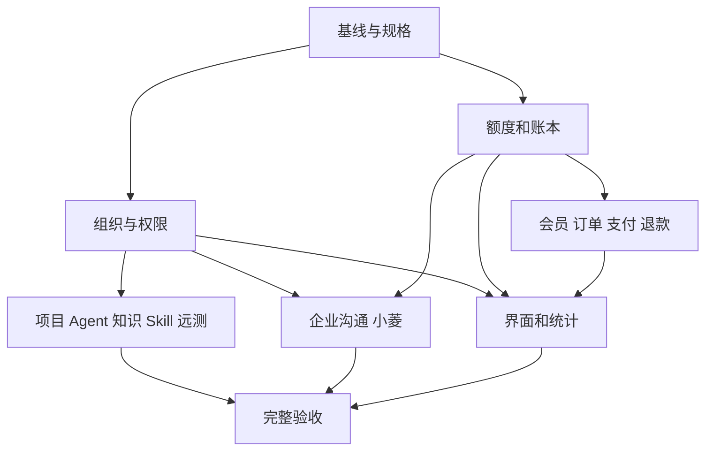

# 任务拆分：企业与计费体系

## 待实施：C4 独立复核人授权

真实本地依赖链已复现唯一最高管理员可提案但无法完成双人审核：本人审批 409，第二个非唯一最高管理员账号 403。现有假依赖测试不构成真实角色验收；当前应保留冻结。详细授权和锁序草案见 [C4 独立复核委任设计](DESIGN_企业与计费体系.md#待实施c4-独立复核委任2026-11-08)。

- [ ] **C4-A 权限迁移**：以实际 head 建独立 per-user C4 委任表，默认无授权；保留现有角色及历史账本。实现最高管理员授权/撤销与同事务审计，不使用对普通管理员默认绕过的通用权限判断。
- [ ] **C4-B 审核入口**：提案仍只允许唯一最高管理员；已明确委任且当前身份有效的平台管理员只可读取最小待审核详情及独立决策，禁止自审，不得获得费率、退款、其他平台管理能力。
- [ ] **C4-C 失权闭环**：在全部实际用户禁用、删除、角色降级入口的同一事务撤销委任；恢复身份不自动复权。普通登录/登出不撤销委任，并实时验证会话及授权。梳理 User、RBAC、委任、钱包和 reservation 的统一锁序。
- [ ] **C4-D 验收**：真实 FastAPI 依赖及多个不同合法角色账号覆盖正反向/自审；隔离 MySQL RR 验证授权撤销与审批两种顺序、重复审批、缺证据继续冻结；核对迁移保留历史数据和前端最小授权体验。

- [x] A：基线核对与 6A 文档：生产版本、迁移链、工作树与现状；独立工作树保护主工作树。
- [ ] B：组织、成员、小组、邀请与作用域授权；企业项目绑定、目录和项目成员授权 API 已实现，邀请接受的 MySQL 并发超卖已修复；小组撤权旧快照拒绝与移除后重入不恢复旧授权已验证，真实多账号验收未闭环。
- [ ] C：账本、用量归因、定价、预占结算和额度；Responses 计量已落地，所有调用路径和供应商成本仍未全部归因。
- [ ] D：会员、永久权益、订阅、席位、订单、支付渠道与退款对账；订单/渠道适配已实现，人工退款、渠道资金对账及真实沙箱未完成。
- [ ] E：企业项目、知识、Agent、Skill、论坛、公告与远测的服务端隔离；旧项目绑定/授权、文件父项目授权、企业项目报告共享和远测项目级审批闭环已实现；旧 Agent 项目知识来源的绑定撤权与远端重嵌入隔离已补齐；企业 TXT/Markdown/DOCX/PDF 附件、企业内检索/下载和小菱检索接入已实现。附件采用本地确定性词项/字符哈希，不是真正模型语义向量；OCR、组/项目级隔离、持久化外部向量服务、旧 Agent Studio 资产迁移仍未完成。
- [ ] F：企业群、小组群、私聊及小菱主动讨论、权限、可见范围和计费接入；微信式悬浮聊天、持久化运行时、后到同级/高权限指令的旧运行阻断、初次/后续模型发送门、工具调用级澄清及受控主动建议已本地实现。主动建议默认关闭、仅群聊、有企业预算和无工具写入；通用语义冲突检测、真实模型、浏览器多账号及生产验收仍未完成。
- [ ] G：工作空间切换、企业管理、个人及企业用量页面，覆盖加载、空状态、错误和窄屏；个人/企业会话状态、普通/管理员侧栏、Agent 导航和直链拦截已有前端实现。本地隔离浏览器已覆盖双企业可见范围、owner 移除仍打开小组群的组长、旧群聊/团队结果清理及另一小组/公司群访问保持；生产完整角色矩阵和真机触屏验收待做。
- [ ] H：迁移、后端/前端测试、真实浏览器账号验证及完整验收文档；本地全套测试和隔离 MySQL 迁移通过，生产、支付和真实多账号验收未完成。

依赖：A→B/C；B→E/F；C→D/F；B/C/D/E/F→G→H。各模块接口变更由主代理集成。

## 原子任务与验收契约

| 编号 | 输入与前置依赖 | 交付及验收 | 状态 |
| --- | --- | --- | --- |
| A1 | 已核对生产提交与 065 迁移 | 独立 `codex/` 工作树，保留原工作树；版本和迁移以验收时重新核实 | 已完成：分支 `codex/prism-enterprise-billing` 基于生产提交 |
| A2 | 用户需求和现有架构 | 持续维护 ALIGNMENT、CONSENSUS、DESIGN、TASK、ACCEPTANCE；未决或未完成项不得标记为通过 | 本地设计和实现记录持续更新 |
| B1 | 账号、组织和席位模型 | 多企业、邀请、成员、小组与管理员/组长授权；跨企业、越权、禁用、并发席位测试 | 后端及管理界面本地覆盖；邀请接受最后席位的 MySQL 并发已验证不超卖；小组撤权/重入及同事务建组分配通过 MySQL 验证，真实多账号验收待做 |
| B2 | 企业、小组和项目归属 | 旧项目、文件、报告、Agent 与远测所有入口统一执行服务端范围检查 | 企业项目 API 只允许所有者同意绑定本人项目；组员默认 reviewer、组长管理本组普通成员授权、跨组需显式授权；移除成员会停用其企业内显式项目 grant，重新加入须重新授予；文件入口沿父项目校验，报告列表/详情按企业项目 view 共享；远测申请、任务和报告绑定同一企业项目并在批准/启动/各执行阶段重验当前执行权。计费/订阅暂停后包括管理员在内都不能执行项目任务。个人 RAG 与旧全局 Agent 项目知识来源在项目绑定时停用、删除旧切片并在远端重嵌入前排除企业来源；旧 Agent Studio 资产仍按账号归属，不自动转成企业资产。企业知识附件另有企业级服务端授权，不继承项目成员权限，详情见 E1 |
| C1 | 钱包、批次、额度、报价 | 预占、并发结算、未知用量冻结、积分过期和企业/个人付款明细准确；账本只由服务端写入 | 增加企业/小组/成员月额度 API 与界面；本地自动化通过，生产级并发和恢复待验 |
| C2 | 各模型和工具调用、可信上下文 | 所有真实路径包含重试、流式、压缩、工具和嵌入均在请求前计量；无法证明上界或定价则拒绝 | 代码审查任务（含并行线程上下文传播）、个人 Agent Responses/聊天、企业小菱、论坛草稿助手与个人授权渗透测试已进入个人/企业钱包 scope，并按 attempt 预占、可信 usage 结算；缺用量/未知结果不会记零。渗透测试的每次模型预占前还重验委托 owner、授权窗口、当前项目执行权和执行代际；无个人钱包时不启动流水线。新账单预占还校验供应商身份，仅放行平台 `system/global` 凭据、官方 DeepSeek HTTPS 主机及批准的 Flash 别名；BYOK、自定义端点和 Pro 在 HTTP 前拒绝，迁移 093 保存身份快照且不猜旧账。论坛助手无个人钱包时返回 402，计费异常不会降级伪装成功。通用 Agent 请求走共享计量门，但未绑定付款主体的入口不能记入用户账本。个人 user-surface Agent 团队 worker 现按所有者个人钱包逐请求预占/结算，预占前复核租约、成员和项目权限，旧 attempt 的 reserved/unknown 账单阻止自动重试；admin surface 未配置平台付款主体而 fail closed；平台 `system/global/fallback` 凭据通过共享 `metered_response_request`/`begin_attempt` 的无 scope 调用默认在发送前拒绝，只有 `BILLING_ALLOW_UNMETERED_EXTERNAL_CALLS=true` 才恢复未入账兼容模式。新增迁移 086 记录计费 Responses reservation 回传的 Search/Fetch 成功次数并用数据库约束成对存储；个人及企业/小组用量 API 和页面显示调用数及已报告计数覆盖数，不将其混入积分扣费。因 DeepSeek 忽略 `max_tool_calls`、缺少可强制上限，付费 scope 仍拒绝服务端工具，正数 usage 不扣费并冻结待对账。外部 `streamable_http` MCP 的发现与执行 RPC 现统一在共享门禁，在商业计量 ready 的无 scope/收费 scope 情况下均于 DNS/HTTP 前拒绝；计量门关闭时，外部 MCP 与远端 embedding 默认仍因 `BILLING_ALLOW_UNMETERED_EXTERNAL_CALLS=false` 在网络前拒绝；只有显式开启该旧兼容开关才可能形成未记账平台成本。该开关不代表已经计价或建立付款归属。远端 embedding 等工具/入口尚未完成独立定价和钱包归属；计量开关关闭时，公共 `/v1/responses` 才保留调用方 Bearer Key 的 BYOK 代理；开关开启时无 scope 请求在上游 HTTP 前拒绝。该代理不占 Prism 钱包，也不进入 Prism 用量图；如需在计量开启时继续支持 BYOK，需定义可信且有速率/滥用控制的例外。DeepSeek Flash Responses 内联图片按 1,024 Token/张预占，并校验单图 1.5 MB、累计原图 28 MiB、最多 600 张及供应商尺寸阈值；其它多模态输入在请求前拒绝；开售锁关闭，Pro/Flash 供应商路由与实际账单需外部确认 |
| C3 | 供应商真实用量与付款明细 | 用户、组、企业 Token 趋势及未知次数；钱包扣费按实际来源拆分，绝不重复 Token | 页面和 API 展示已接入账本；现有 Prism 模型调用未全面计量 |
| C4 | C1/C2 与平台最高管理员权限 | `reserved/unknown` 提案、双人复核、证据留痕、原快照结算/未发送释放；无快照或未计价用量保持冻结；并发批准只发生一次 | 本地实现与定向验收完成：新增 migration 095、平台最高管理员对账 API/工作台、双人审批、阻断事件、原快照复算和并发唯一批准；不含生产、真实供应商证据及支付验收 |
| C5 | C1、C2、平台最高管理员权限 | 完整模型费率目录、供应商成本和汇率快照、计划生效、双人审批、成本变化预警、预占快照和旧价结算 | 模型目录迁移 098 与 Search/Fetch 工具费率迁移 099 已本地实现；工具预占/C4 迁移 100 与 DeepSeek 单次 HTTP 适配器已实现，供应商内置工具仍未开放。管理员 API/页面、模型双官方来源快照、工具 CNY/USD 双币来源、来源生效期与运行时毛利门、并发冲突响应均通过定向验证。真实 provider/账单、生产/商户/真实账号验收仍待做；销售锁保持关闭；自动抓价与实时汇率不在边界 |
| D1 | 已核验付款、周期及席位 | 个人审查员、企业订阅、宽限期、增减席位、永久权益、到期恢复和周期发放 | 个人审查员权益与周期调度、企业续费下一周期总席位、周期起始调容、超员保留成员并阻止新邀请、过期 7 天后限制普通成员且保留管理员续费已有本地测试；MySQL RR 已验证最后席位邀请不超卖、周期发放事务回滚后可重试、两个调度器竞争同一周期只发放一次且席位只应用一次。生产历史角色/数据迁移、生产恢复演练、真实支付与多账号验收仍待做；小组撤权后旧快照拒绝且成员重入不恢复旧小组授权 |
| D2 | 商户配置、服务端商品价格、C1/C2/D1 | 支付宝和微信真实下单、验签通知/查单、关单、幂等发放、退款及渠道对账，完成沙箱与商户验收 | 本地已实现支付宝/微信下单、验签、查单、关单、退款适配器；迁移 090/091 支持离线 CSV/ZIP/GZIP 导入、受限渠道官方交易账单下载、归一化、订单/退款只读匹配、差异筛选与人工审阅审计。微信下载合同仅由 mock 验证；GZIP 先有界解压并验证原始账单 SHA1，导入服务二次复算；退款缺本地支付事件不判匹配；支付宝官方示例返回 HTTP 地址时安全拒绝下载。MySQL RR 已覆盖支付宝/微信同订单重复通知只创建一条支付事件与积分批次、双击并发使用同一 `client_request_id` 只创建并返回同一订单，以及本地关单与支付应用路径在测试验签替身接受后的两种提交顺序最终均保留模拟成功通知的权益；回调终态还分别断言订单与支付事件金额等于创建时冻结快照。最新后端支付/账单/退款/预占对账 10 文件组合 **100 项通过**、前端账单/退款/费率/预占/个人计费中心 5 文件组合 **24 项通过**；全新 MySQL `init.sql→seed.sql→head 098` 对上述 4 个通知并发和关单竞态用例 **4 项通过**。账单导入不自动结算或改账；真实商户沙箱、资金账单/手续费日结、生产收款与商户验收仍未完成；开售锁关闭 |
| E1 | B2 与资源归属 | 个人和企业 Agent、Skill、知识库的范围、发布审批、访问、搜索及撤权链路 | 企业文字条目及 TXT/Markdown/DOCX/PDF 附件均可供有效企业成员检索；owner/admin 可上传/删除附件。附件单文件 ≤8MiB、抽取文本 ≤500,000 字符、企业活动片段 ≤10,000，杀毒扫描失败关闭，解析运行在受限子进程；删除清理原件、正文、片段与向量，既有会话历史按留存规则保留。索引使用本地确定性 hash-v1 词项/字符向量，不外发、不计模型费用，不称为模型语义 embedding；OCR、项目/小组级附件权限、外部 embedding 不在本阶段。MySQL `REPEATABLE READ` 下移除成员或删除附件后，旧快照的列表、详情、搜索及排队小菱运行均不得继续读取/调用已撤内容；附件父行 current-lock + 企业写锁维护配额，10,000 上限不依赖可陈旧 MVCC 聚合。Nginx 与解析前 HTTP middleware 对8MiB文件加multipart余量实施总请求上限。旧 Agent Studio 资产保持作者账号私有，不自动迁移；发布审批和受限 Prompt/`llm_transform` 子调用规则见本行前半及上文旧记录。个人 RAG 与旧全局 Agent 项目知识来源撤权规则不变，绑定/入库两种 MySQL 竞争顺序已验证 |
| E2 | B2 与企业远测模型 | 企业内发起、审批、自批规则、执行、报告及审计；原个人功能回归 | 新增 087 把审批与执行记录按不可变 `project_id` 关联；申请人提交时必须拥有项目 execute 权限，批准时同时重验申请人与审批人权限，启动及执行各阶段再次重验企业/项目/小组/账号状态、固定范围摘要和时间窗；项目报告按当前项目 view 权限共享。计费挂起或订阅过期后管理员可继续管理/查看，但不能执行。旧的无项目审批记录可拒绝/取消但不可批准/执行。项目/组织/报告/远测/迁移组合 **71 项通过**；迁移 087 随隔离 MySQL 8.0.45 的完整 `001→094` 链通过。真实目标网络探测及多账号浏览器验收仍待做 |
| E3 | B1 | 企业论坛、公告、分页、成员隔离及不确定结果幂等 | 本地基础完成，真实多账号验收待做 |
| E4 | 账号与空间切换设计 | 企业空间在页面/导航层隐藏个人功能；个人空间保留公开论坛；企业 API 按服务端身份/租户/资源授权 | 已实现会话级个人/企业空间状态；普通/管理员侧栏、搜索和小菱导航共用页面空间元数据，企业模式隐藏个人论坛/知识/用量，直链回到企业页；企业 ID 恢复前由 `/enterprises/mine` 复核。个人空间与多个企业空间共用账号身份；企业 API 仍按服务端成员/角色/资源授权，公开论坛 API 对登录账号开放，企业模式隐藏个人页面不构成论坛 API 封禁 |
| F1 | B1 | 公司群、小组群、私聊、分页、换号、重试、撤权与安全恢复；桌面微信式会话窗、可拖动/缩放/收回，窄屏全屏交互 | 会话区为左侧最近会话列表 + 右侧消息流；桌面悬浮窗是非模态浮层，不挡背景页面；可拖动、鼠标/键盘缩放、方向键移动（Shift 加速）、Esc/按钮收回并恢复焦点。仅企业群聊在宽度≤760px 或高度≤520px 时全屏布局接管并保留桌面尺寸偏好；个人、管理员及 Agent 团队窗仍按 520px 宽度断点。默认 520px 与企业 760px 两种断点、600px 桌面拖动均有测试；刷新权限会移除已撤销小组的最近会话；群聊标题按实际范围说明可见对象；搜索无结果提供清除操作。企业运行状态、追问、取消、恢复、审批入口已有组件覆盖；账号/企业/会话切换时丢弃旧消息与旧 Agent 状态。本地合成 owner/member/leader、私聊双方、两企业互相隔离及活动页面撤权后清理已完成浏览器验收；生产真实角色和真机触屏仍待做 |
| F2 | B2、C2、F1 与真实团队运行时 | 小菱 @、群讨论、冲突优先级、资源可见范围、写操作授权和预算限额 | 已有独立企业 Responses 运行时：原发起人身份固定，当前会话/同企业文字知识形成上下文，服务端保存权限快照、持久检查点、租约与 fencing；模型调用走企业预占/结算，异常 usage 或未知费用待核对。运行可刷新后从服务端列表恢复，支持 `call_id` 追问、显式重试和取消；工具包括知识搜索、本人私有草稿、精确公告审批，以及受限已发布 Prompt Agent/`llm_transform` Skill 子调用。子调用以父 run + tool call ID 幂等，走企业钱包/成员额度，模型无工具并重验权限；已完成、未知、失败和活跃租约状态分别处理，禁止不明费用重放。新增 `run_approved_enterprise_asset_team`，只接收 2–3 个不同的已审批 Prompt Agent/`llm_transform` Skill，顺序执行；每步复用独立父 run + 派生 tool-call 幂等记录与企业钱包预占/usage 结算，未知账单冻结，前序输出标记为不可信并限长，任一步失败即停止。此为受限已发布资产协作，不是 AgentRegistry 注册运行时 Agent 团队。组长权限只在本组 rank 生效，企业 owner/admin 可管理公司及小组运行；企业挂起在工具/模型预占/恢复/审批前拒绝。角色 rank 只指导冲突，不提升工具发起者权限。排队后如果其他同级或更高权限成员发送新 `@小菱`，下一次模型/工具授权检查会拒绝旧运行继续；同一冻结上下文内的语义冲突仍依赖模型调用 `ask_user`，不是通用形式化检测器。周期 worker 自动消费未开始的 queued 任务，与 HTTP 后台任务共用数据库租约认领；运行中 lease 过期任务仍人工核对后显式恢复，以防模型已收费但检查点未写时重放。个人 Agent 团队队列只支持 `user/admin` 表面且绑定个人运行与会话：`user` surface 已按团队所有者个人钱包逐调用计费，admin surface 在计量开启时因没有已验证的平台付款主体而 fail closed；计量关闭时仍可能产生未记账平台成本。此队列不可直接复用于企业；企业租户成员授权、企业钱包逐调用归属、队列可见性和停止/审批链未接入。真实 Agent 团队、多工具、供应商真实账单与真人多账号仍未完成 |
| F3 | F2、B2、C2 | 企业专用注册 Agent 团队持久队列、企业钱包扣费、审批、恢复、权限可见投影 | F3-A/B/C/D/E 已完成本地实现；迁移 097 固化单一企业项目范围。当前注册 Agent 白名单为 `language_detector`、`code_reviewer`、`security_sentinel`：安全哨兵只接受服务端绑定项目与受限扫描选项，建队校验 `security:scan`，扫描逐模型请求复用企业计量 scope，扫描预算不超过任务调用上限；企业扫描跳过项目当前归档写路径，完整/不完整报告与任务终态原子写入不可变制品，Team 结果只保存制品引用，读取要求当前会话结果权限与项目 view 权限求交。零模型请求的静态扫描允许零 reservation，非零报告请求数必须与任务账本 reservation 数一致。报告 UI 仅按需读取，HEAD 复核不读取报告 LONGTEXT；慢请求单飞、旧授权响应不能影响新报告，撤权/网络复核失败会清正文并显示提示，triage 不标完整项目覆盖。MySQL 取消/新租约接管旧 worker fencing 与撤权先行/报告先锁授权两种顺序均已覆盖；后端定向 263 项通过，完整 MySQL `001→097` 63 项通过/11 条既有警告，前端完整 Vitest 2703 项通过；目标 Ruff、ESLint 与生产构建通过。真实 provider 费用/端到端模型扫描、真实企业账号浏览器及生产验收仍待做；销售锁关闭。
| G1 | B1、C3、E3、F1 | 个人 Token 页面与企业管理、沟通、企业/组/成员用量；角色变化及时清屏、窄屏可用 | 个人用量和企业/小组图表、月度额度界面本地完成；个人计费图按认证账号汇总其个人/企业发起的已计量调用，账号 token/profile 变化时同步清空并重新加载，迟到响应不得回填；统计仅包括已接入账本的调用 |
| H1 | 全部变更与测试环境 | 单元、集成、真实 MySQL 迁移及并发；真实浏览器多账号、支付沙箱分开记录 | 当前唯一 Alembic head 为 `100_billing_tool_reservations`。A2 reservation/C4/usage 与 A3 Search/Fetch transport、迁移回归组合 **28 项通过**；企业用量/个人用量/C4 前端目标组合 **16 项通过**，此前 ESLint/`vue-tsc`/Vite 构建和目标 Ruff 通过。SQLite 100 回归在真实约束形态上通过；A5 一次性 tmpfs MySQL `001→100` 全链、完整后端/前端 suite 尚未复跑。此前完整后端 `9,976 passed、77 skipped` 与前端 `191 文件/2,713 passed` 早于 A2/A3，不能代表当前状态。所有均为本地隔离环境，不代表生产迁移/恢复、provider 真实账单、商户沙箱、真人账号浏览器或生产发布。外部待办见 ACCEPTANCE/TODO；销售锁关闭。|
| H2 | H1、正式配置与发布授权 | 生产备份恢复演练、升级、镜像与业务核验；FINAL/TODO 如实标明未配置与未验收范围 | 未开始 |

## C2 补充验证（2026-11-06）

Responses 纯文本 message 的计量预检曾因字符串分支返回项数不一致而抛出 `ValueError`，导致企业资产子调用在 Provider 前被拦截。新增回归先复现、再修复为统一四项返回结构。修复后定向计量组合 **98 项通过**，完整后端套件 **9,855 项通过、59 项跳过、0 失败**。这只关闭已复现的本地计量回归；Embedding/MCP 单价与付款归属、DeepSeek Search/Fetch 工具级扣费、生产账单和真实支付仍未闭环，销售锁保持关闭。

## 最新项目范围迁移与运行权限检查（2026-11-07）

迁移 097 为 `enterprise_agent_team` 增加 nullable `project_id`，建立 `(enterprise_id, project_id)`→企业项目同租户复合外键及项目列表索引；历史团队允许空项目范围，不能绑定其他企业的项目。SQLite 迁移用例覆盖同租户、NULL 兼容、跨租户拒绝和 downgrade。团队创建时固定项目范围到计划摘要和团队记录；任务领取、每次模型发送授权、成功完成及结果读取重验当前项目绑定/权限；项目授权撤销后拒绝新模型请求和成功结果提交，同时允许失败/账单收口。群聊只能绑定本小组责任项目。项目结果列表/详情要求当前 team 会话可见范围与 project `view` 权限同时成立。

验证：097 定向迁移、服务与运行时 **44 项通过**；一次性 tmpfs MySQL 8.0.45 完整 `001→097` 空库迁移链 **58 项通过、11 条既有警告**，包含 ORM schema 对照、既有 RR/计费/撤权回归、096 复合外键和不可变触发器实写验证，以及 097 可空列、同租户复合外键与索引元数据。目标 Ruff、`git diff --check` 通过；临时 MySQL 容器自动删除。

**历史状态（报告 UI 与 Sentinel MySQL 并发矩阵完成前）**：本地 Sentinel 企业项目扫描执行链、不可变报告原子写入和项目 view/会话权限求交已接入；当时相关后端定向组合为 255 项通过、目标 Ruff 通过；前端报告详情当时尚未实现，Sentinel 专用 MySQL 竞态矩阵也未执行。上述工作已在后续阶段完成。当前剩余为真实 provider 账单、真人账号浏览器及生产迁移/恢复/支付验收；销售锁关闭。最新实现与验收见 F3/H1 表和 ACCEPTANCE 最新追加。

## 个人渗透证据人工核查（本地）

- [x] 最高管理员按委托精确读取执行及活动、关联预占和沙箱的最小状态；每页当前角色与令牌校验并持久审计，错归属标为不可确认。
- [ ] 独立 MySQL RR 中验证撤权先行拒绝、核查先锁时撤权等待及数据最小化；真实浏览器、生产数据和外部服务证据尚待核验。
- [ ] 建立可验证的历史执行恢复、终止核查及合规审计留存/脱敏删除流程；当前入口不提供解除冻结、标记排空、退款或删除。

## 2026-11-09 小菱指令澄清扩展原子任务

1. **运行前证据**：按同一会话冻结窗口计算候选、消息指纹和全部快照作者的权限版本；无候选也记录可复核证据；候选存在时保存 `phase=model_send` 请求与专用 pending，保持零模型预占/零发送。
2. **专用恢复**：查询/决定按 model_send/tool 两类状态验证；模型发送由原发起人继续时直接转入 `drive_persisted`，不得经通用工具恢复；拒绝、重复、过期、角色 ABA、消息修改及新高权消息均失败关闭，记录不可被普通 retry 绕过。
3. **发送 guard**：每次 Responses 模型尝试及上下文压缩都在账本预占前验证完整 model_send 许可；缺少证据、版本变化或决定不完整时不新增 reservation。unknown / reserved 继续冻结，不自动退款或重发。
4. **工具统一门禁**：在工具分支前按当前 call ID、名称、企业/会话目标、参数摘要澄清所有已暴露工具；每个动作单独决议，保留各工具原有授权、订阅额度、锁、审批和事务边界；取消运行不受阻。
5. **前端状态**：悬浮聊天沿用现有澄清卡，显示“发送本次回复”或具体动作名称；模型发送 pending 与工具 pending 使用同一接口外观但后端类型分派独立；刷新、切账号、撤权、迟到响应均不泄露旧候选。
6. **验收**：SQLite 覆盖无候选、候选、拒绝/修订、模型专用恢复、工具精确重放、普通 retry 旁路和多角色范围；一次性 MySQL RR 覆盖撤权/决定、run/state/company/钱包锁顺序及竞争恢复；前端覆盖状态轮询/决定/恢复。全量后端/前端与 MySQL 全迁移分别记录；生产、真实 provider、支付和多账号浏览器不得混写为本地测试证据。

## 2026-11-09 模型发送与工具澄清门阶段状态

执行项 1–5 已在本地代码与前端接通，执行项 6 的当前阶段自动化证据为：相关 SQLite 定向 78 passed、1 strict xfail；一次性 MySQL 8.0.45 空库迁移至 118 的权限/澄清/团队组合 20 passed；前端完整 210 文件、2,976 项通过，ESLint 与生产构建通过。完整后端回归进行中。候选仍只涵盖最近 30 条冻结历史里其他同级/高权作者显式 `@小菱`；任意自然语言冲突、未显式提及和窗口外历史不保证检测。生产当前仍为 4.1.42，代码尚未发布；商户、真实模型、真实账号浏览器及生产恢复验收待完成。
