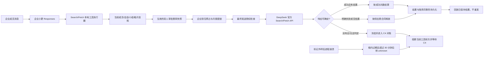
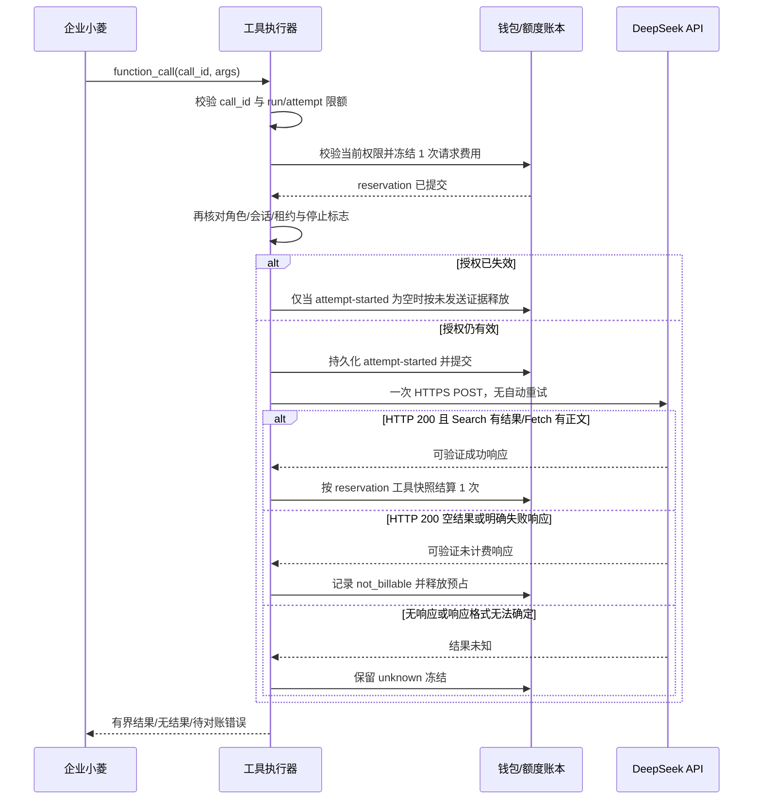

# Search 与 Fetch 计费设计

## 总体架构

## 分层职责

- **工具执行器**：参数校验、单 run 3 次请求硬限额、工具 schema 隐藏/失败关闭、输出截断及工具结果标记。
- **成本目录**：费率目录包含 Search/Fetch 的供应商单位成本、客户扣费，以及分别固定为中文人民币指南和英文美元价目页的来源 URL/核验时间；币价来源、汇率来源、费用、生效时间全部进入版本哈希，双人批准后不可变。计划生效时间和每次调用时都重新校验来源年龄；调用时还重算官方成本下限和 30% 毛利。
- **账本**：`BillingReservation.billable_kind` 将模型调用与 Search/Fetch 区分；工具 reservation 使用企业钱包、批次预占明细、企业额度行锁、幂等键、单位成本/客户费率/目录版本快照和 unknown/C4 状态。工具 attempt-started 在任何网络操作前持久化提交；已有 key 永不触发第二次发送。
- **供应商适配器**：固定 HTTPS 主机与固定两个 endpoint，使用平台 DeepSeek key，`trust_env=False`；禁止自由配置 host、自动重试与把用户 URL 交给本机 HTTP client。
- **用量查询与管理 UI**：Token 图只合计 `billable_kind=model`；个人/企业用量显示 Search/Fetch 成功次数、用户扣费、未知/待处理冻结和明确不计费次数。费率目录显示单笔毛利；C4 在单条 reservation 展示供应商成本和客户费率快照。不宣称用量页已聚合供应商成本或整体 margin。

## 计费流程与状态

## 数据与不变量

- `BillingRateCatalog` 新列保存 Search/Fetch 每成功请求供应商成本（CNY 微元）、客户费率（毫积分）及两个独立币种来源事实；新目录 version/source hash 纳入工具来源和四项费率。历史目录默认费率为 0，执行端拒绝，须经创建、双人审批和未来生效才能启用。
- `BillingReservation.billable_kind` 区分 `model`、`search` 与 `fetch`；工具记录还含规范化工具名及供应商成本/客户费率/目录版本快照。Search/Fetch reservation 使用独立 `request_key`，唯一键阻断重复供应商调用。DDL 的工具约束必须对费率字段显式 `IS NOT NULL`，避免 SQL CHECK 的 UNKNOWN 通过。
- 只允许企业钱包；预占同时保留适用企业、小组、成员月额度。结算时释放预占并增加实际企业额度用量；不允许个人回退。
- model reservation 仍要求可信 Token usage 和模型费率；任何 server-side usage counters 不得借新字段自动绕过现有未计价服务端工具 gate。
- 工具 reservation 不填输入/输出 Token，个人/企业 Token 图查询必须按 `billable_kind=model` 过滤；用量页面分别汇总 Search/Fetch 成功次数、unknown、客户扣费和待处理/不计费计数；C4 单条记录显示供应商成本与客户价格快照，不提供供应商成本或 margin 的用量聚合。
- `provider_attempt_started_at` 写入并提交是唯一网络发送闸门；同 key 重放只读取已持久化结果，找不到结果时一律拒绝重发。确定的工具结果与结算/释放事务性写入；该 marker 为空才可按未发送释放；明确不计费记录 `not_billable`，连接或响应不确定则保留 `unknown` 预占。陈旧的 marker 预占只能经租约过期、30 分钟等待和管理员恢复操作转 `unknown`，绝不自动结算/释放。
- C4 以原费率快照确认成功次数为 0 时，不扣积分；用量页仍将这类已核实的零成功 reservation 计入明确不计费调用，避免“已查明但消失”。
- unknown 无法证明未发送时保持冻结；管理员只有来源账单或可审计未发送证据，才能走当前双人 C4 人工流程。

## 异常策略

- 无活动目录或工具价为 0：不下发 schema，后端拒绝执行。
- 目录/钱包/限额/团队授权/企业状态校验失败：提交前无 HTTP 外呼。
- 授权变更发生在预占后发送前：最后发送门失败，释放未发送预占。
- 连接中断、读取超时、无法解析成功响应：unknown，禁止 provider 自动重试和任务自动重放。
- 明确 HTTP 错误：按官方失败不计费规则释放；不在当前工具 call 内重试。
- Search 空 `results`：按官方零结果免费合同释放；正结果每条调用只计一次，不按结果条数计价。
- Fetch HTTP 200 且 content 为空：按明确不计费结果标记 `not_billable` 并释放预占。
- Fetch 响应结构错误、正文缺失或无法判断供应商是否完成计费：unknown，冻结并交 C4；不得按同一调用重发。
