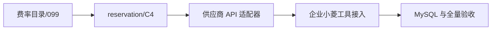

# Search 与 Fetch 计费任务拆分

## A1：费率目录与单价快照

- **输入契约**：生产基线 4.1.42 / migration `065_review_rule_lang_severity`，当前本地唯一链 head `102_billing_tool_recovery`，双人审批费率目录、DeepSeek 官方 CNY/USD 两个 Search/Fetch 来源和当前积分商品基准。
- **实现约束**：迁移 `099`；历史目录工具费率为 0 且不自动开通；分别固定并记录中文人民币指南、英文美元价目 URL/核验时间；来源覆盖计划生效时间且运行时持续新鲜；保守成本底线与至少 30% 直采毛利在创建、审批、运行时重验。
- **输出契约**：管理 API/界面创建与审阅 Search/Fetch 成本、客户费率及双币来源；公共定价只展示当前有效的工具价格；目录和来源快照不可变；A1 不接外呼，不能视为 Search/Fetch 已开放计费。
- **验收**：SQLite 外键开启的迁移测试、完整 MySQL 8.0.45 空库链及 ORM schema、费率 margin/版本/来源新鲜度/双人审批测试、前端费率目录 tests、ESLint/build/Ruff。

## A2：按次工具 reservation 与 C4

- **输入契约**：A1 的活动目录及统一 `BillingReservation` / `BillingLimit` / 账本服务。
- **实现约束**：`billable_kind`、工具单位成本/客户价/目录版次及成功次数独立于模型 Token 字段；企业钱包 only；每请求固定价预占；attempt-started 先提交再 network；同 key 绝不重发；确定未发送释放、可信非计费响应标记 `not_billable`、未知冻结；C4 按原工具费率快照复算 0/1 成功次数；用量图按 kind 聚合；数据库约束不能让 NULL 费率通过。
- **输出契约**：Search/Fetch 记录可审计，月额度用量与钱包批次同步，C4 能呈现 unknown 工具 reservation 并双人处理。
- **验收**：并发同 key、余额/月限额边界、批次分摊、attempt-started 后不能重发或按未发送释放、成功/明确非计费/未知幂等、C4 0/1 工具证据双人审批、Token 与工具图表隔离 tests。迁移 100 必须在 SQLite 外键开启时保留既有模型预占与账本明细并替换约束。

## A3：DeepSeek Search/Fetch 适配器

- **输入契约**：A2 的已冻结一次请求额度与 `deepseek` system/global credentials。
- **实现约束**：仅系统/全局平台托管 Key、固定官方 HTTPS endpoint、`trust_env=False`、禁止重定向及重试；Search query 1–128 字符且固定请求 5 条/`need_content=false`，Fetch URL 最大长度 2,048 字符并拒绝非公网 IP 字面量，输出最多 12,000 Unicode 字符；响应原始读取最多 256 KiB；不把请求参数、响应正文、密钥复制到账本/审计。
- **输出契约**：单次可验证 API 结果、明确无结果/HTTP failure 或 unknown 状态；只有 HTTP 200 且 Search `results` 非空或 Fetch 正文非空结算 1 次，空结果和非 200 按官方规则释放，传输/格式不确定冻结。
- **验收**：transport mock 正/空/错误/timeout/malformed/大响应、权限在预占后被撤销、来源主机固定、无重试与重定向、Key 只在 Authorization header 且错误消息不泄漏。

## A4：企业小菱工具与安全接入

- **输入契约**：A1–A3 已完成、企业 Responses tool executor/持久 checkpoint。
- **实现约束**：只在活动费率与计费门禁 ready 时向企业小菱注册本地 function tool；同 run 最多 3 次已启动外部请求；每次复核企业/成员/会话/小组/租约；`call_id` 幂等。供应商内置 `web_search` 始终拒绝。工具结果与已确定账务同事务保存；已有结果可恢复回放，未知结果停止当前 Responses 工具轮次。标记外呼后崩溃的预占只能在结果/usage 缺失、租约过期且超过 30 分钟时转 C4 unknown，绝不自动扣费或释放。
- **输出契约**：只将有限、脱敏网页结果交给当前企业小菱运行；结果和确定的结算/释放原子持久化；相同调用只回放，不重复外呼。未知账单进入 `awaiting_reconciliation` 并阻止当前轮继续调用；切会话/撤权后不得展示或继续请求。
- **验收**：小菱 tool-loop mocks、刷新/租约恢复/撤权、同调用幂等、并发两次预算抢占与异常账单 tests。

## A5：MySQL 与整体验证

- **输入契约**：A1–A4 与目标 Ruff/前端 lint/build。
- **实现约束**：隔离 MySQL 8.0.45 tmpfs，从项目 init/seed 与 `001→102` 链运行；不得触碰生产/其他容器；完整后端与前端 suite 最新结果分开报告。
- **输出契约**：更新主 `TASK` 的对应项和主 ACCEPTANCE/TODO/FINAL；记录真实 provider/生产仍未验收的明确边界。
- **验收**：全链唯一 head/ORM 结构、工具费率与 reservation RR 并发、C4 权限矩阵、完整后端测试、前端 tests/lint/build、Ruff、`git diff --check` 全通过。

## 依赖图

## 执行审查清单

- [x] 费率目录分别留存两种币价依据，来源覆盖计划生效时间，运行时快照 fail closed 检查来源新鲜度与毛利。
- [x] A4 仅在有效计费配置下开放本地函数工具；拒绝供应商内置工具；同一 run 最多 3 次，按 call_id 幂等；未知结果熔断，结果与账务原子持久化，陈旧预占只能转入 C4。
- [x] A2 每次工具预占固定一笔请求费用，attempt marker 提交后才允许 HTTP；超时、异常恢复与同 key 重放不重新发送。
- [x] A2 未知结果冻结；重复 reservation 冲突；C4 可按原快照双人裁定 0/1。
- [x] A3 只对 HTTP 200 且有内容结算；Search 空结果、Fetch 空正文与明确非 200 释放，响应不确定冻结。
- [x] A2 C4、用量图、企业月额度与数据库账本覆盖工具类型；SQLite 迁移约束明确检查费率非空。
- [ ] 生产与支付验收不被本地自动化结果冒充。

## 当前阶段状态

- **已完成**：A1 费率目录；A2 工具账本、预占、C4、用量拆分；A3 DeepSeek 固定端点适配器；A4 企业小菱工具接入、权限/租约复核、最多 3 次上限、unknown 熔断、结果回放和 30 分钟陈旧预占恢复。迁移 head 为 102。
- **待完成**：A5 MySQL `001→102` 全链、完整前后端回归、文档对照和最终本地验收。
- **外部未验**：真实 DeepSeek 请求及原始账单、支付宝/微信商户沙箱、生产数据迁移/恢复、真实账号/浏览器验收与部署。
