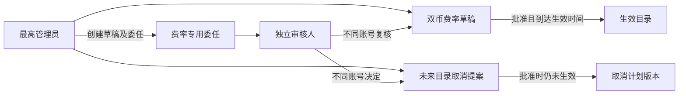

# 费率独立复核：设计

## 数据与迁移

在实施时核对唯一 Alembic head 再创建独立后续迁移，不抢占 104、105、106。表名以下均为候选：

- `billing_rate_reviewer_grant`：`user_id` 唯一、active、授予/撤销人及时间；迁移不初始化授权。只允许平台最高管理员对其他活跃平台管理员操作，并以同一事务写入审计。
- `billing_rate_cancel_request`：绑定目录、申请人、申请说明、状态、复核人、复核说明及时间；使用可空的 active_catalog_id 唯一约束保证每目录最多一个待复核申请；将状态和该活动键的合法组合写入约束。拒绝或批准时同时清除活动键，事件与状态不可伪造历史。不得靠 MySQL RR 对不存在的键执行 `FOR UPDATE` 保证唯一性。

复用现有 `billing_rate_catalog_event` 的目录创建、审批、拒绝、取消事件；取消申请/决定的证据持久留在取消表。实际表/事件变更前盘点数据库触发器、CHECK、迁移 head、历史行和数据库版本；优先向前兼容，不回填已有目录的委任或来源事实。实施时核对 Alembic revision 长度与现有部署脚本。

## 授权及锁序

受委任者必须同时满足 User 启用、token_version 一致、User.role=admin、唯一有效 RBAC 角色为 admin、专用 grant active。用锁定当前读，不能使用对管理员默认放行的普通 permission 判断。只由最高管理员授予/撤销，持用户锁及授权锁后更新和审计；用户禁用、软删、角色降级在同一事务撤销，恢复不自动授权。

决定事务先持当前账号/角色和专用授权锁，再锁目录、取消申请或事件，之后才变更目录；撤权和决定同锁顺序，先提交者生效。创建或取消申请竞争通过唯一约束、事务回滚后新 session 重读解决。按多个用户固定顺序锁定，防止互相授权造成锁环；不要持数据库锁进行网络请求。MySQL 真实竞争证明锁序及结果，SQLite 不当作锁证据。

## 接口合同

- 最高管理员的草稿创建、完整目录读取及费率委任管理保持最高权限；委任必须有明确理由和审计。
- 新增受委任人可访问的最小待审列表及单项详情，包含目录 ID、模型/工具价格、来源 URL/核验时间、汇率、毛利计算、创建人及计划生效时间，不包含密钥、prompt、个人账单与企业身份。
- 草稿批准/拒绝在服务端执行独立账号和当前授权检查，返回必要状态；创建人不得批准本人草稿。既有 API 可以为最高管理员保持兼容，但不可依赖前端隐藏实现限制。
- 取消申请绑定目录及固定说明，拒绝重复待审；取消决定必须不同人，批准时锁目录后以数据库当前时间或服务端同一可信时钟检查 `effective_at > now`，原子设置 `canceled` 与记录决定；生效先发生时不能倒改历史，改为拒绝并留证。
- 所有写操作幂等或返回明确冲突；同键不同内容冲突。前端网络超时不能声称成功或自动执行第二次金融操作，应刷新/查询已有状态。

## 注意

不同账号无法证明背后是不同自然人；实际运营的人员独立性需单列验收。真实报价、商户账单、支付沙箱及生产部署与本地验证分开。
