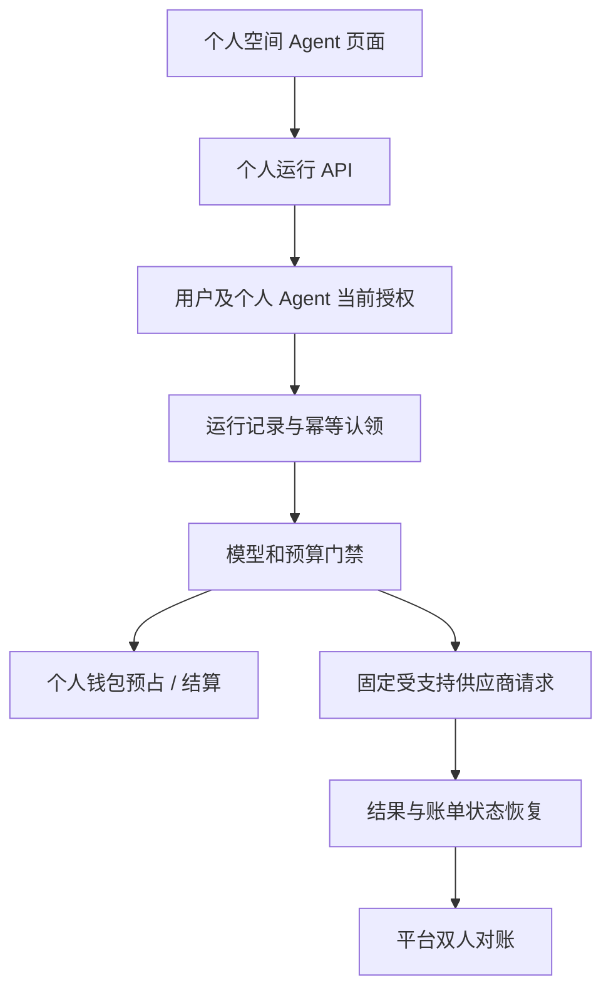

# 个人基础 Agent：计费运行设计与原子任务

> 状态：**待实施、待验收**。记录时间：2026-11-08。本文是工程设计，不是已完成的功能或真实供应商合同。当前个人 Agent 的配置管理在并行实施中；本文的迁移编号、路由和表名均为候选，实施时重新核对唯一 Alembic head。保持销售代码锁关闭。

**简化执行原则**：在满足权限、费用和恢复边界的前提下，将个人运行认领、调用、结果和用量展示作为一个可用纵切交付；不要单独发布只能记录而不能执行的接口。首版单次模型调用优先评估一张运行表和现有账本，避免提前引入通用多 Agent 队列。个人全局发布及管理员审核仍是独立的必需需求。现有 C4 接口要求唯一最高管理员且禁止自审，本地真实依赖链已复现无法由两个合法账号完成审核；独立审核权限未实现前保持冻结。

**2026-11-08 实施状态**：经复核，纯保存摘要且无法执行的试验接口会占用将来的幂等键，未形成用户需要的功能，已从工作树撤回。104 仅是候选迁移编号，个人运行记录、调用接口及计费执行当前均未实现。后续实现须将持久运行与受控执行作为完整闭环，不能把不可执行的空记录显示为已提交任务。

**2026-11-08 补充核对**：工作树已出现用于 C4 独立复核委任的迁移 `104_c4_reviewer_grant`，不得使用 104 实现个人运行；新迁移的父节点和唯一 head 以实施时的 Alembic 实际结果为准。C4 委任仍在并行实现及验证，历史段落中的“未实现”描述为当时记录，不代表当前已通过完整验收。

**禁用时间线**：禁用个人 Agent 后，不再接受新的运行；禁用发生在请求许可提交之后、响应结算之前时，已发生的可信用量仍结算，但本次输出不展示。禁用前已成功完成并保存的本人历史结果继续保留，本人可读取；禁用不会删除或隐藏这些既有历史。禁用账号的读取权限另按账号状态校验。上述为本地实现与测试合同，不代表真实供应商或生产环境已验收。

**单次文本模型模式**：首版由服务端固定 DeepSeek Chat Completions 的 `thinking: {type: disabled}`，用户不能传入或切换模型模式；该字段计入请求输入上界。共享计费门禁仍接受官方协议的缺省、null、enabled 和 disabled，未知结构拒绝计费。真实供应商调用尚未验收；官方协议见 [Chat Completions API](https://api-docs.deepseek.com/api/create-chat-completion/)。

## 1. 对齐、目标与约束

用户要求普通个人用户和审查员均可创建并使用自己的 Agent，并可申请全局发布、由平台管理员确认。当前个人配置 CRUD、个人模型调用及个人来源全局发布均需分别核对实现和验收状态。本文只设计**个人私有、无工具的单次文本 Prompt Agent**的调用与个人钱包计费。该纵切是实现个人自用的起点，不能替代代码审查 Agent、企业内发布、个人全局发布及管理员审批的后续交付。

请求的 owner 只能由当前登录身份推导；Agent 及版本的权限只由服务端判定。模型、endpoint、凭据来源、付款主体、输入输出上界及单价不得由客户端指定。默认不接受工具、Skill、任意 URL、BYOK、流式、压缩、子 Agent 或模型自动重试；未来增加任一能力须另做费用上界、权限和恢复设计。个人 Agent 不加入旧全局 Agent 注册表或企业目录。

依赖并复用项目认证、个人钱包、批准的费率目录、`billing_runtime_gate` 上界校验、`billing_ledger_service` 预占及结算。运行入口要求商业计量 ready、受支持的官方平台凭据和模型、有效费率和足额个人钱包；任一不满足则在外呼前关闭。用户余额、真实 provider 费用和销售开通是不同条件。`BILLING_SALES_CODE_GATE_OPEN=False` 仍是开售锁；不能因为运行实现而更改。

## 2. 当前代码与必须修正的假设

- `personal_agent` 与 `personal_agent_version` 的 103 迁移正在并行工作树内实施。版本当前由服务层只创建不更新；现有模式并未证明数据库级不可变，运行、审批都应固定 version ID、快照摘要并在使用前核对。
- `billing_runtime_gate.begin_attempt()` 在事务中执行 `attempt_guard → ledger.reserve → on_reserved` 后返回；`NativeResponsesTransport` 与异步 Responses 随后各自发起网络请求，当前并不会调用 scope 的 `send_guard`。因此仅配置 `send_guard` 无法保证最终发送前的授权检查。
- `_next_request_key` 的计数器只存在当前进程的 scope，重启后不能充当持久运行幂等依据。运行记录和 reservation 必须有服务端生成、持久且唯一的关系；不能根据用户传入键拼接不受限的账本键。
- `finish_attempt()` 以可信 usage 和预占费率另开事务结算，现有传输向调用方交付结果与结算不保证同一事务。已结算但结果未保存是可能状态，不得重发或退回已发生费用。
- 当前通用模型 reservation 的 `reserved` 不包含 Search/Fetch 的发送标记。仅凭请求过期、worker 心跳丢失或租约过期，无法判断请求有没有到达供应商。
- 现有 C4 可对 `unknown` 提案并由另一最高管理员复核；其陈旧恢复入口当前专门约束 Search/Fetch。不能把它当作个人模型请求自动恢复已经实现；需分别验证对模型 reservation 和个人调用状态的映射。

## 2.1 上游协议、成本和隐私核对（2026-11-08）

价格部分为历史核对；2026-11-09 最新重读 DeepSeek 官方英中页面显示 Flash 高峰未命中输入/输出为 US$0.30/US$1.20 与 ¥2/¥8 每百万 Token。本轮较早页面读取曾显示 US$1.32/¥9，按最新直读价更新成本门；当前算术和销售门槛见 [模型成本核对](模型成本核对.md)。

- [DeepSeek 官方 Chat Completions 协议](https://api-docs.deepseek.com/api/create-chat-completion/) 使用 `POST /chat/completions`；首版发送固定的系统和用户文本消息，显式设置有界 `max_tokens` 与 `stream=false`，不发送工具或客户端提供的 provider、模型、账单参数。可信响应的 `usage.prompt_tokens` 是缓存命中与未命中输入的总和，`usage.completion_tokens` 是输出总用量。不得将缺失、负数、布尔值或超预占的用量视为零。
- [官方思考模式说明](https://api-docs.deepseek.com/guides/thinking_mode/)指出默认启用思考；`billing_runtime_gate` 仅接受 `thinking` 对象形状 `{"type":"enabled"}` 或 `{"type":"disabled"}`，并拒绝其它字段和值；`reasoning_effort` 不在请求白名单。可信 usage 按完整 completion token 结算，不能把空正文认定为免费。
- 官方列出 `stop`、`length`、`content_filter`、`tool_calls`、`insufficient_system_resource`、`aborted` 等结束原因。应如实区分完整结果、截断和不可用结果；即使无法展示完整内容，只要来源可信且 usage 完整，仍须按原费率快照结算。模型未定价工具的出现必须停止，不能隐含执行。
- [中文官方价格](https://api-docs.deepseek.com/zh-cn/quick_start/pricing/)最新页面列 `deepseek-flash` 高峰每百万缓存未命中输入/输出 ¥2/¥8；[英文官方价格](https://api-docs.deepseek.com/quick_start/pricing/)相应为 $0.30/$1.20，低峰价格为高峰的一半。当前成本目录保存美元价格并按中英文成本较高值核验；FX 6.7188 时输入/输出成本分别 ¥2.01564/¥8.06256，不等于真实结算或供应商账单。
- 当前模型 `rate_snapshot` 在新预占时检查英文价格、人民币价格及汇率来源均不超过 30 天，并重新验证官方来源与供应商成本下限；过期或低价目录 fail closed。自动抓价/变更告警和真实供应商账单核验仍未实现，需由费率审核人定期刷新来源。
- `billing_runtime_gate` 按序列化 UTF-8 字节与协议余量估算输入上界。这是当前实现采用的保守方法，但本轮未在官方文档找到可证明所有输入及服务器封装均不超过该上界的合同；异常用量超过预占时保持冻结，持续用真实供应商 usage 及账单检查该假设。
- `resolve_api_config` 和全局 LLM 配置读取在密钥轮换/失效时可能提交或回滚传入的 Session。企业 Search/Fetch 最终授权现通过独立 Session 解析并重比供应商身份，避免提交持有权限锁的授权事务；回归测试模拟了解析器提交。其他持有业务锁的调用方不得共用该 Session。配置缺失、非官方端点、BYOK 或不合格回退不得记入平台钱包。
- 现有 `DeepSeekAgent.call_raw()` 有重试循环，并调用 `record_usage_attempt`，后者可把 prompt 和 response 写入 `AiCallLog`。个人私有内容不得直接复用该默认日志路径；即使设置 `max_retries=0` 也须验证敏感内容不进入日志。只持久化必要的限长结果及明确的所有者读取权限；未实现保留期时不得宣称自动删除。
- 官方[错误码说明](https://api-docs.deepseek.com/quick_start/error_codes/)对部分网络与服务器错误建议重试，但本轮未找到可证明断线请求未发送或未收费的合同。首版仍坚持单次上游 POST、未知冻结和人工核对；发送许可提交后若用户失权，可信 usage 应照常结算，结果不得向失权账号公开，不能因为撤权而伪称未收费。

以上均为公开文档和本地代码核对，**尚未核验真实供应商请求、模型账单、汇率合同或支付账单**；实施后须分别记录 mock provider、MySQL 并发、多账号浏览器与真实供应商验收。

## 3. 分层与依赖

P8 与单次私有运行有独立审批、目录和审计契约，完成 P7 不代表 P8 已完成。当前已有企业来源发布代码不自动适用于个人来源。

## 4. 数据契约与迁移草案

候选迁移以实施前真实 head 为父节点（若 103 仍是唯一 head，可命名不超过 32 字符的 `104_personal_agent_run`）。保持旧表、旧用户与账单，禁止通过设置默认值伪造历史请求或费用；在 SQLite 和 MySQL 空库链、旧数据副本分别验证。迁移前核对数据库 `alembic_version` 宽度及现有真实数据。发布前需要隔离备份恢复演练；本文不授权生产迁移。

建议 `personal_agent_run` 至少保存：服务端 run ID、owner ID、agent ID、版本 ID/版本号和内容摘要、`client_request_id`、标准化输入摘要、状态、代际/租约、取消标记、reservation 关联、已发送标记、保守输入与输出 token 上限、结果或不可恢复原因、创建/更新时间。`UNIQUE(owner_id, client_request_id)` 确保同账号同键不重复创建；同时约束 reservation 唯一归属。owner、agent、version 的组合在业务层及必要数据库约束中校验，不信任请求体赋值。请求键和摘要规范必须确定序列化规则并限制长度；同键改变 agent、版本或输入返回 409。

若需要多个模型 attempt，单独使用 `personal_agent_attempt`，唯一绑定 run、代际及顺序号，同时一条 attempt 对应一条 reservation；初版只允许一次实际上游请求。attempt 必须记录发送标记及证据状态，不保存 API Key、供应商授权头或原始错误内容。以状态检查约束不允许的组合；锁定读取已有行使用主键或唯一键，对缺失键避免 MySQL RR 下的 `SELECT … FOR UPDATE` 间隙锁，使用唯一约束和冲突回滚后的新事务重新授权读取。

结果及输入正文涉及私密内容。首版输出必须限制大小，返回错误只含安全摘要；记录何时保存正文、谁可读取及其实际清理能力。保留期若尚无实现，产品和验收不得声明“自动到期删除”。账单、审计与结果分别管理，删除 Agent 不得静默删除账本或篡改历史。

## 5. 接口合同草案

- `POST /api/me/agents/{agent_id}/invocations`：只接受客户端幂等键、明确版本及有限长度文本；拒绝未知字段。服务端验证 owner、当前账号状态、Agent active、版本确属该 Agent、模型门禁、钱包和输入上界。新请求返回 run ID 与真实状态；同键同输入返回已有 run，同键不同摘要返回 409；跨账号/不存在返回一致的 404。
- `GET /api/me/agent-invocations/{run_id}`：只允许 owner 查看状态及其结果；不得由平台管理员身份自动穿透他人私有内容。状态可区分已接受、运行中、待核对、成功、结果不可恢复、失败和已取消，并按账单事实显示，不把未知费用显示成零。
- 如果提供取消接口，只能由 owner 操作；持久记录取消意图，阻止后续模型请求和结果公开。已发出请求可能仍产生费用，必须继续处理响应或保留冻结。刷新和重复调用查询同一 run，不新建账单。
- 配置 CRUD 和版本接口以实际 103 实现为准；不得利用已有高级 Agent Studio 路由的角色保护绕过权限。个人全局发布申请、审批和目录另立独立契约后实现。

HTTP 文案、状态码和分页沿用项目真实 API 约定；不能只凭前端按钮隐藏实现授权。日志、错误与事件不包含 prompt、输入、完整输出、Key 或供应商响应体。

## 6. 状态、事务与故障恢复

状态建议：`accepted → running → succeeded`；上游可能收费且结果不确定转 `awaiting_reconciliation`；明确未发送且撤权可结束为 `cancelled/not_sent`；账单已结算但结果丢失为 `result_unavailable`。账本状态和运行状态独立保存并交叉核对，不能由一个状态推断另一个已经提交。

1. **认领事务**：锁定当前账号和个人 Agent；复核状态、版本、输入摘要；插入 run 并提交。唯一键冲突后事务整体回滚，在新事务重新认证和查询；同键同摘要返回现有状态，不执行第二次 HTTP。
2. **预占事务**：先锁授权/运行状态，按项目统一锁序再锁个人钱包、额度和 reservation。重新计算固定模型与输入上界，采用批准费率预占；同事务持久化 attempt、reservation 关联与代际。请求门未就绪或积分不足时整个事务回滚，provider POST 次数为零。
3. **发送标记事务**：在实际传输前重验账号、Agent、run 代际、停止状态与受控 provider；持久化一次性发送意图并提交。仅此路径可以发 POST。该标记表达“随后可能已发送”，不能表达供应商确实收到了请求。
4. **撤权与并发边界**：发送标记提交是内部执行许可的线性化点；撤权先提交则发送标记不能成功。若标记先提交、撤权随后发生，即使进程尚未写出网络字节，也不能承诺请求绝不会发出；应抑制后续流程、按可能计费处理。若产品要求撤权提交后强制保证零网络发送，必须先设计能覆盖数据库提交至 socket 写入窗口的协调机制，并提供真实并发证明；普通 lease 检查或两次数据库检查本身不能证明这一点。不要在整个上游 HTTP 期间持有数据库锁。
5. **成功/失败**：仅接受受信任 usage，检查输入输出均存在、非负且不超过预占上界，拒绝未定价工具计数；按 reservation 原始快照结算。若设计要让结算与结果原子提交，须在同一数据库事务中调用账本与写入受限结果，同时遵守全局锁序；现有 `finish_attempt` 不自动提供此保证。否则明确处理 `settled + result_unavailable`，保持只读，不重发。
   发送许可提交后若账号或 Agent 失权，可信用量仍应按原快照结算；不得向已失权账号发布结果，无法核实费用时继续冻结。撤权不能使已发生费用消失。
6. **未知**：超时、断线、无法解析的响应、缺 usage、异常或用户取消已发送请求时，以状态保持费用未知并停止自动重发。结算失败也不得将请求当成未发送。状态变更须 fencing 旧代际，但旧进程可能在检查后暂停再恢复；代际检查不能单独证明旧进程已不可能发网络请求。
7. **陈旧与 C4**：必须有持久状态、审计事件、有效性核对及明确允许的 `reserved → unknown` 转换；只冻结、不凭时间自动扣款或释放。更重要的是，不能只凭租约超时或绝对 HTTP 超时推断旧 worker 已停止：进程可能在发送标记后被暂停，恢复后仍发出请求。人工确认“未发送”并释放/重试前，必须有可靠的旧执行者已终止或隔离证据，且有供应商未发送证据；无法证明则持续冻结。是否支持明确新请求由人工核对及产品合同决定，不能自动复活原 run。双人复核现有 C4 的角色、状态、快照和事务覆盖均需真实验证。

## 7. 原子任务与验收合同

| 任务 | 输入及依赖 | 输出与实现限制 | 验收 |
|---|---|---|---|
| P0 配置基线 | 103 及现有个人 CRUD、账号认证 | 核对版本/owner、停用和唯一键；不扩展高级工坊 | SQLite 和 MySQL、跨账号及旧数据通过 |
| P1 运行模型 | P0、实际唯一迁移 head | 新增持久 run/attempt、约束、索引和迁移；禁覆盖旧账 | SQLite 迁移与 MySQL `init → seed → head`、重复及非法状态用例 |
| P2 认领/查询 | P1、账户及版本 | 当前账号、幂等摘要、冲突和隐私；缺键不持 gap 锁 | 同键同值/异值、跨账号猜 ID、禁用账号和多企业空间 |
| P3 发送与预占 | P2、可信模型及个人钱包 | 预算上界、动态资格、attempt marker 和明确发送线性化；未 ready 一律不外呼 | 余额或费率不足、授权/停用/取消先于发送许可生效时 POST=0；许可先行则按可能已发送处理；MySQL 并发同键至多 1 POST；不同用户不同键并发无死锁 |
| P4 结算与结果 | P3、受信 usage | 使用预占快照，未知冻结，固定输出上界；结果丢失不可重发 | 正常、缺失/超限 usage、错误、timeout、结算失败与结果写入失败 |
| P5 恢复与 C4 | P4、人工审核协议 | 明确过期、代际、旧进程隔离与双人审核；不凭时间假定未发送 | 数据库提交边界进程中断、C4 并发、旧 worker 暂停/恢复及无证据不释放 |
| P6 界面 | P2–P5 | 用真实 API 显示运行状态、余额不足、未知和结果；原样保留私有边界 | 前端组件、键盘/窄屏、普通用户与审查员真实浏览器、多账号隔离 |
| P7 综合 | P0–P6 | 记录静态、SQLite、MySQL、mock provider 和真实浏览器的不同证据 | 全量后端/前端、迁移 head、格式检查通过；已知跳过列明 |
| P8 个人全局发布 | 私有 Agent、平台审核和目录共识 | 个人来源不可变快照、提交/撤回/审核/撤销，独立于企业来源 | 普通用户和审查员申请、非管理员拒绝、待审不可见、内容摘要一致及撤销后的调用 |

每项先复现或先写失败用例，再实现、运行专项、更新 TASK/ACCEPTANCE；数据库锁争议需真实 MySQL 双事务控制相对顺序并观察锁等待，SQLite 不能证明 InnoDB 行锁或 gap 行为。跨账号认证要验证实际 HTTP 与服务层。记录模拟网络时不能写成真实 provider 验收。

## 8. 本轮尚未完成与外部验收

个人 Agent 运行记录与接口、真实运行、预占与扣费、个人全局发布及其审批均为待实施。真实模型成本、调用账单和所有费用归属仍须按当时官方价格与实际账单复核；汇率、支付手续费、税费、退款及基础设施成本不能忽略或用于声称不亏损。支付宝/微信真实商户资质、隔离沙箱、真实回调和账单、生产副本迁移/恢复、多角色浏览器及生产发布仍为独立待办。代码完成前不得打开销售锁。
