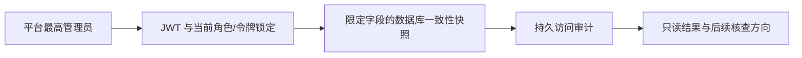

# 个人渗透人工核查：范围、设计与验收

## 对齐与共识

平台最高管理员需要定位无法安全删除或迁移的个人渗透委托及其执行、账务和沙箱关联状态。只提供经鉴权的只读核查，不提供终止、标记排空、结算、退款、删除、恢复执行或开启 staging。历史缺少执行行、未关联预占或沙箱均不能证明不存在费用或任务已终止；管理员意见、租约、状态、TTL 及本地模型响应摘要都不是远端终止证明。

## 架构与接口

对委托的精确 public_id 查询、按代次及活动分页。先核对 JWT，再通过同事务当前锁读账号、角色和 token 版本；返回前强制写入固定动作与委托标识的审计记录并提交，失败关闭。当前授权使用账号再角色的既有锁序，业务数据普通快照读取，不能把该快照视为实时停止证明。每页均重新授权并审计；结果必须标记快照可能落后。

输出限于委托状态和时间、执行代次和状态、父工作线程返回时间、活动类型及状态；预占仅在 user_id 与委托所有者相等且企业归属为空时给出内部 ID 和状态，否则标记关联不可确认；沙箱仅在项目和所有者均一致时显示内部 ID、状态和是否存在本地回执记录，否则标记不可确认。回执存在不代表有效。仅使用内置安全建议，不返回 scope、源码、报告、日志、错误文本、执行 token、request key、供应商凭据或回执原文。

## 原子任务及验收

- [ ] 真实 JWT：最高管理员正向，普通管理员、企业管理员、普通用户、停用和旧令牌均拒绝；MySQL 当前读覆盖撤权先行和访问先行竞争。
- [x] 未登记历史活动标记证据缺失，未知和未关联保持待核查；关联错主或错项目不能泄露其他人的内部记录或状态（隔离 SQLite，真实 JWT）。
- [x] 每次成功读取写入固定审计，注入审计失败必须拒绝响应；查询和审计之外无业务状态变化（隔离 SQLite）。
- [x] 分页、边界、字段白名单和敏感内容排除；不以模型/沙箱/账本状态当作可信终止，也不操作外部服务（隔离 SQLite）。
- [ ] SQLite 和真实 JWT 自动化、独立 MySQL 竞争复验；本地结果、外部协议与生产/浏览器验收分别记录。

本地核查专项与完整路由鉴权矩阵组合 **1567 项通过**；独立 MySQL 并发撤权、真实浏览器和生产验收仍待完成。
