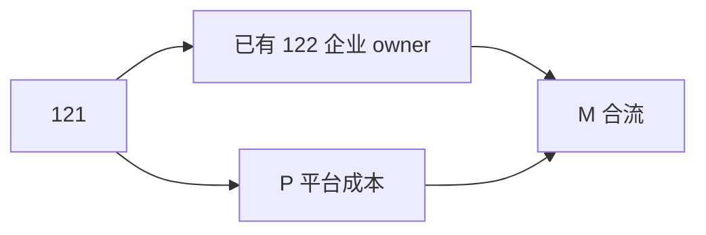

# 平台成本迁移先行与合流：决策草稿

## 状态与前提

仅供方案审查，不代表可以迁移或发布。本次以会话提供的生产基线 `121_billing_model_evidence` 为前提，未访问生产核实。企业 owner 的公开 WIP revision `122_assistant_call_owner` 及其 `down_revision=121_billing_model_evidence` 已有身份，其他数据库是否使用未知；不得改写、改号、复用或重设其父节点。平台功能、企业 owner 功能分别保持默认关闭；平台 test-only metadata 和触发器尚不是正式迁移。

本草稿讨论平台确需先行的备选路线；长期线性路线仍是保留 `121 → 122 → 平台`。当前 122 分支的发布门对 122 无条件拒绝，即使禁用版本镜像指纹匹配；两个路线均不能直接上线。

## 候选图

`P` 和 `M` 是占位名称，不是已分配的 revision，正式 ID 必须与所有已公开 revision 全局唯一、满足当前数据库版本字段长度及命名要求。

先行发布物只包含经审查的 `121 → P` 图，且该发布物自身只有一个 head；不得在同一先行发布物中把 122 和 P 作为两个未合流 head。后续完整代码树保留原 122 与 P，用新的 `M` 将二者合为唯一最终 head。先行只是推迟而非取消 122：到达 M 的路径仍须实施 122，且不得因此开启企业 owner。

现有 `revision_relation` 支持多父 tuple，但并不等于现有部署门已支持该方案；`current_alembic_revision` 将多行视为 `ambiguous`，最终验收要求唯一 current/head。当前平台工作树的部署脚本也没有可直接证明 122 状态的完整门。P 先行的部署和回滚必须都使用独立可信探针，识别已知 122 revision、其三张表/约束/触发器、迁移标记及不明部分结构；未知、读取失败、历史不一致均失败关闭，不能把图中缺少 122 当作数据库从未使用过 122，也不能只在部署前检查而让旧镜像经回滚绕过检查。

## 路径与验收矩阵

| 初始数据库 | 目标 | 处理与必须证明的结果 |
| --- | --- | --- |
| 全新隔离库 | M | 从头完整建库迁移；121、P、原 122 均按依赖执行，最终唯一 M；验证平台与企业开关仍关闭、数据完整、两个兼容门均生效。 |
| 121，122 全部结构和标记均确认不存在 | P 先行 | 仅在平台迁移及发布/回滚兼容性完成验证后执行 P；结果唯一 P，122 不执行、不伪造。先核对旧镜像、运行中和外部 worker 的行为；不是发布授权。 |
| P，122 全部结构和标记均确认不存在 | M | 在隔离演练后执行原 122 和 M；122 表完整、三表为空且企业开关关闭只是必要条件，还要证明旧读写者隔离、镜像兼容和禁止意外激活。 |
| 122，结构完整且 owner 三表为空 | P 或 M | **P 先行发布物必须拒绝**，不可当作 121 或将数据库降级。仅审查通过的合流发布物可评估执行缺失 P 并到 M；同时验证 122 的 reader、外部 worker、标记、保留策略及回滚兼容。 |
| 122，任一 owner 表有数据或无法确认数据状态 | P 或 M | P 先行发布物一律拒绝；当前禁用版 122 读者门也会拒绝有数据的库。M 仅在另行完成数据、活跃执行者及读写协议兼容设计和验收后评估；不得清空 owner 行或以强制标记绕过。 |
| 121/P/122 任一状态，但表、revision、标记或触发器不一致 | 任意目标 | 拒绝发布及自动回滚，保全证据；在隔离副本检查后制订专用前向恢复。revision 为 121 不证明 122 或 P 的 DDL 没有部分生效。 |
| 受控合流期间暂见 P 和 122 两行 | M | 在独占迁移锁持续有效、写者已隔离、迁移进程仍受控运行且进度可验证时，这可能是 Alembic 合流的正常瞬态，并非仅凭两行就能断定失败。现有部署查询仍会将其视为 `ambiguous`；不得对外启动服务或放宽现有门，需要专门设计有界的迁移内监测。 |
| 迁移退出、超时、失锁后仍有多行，或发布终态不是唯一 current | 任意目标 | 停止受影响写者并拒绝发布、自动继续和不兼容回滚；核实迁移日志、表和触发器、标记及备份，再以经审查的前向修复恢复到一致状态。绝不凭单个版本号推测已执行的迁移。 |
| revision unknown、不可读取或出现非预期组合 | 任意目标 | 不能仅按正常合流瞬态处理；停写并失败关闭，核对独占锁、迁移进程、结构和日志后，采用经审查的恢复流程。 |
| 已到 M | M | 检查唯一 current/head、两个完整 schema 及各自发布门；重复部署应保持数据、冻结状态及关闭配置，不重复创建或重放。 |

涉及 122 的实际 reader 或 owner 数据不得仅因有合流图就被视为兼容；数据库外可能存在旧 worker、直接 SQL 写入者、独立脚本或旧部署产物，须先完成清单和可验证隔离。现行 `122` 的禁用版门对 owner 行非空失败关闭，不能通过改门直接将这些数据交给旧代码。

## 中断、恢复与回滚边界

- MySQL DDL 可能先提交部分表、外键或触发器而 Alembic 尚未更新；受控合流也可能暂有两条 version。应在每个 DDL、revision 更新、标记、进程退出、超时和失锁点注入故障，分别验证正常瞬态与异常残留；检查覆盖缺表、残余表、约束/触发器不完整、标记不一致及版本多行。
- P 若在共享的 `agent_response_run` 安装触发器，执行 DDL 前须盘点并隔离所有相关写者，包括其他服务实例、后台恢复线程和外部 SQL 写入者，验证独占迁移锁持续有效；不能只停当前 Backend。必须先在隔离环境演练触发器创建中断、现有表可用性、部分结构门禁及前向恢复，再考虑恢复写入。
- 必须在隔离数据库完成从每个可复现状态的前向修复演练；不得直接执行 `stamp`、删除或清空 owner/账本数据、盲目重建触发器。只有审查确认的修复脚本可处理证据明确的状态。
- 122 的降级实现明确拒绝自动降级；P 和 M 的数据库及应用回滚合同尚未设计。旧镜像能启动不等于能安全读取新状态；需证明精确镜像、数据库结构与数据、相关后台任务及外部写入者的兼容，再制定恢复或前向部署方案。
- 备份验收须包括完整依赖、触发器及其 DEFINER、权限、数据一致性和隔离恢复后的真实业务；六表测试与简单行数对比不证明全库可恢复。不能把事先的备份存在或健康检查当作恢复验收。

## 决策门

P 的真实 revision、正式迁移和合流实现均尚未创建。只有在明确独立发布的必要性、完整读写者清单、数据/权限及兼容合同、半迁移前向恢复、以上矩阵和旧版/回滚测试均完成后，才能决定是否进入实施。否则保持 121，继续在隔离环境验证；不得因为平台需要先行而降低企业、支付或计费安全门。
