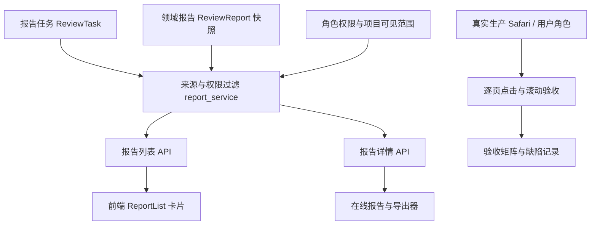
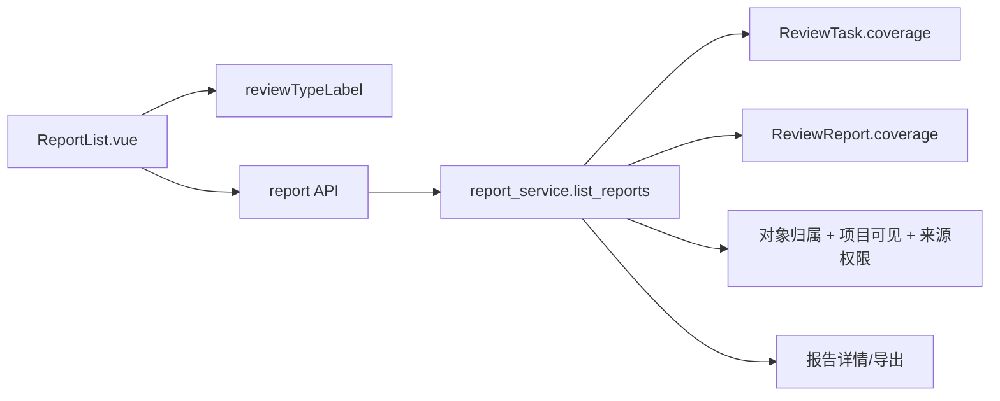

# 全功能生产端到端验收：设计

## 总体流程

## 当前修复设计

- 数据源优先级：`ReviewReport.content_json.coverage.requested_mode`，其次 `ReviewTask.coverage.requested_mode`；兼容 `test_mode` 别名；只接受 `whitebox`、`blackbox`、`combined`。
- 未知、空白、超出允许值的模式不回填，前端继续展示“模式未记录”，不按标题猜模式。
- `source.test_mode` 是列表展示元数据，不改变已有报告内容、状态、权限或模型调用。
- 前端继续复用 `reviewTypeLabel`，避免新建重复映射。
- 沙箱汇总解析识别 `中优先级`、`低优先级` 等严重度分组，但不把分组标题计作发现项；只计入分组里的显式编号发现。`提示`、`提示级`、`待复核`、`未分级` 保持未分级，避免误加到低危。
- Word 领域报告不使用默认大号文档标题样式；长标题居中单段显示为 18pt 宋体，正文 markdown 转换流程不变。
- 报告摘要和文件行统一使用规范化评分；没有有效评分时展示“未评估”/`—`，不遗留旧的报告分数。
- Markdown 清理把字面的三连星脱敏标记替换为可读文本，并清理未配对双星号格式残留；正常代码内容及星号运算符保留。
- JSON、HTML、PDF、Word 导出共享规范化报告数据。远程评估导出复用既有授权检查与持久化报告，不从其他账号取数。

## 依赖与失败处理

- 列表与详情共享已授权报告源；来源快照缺失/不匹配仍由现有后端 fail-closed。
- 生产浏览器发生未登录、权限不足、服务错误或内容不完整，记录为未通过并保留截图/页面证据，不以静态代码推论代替。
- 远程站点测试与代码审查具有不同来源和费用；验收只复用历史数据，不将其互相混作报告类型。
- 官方漏洞源缺少授权接入时，将报告状态标记为“未接入/未知”，不能显示 OWASP 为国内来源匹配。
- 远程评估没有当前账号可读的生产样本时，只记录账号视角的空列表/权限行为。用户明确授权后可提交一次固定 HTTPS 根地址的只读评估申请；平台要求另一具备“渗透测试授权”权限的账号独立审批，批准前不得探测。当前申请 `9f181b3b276446e091a8682dc4ee8215` 等待审批，尚未执行网络请求。

## 模块依赖

## 发布与实测状态

先前报告评分、内容清洗和导出修正已按既有 Linux 发布事务部署，产品版本为 `4.1.10`，已部署基线 SHA 为 `7829b27101712abd381bdd0b8109472b9ff64acc`。本次 T8 新发现及候选修正仍未部署，不能算入上述生产 SHA。报告 #180/#198/#199 的生产详情和四种导出已经实测。远程评估 API 与服务自动化覆盖通过；用户已授权的根地址评估申请正在等待独立审批，线上远程报告和导出仍未实测。其余页面覆盖范围以 ACCEPTANCE 和 TODO 中记录为准。
