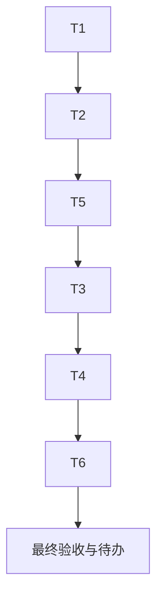

# 全功能生产端到端验收：任务拆分

## T1：修正沙箱报告模式元数据

- 输入：任务覆盖快照、报告快照。
- 输出：报告列表仅在明确时返回受支持的 test_mode；前端按真实模式标注。
- 验收：白盒、黑盒、组合可分别展示；历史无模式仍显示未知；不调用模型，不改变报告权限或正文。
- 状态：已在初始 `4.1.10` 候选实现、部署并由报告列表真实浏览验证；当前补丁不再改动该逻辑。

## T1b：修正沙箱报告汇总计数与 Word 标题

- 输入：生产 #198 白盒、#199 黑盒报告的真实 markdown 和 Word 导出预览。
- 输出：分组标题不计为问题，组内显式编号项计入问题；提示和待复核项不伪装成低危；Word 长标题使用紧凑中文标题样式。
- 验收：针对 #198/#199 的回归用例，报告计数分别为 6（中 2、未分级 4）和 6（高 2、中 2、未分级 2）；新生成 Word 首段居中、18pt、标题文本不截断。
- 状态：代码与定向测试完成，待同版本生产部署后用真实报告再验。

## T2：复核候选质量

- 输入：本次差异及已有单元测试。
- 输出：可部署候选 SHA，差异只包含明确修复和来源准确性。
- 验收：静态差异检查通过；候选服务不在本机做产品验收。已生成并执行回归测试。
- 状态：完成；候选提交 `3711e3115cfa618c351464eab4dbfe6c2c27fe77`，版本保持 `4.1.10`；后端相关回归 203 passed，前端相关测试 64 passed，前端生产构建、Ruff 与 `git diff --check` 均通过。完整后端套件 7431 passed / 6 skipped 是较早结果，不代表此候选全量通过。

## T2b：修复报告评分依据与 Markdown/PDF 可读性

- 输入：生产审查员报告详情、导出文件的真实浏览器与文件观察。
- 输出：失败或覆盖不完整时隐藏无依据评分；清除未配对双星号格式残留且保留合法星号代码；长任务编号可换行；PDF 结尾限制说明与相关证据保持在一起。
- 验收：后端报告相关回归、前端报告/Markdown 回归和前端生产构建通过；生产部署后用同一报告重新验证页面与导出。
- 状态：候选实现与本地自动化验证完成；正式生产部署及生产重导复验未完成。

## T3：生产报告矩阵

- 输入：审查员当前可见的既有报告列表。
- 输出：代码审查、黑盒、白盒/组合、渗透与远程评估的路由/任务/详情/导出记录。
- 验收：逐项确认归属、权限、执行状态、验证范围、报告字段、格式。不存在的报告类型注明“未找到可验样本”，不新建高成本任务。
- 状态：部分完成。已检查审查员可见的代码审查 #180、黑盒 #199、白盒 #198，渗透测试列表和远程评估空列表；没有远程评估可读报告样本。

## T4：生产页面与角色矩阵

- 输入：用户已登录的 Safari 角色会话及当前路由。
- 输出：页面顶部、中段、底部与关键只读交互的可见性记录。
- 验收：普通用户/审查员/管理员的可访问和不可见边界有实际证据；不改变权限配置、不操作删除。
- 状态：已完成审查员视角的报告列表与已抽样详情滚动。超级管理员 Token 用量页此前由用户确认已验证，本轮没有重复登录管理员；小菱自动重启行为未取得独立生产证据，不能记为通过。

## T5：唯一正式发布与复验

- 输入：一个完整候选 SHA，版本 4.1.10。
- 输出：正式部署回执、健康/就绪/版本/SHA、报告列表真实复验。
- 验收：一次发布，无 GitHub 阻断；失败执行发布脚本已有回滚。
- 状态：候选 `3711e3115cfa618c351464eab4dbfe6c2c27fe77` 已提交，产品版本仍为 `4.1.10`；正式部署脚本被数据库凭据强度门禁阻断，且配置缺少 `APP_DOMAIN`。当前 Docker context 是本机 `desktop-linux`，并非已证明的 Linux 生产目标；发布脚本未执行备份、构建、迁移或生产服务切换。GitHub 上传不属于部署前置，也不是本次失败原因。需恢复正确发布主机和合规、匹配的安全配置后，同版本纠正部署并复验。

## T6：验收文档收尾与独立复核

- 输入：真实生产 Safari 观察、候选提交、测试与部署命令回执。
- 输出：ACCEPTANCE、FINAL、TODO 文档。
- 验收：明确区分已验证、未验证、未部署与阻断；另一 Agent 对计数、版本、提交和文档结论独立复核。
- 状态：独立复核已完成，复核方重新运行并确认 203 项后端相关测试、64 项前端测试、前端生产构建、Ruff 与候选 SHA/版本/文档状态一致。Harness validate/postflight 已运行；validate 仍报告一份既有收件箱笔记缺少标题、状态和 tags，并有两项来源/观察时间警告，该无关笔记未在本任务中修改。

## 依赖图

