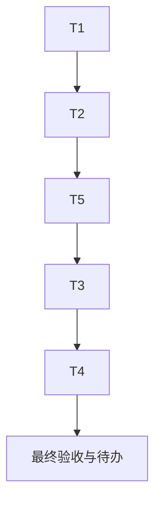

# 全功能生产端到端验收：任务拆分

## T1：修正沙箱报告模式元数据

- 输入：任务覆盖快照、报告快照。
- 输出：报告列表仅在明确时返回受支持的 test_mode；前端按真实模式标注。
- 验收：白盒、黑盒、组合可分别展示；历史无模式仍显示未知；不调用模型，不改变报告权限或正文。
- 状态：已在初始 `4.1.10` 候选实现、部署并由报告列表真实浏览验证；当前补丁不再改动该逻辑。

## T1b：修正沙箱报告汇总计数与 Word 标题

- 输入：生产 #198 白盒、#199 黑盒报告的真实 markdown 和 Word 导出预览。
- 输出：分组标题不计为问题，组内显式编号项计入问题；提示和待复核项不伪装成低危；Word 长标题使用紧凑中文标题样式。
- 验收：针对 #198/#199 的回归用例，报告计数分别为 6（中 2、未分级 4）和 6（高 2、中 2、未分级 2）；新生成 Word 首段居中、18pt、标题文本不截断。
- 状态：代码与定向测试完成，待同版本生产部署后用真实报告再验。

## T2：复核候选质量

- 输入：本次差异及已有单元测试。
- 输出：可部署候选 SHA，差异只包含明确修复和来源准确性。
- 验收：静态差异检查通过；候选服务不在本机做产品验收。已生成回归测试，运行与否服从用户生产端验收限制。
- 状态：已执行；本轮聚焦测试 40 项通过，Ruff 与差异检查待最终复跑；较早的完整后端套件 7431 项通过、6 项跳过，发生在本轮 Word 标题改动前。

## T3：生产报告矩阵

- 输入：审查员当前可见的既有报告列表。
- 输出：代码审查、黑盒、白盒/组合、渗透与远程评估的路由/任务/详情/导出记录。
- 验收：逐项确认归属、权限、执行状态、验证范围、报告字段、格式。不存在的报告类型注明“未找到可验样本”，不新建高成本任务。
- 状态：部分完成。已检查审查员可见的代码审查 #180、黑盒 #199、白盒 #198，渗透测试列表和远程评估空列表；没有远程评估可读报告样本。

## T4：生产页面与角色矩阵

- 输入：用户已登录的 Safari 角色会话及当前路由。
- 输出：页面顶部、中段、底部与关键只读交互的可见性记录。
- 验收：普通用户/审查员/管理员的可访问和不可见边界有实际证据；不改变权限配置、不操作删除。
- 状态：已完成审查员视角的报告列表与已抽样详情滚动。超级管理员 Token 用量页此前由用户确认已验证，本轮没有重复登录管理员；小菱自动重启行为未取得独立生产证据，不能记为通过。

## T5：唯一正式发布与复验

- 输入：一个完整候选 SHA，版本 4.1.10。
- 输出：正式部署回执、健康/就绪/版本/SHA、报告列表真实复验。
- 验收：一次发布，无 GitHub 阻断；失败执行发布脚本已有回滚。
- 状态：首个候选 `54507b241b847e9902f5381cddc2afaf2188fb5` 已部署为 `4.1.10`，真实浏览器发现 T1b 缺陷；T1b 合并后同版本号进行一次纠正部署，然后必须复验。

## 依赖图

