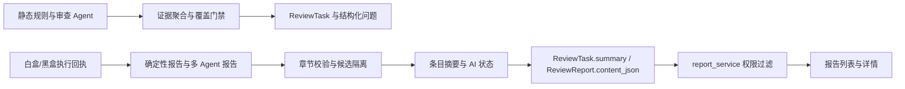

# 设计：审查与黑白盒报告可信度

## 架构与数据流

## 关键规则

1. 报告章节识别只接受真实 Markdown H2，忽略围栏内伪标题；问题清单统计只读取问题清单区。
2. 未核实模型发现统一放入“AI 候选发现（未核实）”；已确认问题统计以规范化的“问题清单”区为准。
3. AI 报告需通过必需章节、Agent 角色清单与执行完成校验；失败时以执行回执生成确定性报告，并写入 `ai_review.status=incomplete` 和安全的失败原因。
4. 执行状态/覆盖与 AI 报告生成状态分开呈现；权限检查仍在服务端先行。

## 异常处理

模型失败或输出被截断：发布确定性报告并标注 AI 未完成。执行租约在报告阶段失效：保持执行器结论，尝试发布确定性报告。报告数据库写入失败：返回 `report_persisted=false` 与稳定错误码，事件中记录，不把任务报告状态伪装为成功。
