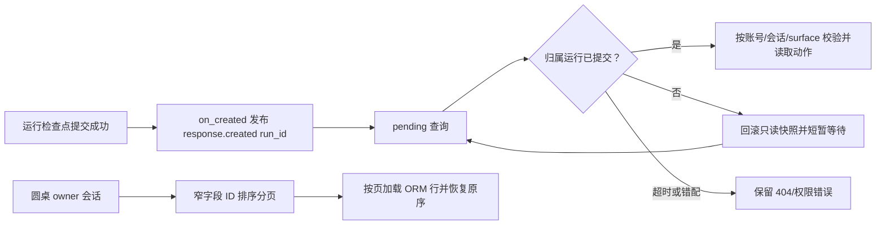

# 设计：小菱运行恢复与星图布局

## 数据流

## 组件

- `DeepSeekResponsesRuntime.start` → `AgentResponsesService.start` → SSE API：检查点提交后通过私有回调发布创建事件；早于模型执行，创建失败不发布。

- `agent_browser_service.pending_actions`：对“运行刚创建”短暂缺失做有界重读；不更改动作状态机或授权策略。
- `discussion.list_discussions`：第一阶段仅选择排序所需 ID，第二阶段加载当前页详情并恢复排序。
- `AgentChatDrawer`：保留可调节尺寸，采用顶部有界星图区和下方独立消息滚动区；不再在团队数据变化时把用户强制滚到底部。

## 异常策略

- 数据库和权限异常继续由现有 FastAPI 错误处理器映射。
- 重试窗口耗尽返回原始 NotFound；已存在但绑定不匹配的运行不被重试伪装。
- UI 空间不足时星图区内部滚动，聊天历史仍可独立滚动；小视口通过现有移动端布局约束尺寸。

## 结论与进度契约

团队终态回执只恢复同账号、同会话、同入口团队进度并确认消费；汇总失败保留真实错误卡。读写快照统一过滤旧版 teamFallback / team-terminal 自动答复。两端团队面板只显示执行进度，小菱 Responses 才能产生聊天结论。
