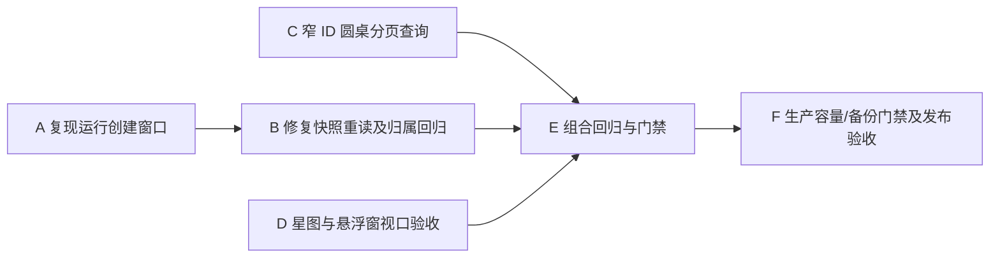

# 任务：小菱运行恢复与星图布局

## 任务依赖

## 原子任务

| 编号 | 输入 | 输出与验收 |
|---|---|---|
| A/B | 当前 `response.created` 与检查点异步持久化链路 | 有界重读重置快照；固定请求令牌版本；覆盖成功重试、未知/错配 404、账号隔离、终态和权限撤销 |
| C | 当前圆桌 owner/status/更新时间排序语义 | ID-only 第一阶段、页详情第二阶段、稳定顺序恢复；分页与隔离测试通过 |
| D | AgentChatDrawer 当前组件与 CSS | 星图不在底部、不强制滚动；尺寸与滚动视口测试覆盖桌面/窄屏/低高度 |
| E | 本任务源码与既有未提交修改 | 定向、类型、lint、build 与发布门禁结果可复现 |
| F | 干净候选完整 SHA 和当前生产状态 | 备份、隔离恢复、容量检查、正式部署及生产冒烟；任一门禁失败则停止发布 |

| G | 用户端、管理端团队回执与快照 | 去掉成员结论合成；过滤旧快照；团队面板仅保留状态与任务；由小菱汇总 |

## 追加：创建通知顺序

运行内核在检查点提交成功后通知 API 发布 `response.created`。保持非 start 动作引用既有运行的协议兼容；定向覆盖延迟提交、事件顺序、API 流与断开后继续执行。

## 追加任务

1. 后端内部定时释放过期运行缓存，并为沙箱测试缓存设置容量上限。
2. 实现可配置报告保留期，处理普通审查、圆桌与渗透报告的关联生命周期。
3. 发布前执行有限定向边界检查；发布后核对维护启动日志、配置值和候选清理计数。
