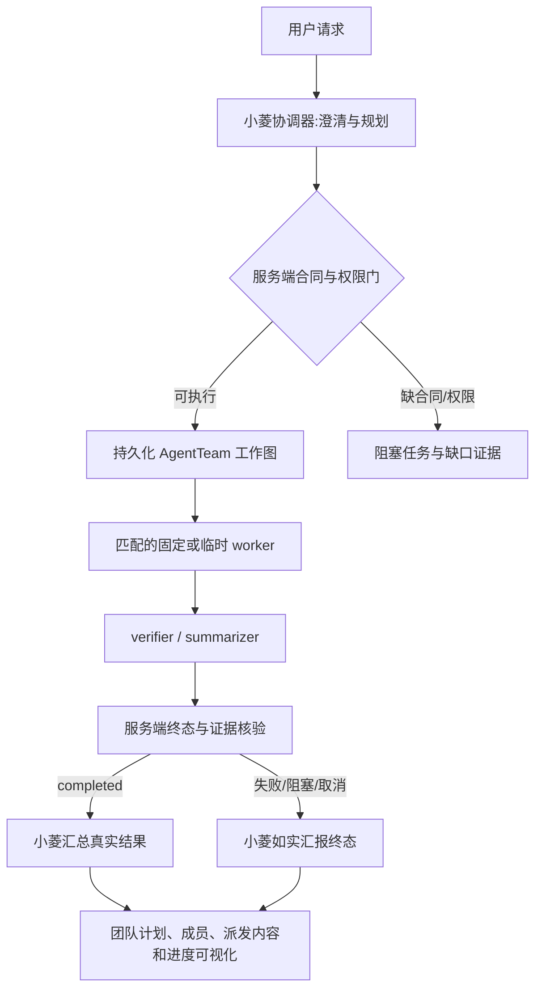

# 小菱全任务团队执行设计

## 分层方案

## 核心组件

- **Responses 工具执行器**：协调者模式只暴露团队规划、发现、状态、取消、重试和必要澄清控制；服务端拒绝直调任何业务 API、Skill、MCP 或项目工具。
- **能力目录**：`list_agents` 提供成员能力和 `team_input_contract`。普通文本任务使用 `task_worker`；页面只读使用固定能力目录、RBAC 和真实 FastAPI 路由；领域业务复用专用执行 Agent。目录无合同则建立阻塞节点，不构造任意 URL/命令。
- **AgentTeam DAG**：沿用当前用户、surface、session、root run 和租约隔离；所有成员输入和完整派发指令持久化。终态必须检查 worker、verifier/summarizer、依赖结果、错误与证据。
- **异步完成**：初始执行回合可以提交团队并返回确定性“已派发”状态；团队终态回执只允许关联原团队的会话新回合读取并汇总。不能因回执自动续跑旧圆桌或重新派发业务任务。
- **前端轨迹**：沿用 `AgentTeamTrace` 展开组件，真实展示团队目标、成员身份/角色/固定或临时类别、任务 instructions、依赖和节点状态；当前新建团队自动展开，历史团队保留折叠习惯。
- **常用临时成员**：统计已完成任务中的临时 Agent 合同指纹与重复复用情况，达到审慎阈值时仅生成治理候选；保留发布依赖已有 Agent Release 审批与权限，不创建并行发布机制。

## 完成门禁

Completion guard 必须绑定当前账户、surface、session 与当前人类根任务；自动 `task.result` 回合通过其持久消息关联回原 team_id。普通人类请求未创建真实 worker 任务时不能完成。团队进行中时只可返回固定派发状态；团队完成时必须复核所有必要任务状态、依赖与结构化 result_json；存在 failed/blocked/cancelled、空结果、缺 verifier 或归因不符均不得输出完成结论。使用服务器确定性处理避免让模型在“仍在运行”的情况下反复试生成，减少无效 token 消耗。

## 异常处理

- 工具计划不合法、成员不存在或能力参数不符合注册表：拒绝创建或持久化 blocked 项，并展示具体合同缺口。
- Worker 租约失效/父任务人工停止：禁止写回与自动恢复；系统异常中断则只按现有恢复策略恢复同一任务。
- 任务执行失败：团队标记失败，保留真实部分结果；新一轮重试必须改变策略并保持同一数据范围。
- 运行时门禁异常：失败关闭，不向小菱开放业务工具回退。
- 减少动态效果遵从 `prefers-reduced-motion`，团队内容文本转义，窄屏可横向浏览依赖图且键盘可访问。
