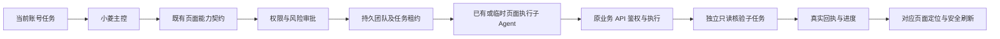

# 小菱全站混合执行与团队设计

受控执行输入：operation=execute_capability、scope=user/admin、capability 固定编码、params 按 OpenAPI。核验输入 operation=verify_results，只能读取本团队依赖任务已落账的结果，不能把核验变成写入。

界面事件 page_action 由服务端能力注册表生成，包含 page、capability、phase、mutation、result_route 与账号归属。submitted/pending 不触发完成刷新；completed 且 mutation 才通知已授权页面刷新。未知目标不猜测当前页面的第一个按钮；有未保存输入时延后刷新。

异常：路由拒绝保留真实HTTP类别；未知结果暂停写入重试；202/queued 返回未完成；不能把状态为创建团队当作业务完成。

## 浏览器桥与页面层级

新增当前会话内 `operate_current_page`；动作仅 inspect/navigate/scroll/click/fill/select/check。客户端先提交当前可见业务控件观察，服务端生成最新快照绑定的句柄，后续动作不能提供任意选择器、脚本或外部 URL。UI 认领 CAS 保证同账号多标签页只有一次执行；认领后失联记为 indeterminate，不重新排队。当前账号停用、令牌版本变化或运行结束立即停止。秘密字段不读值，文件选择需要本人。

`response.browser.required` 只由服务端动作桥签发，模型上游同名事件过滤；执行 nonce 和 claim_token 不进入模型或持久明文。动作账本使用 Alembic 063，新建账号/会话/运行与幂等请求索引；长文本 JSON 使用 MySQL LONGTEXT。客户端观察标为 client_observed，server_verified=false；完成 guard 明确拒绝以此声称业务写入成功。

层级分为页面、侧栏/页头、引导、聊天、团队、圆桌菜单、模态弹窗和弹窗内部下拉。菜单脱离玻璃页头 stacking context 传送 body，固定坐标参照触发按钮并限界视口。指针使用 pointer-events:none，仅在真实目标存在且可命中时显示，根据目标所在弹层同步更新层级；不为未知目标猜按钮，也不穿透遮罩。详细数值及全站扫描见 FRONTEND_LAYER_AUDIT.md。

## v101 的结果与传输契约

页面指令从服务端sink进入内部队列时保留HMAC；encode对外发送前再次验证并移除签名。上游伪造事件仍拒绝，不能用客户端“可信”标记替代验签。页面状态failed/cancelled/indeterminate/user_required或completed=false返回工具错误，历史包装success只在公开读取时纠正，原账本保持不变。

团队结果的公开事件可以是预览，任务结果和最终摘要是业务交付来源。较小的持久结果完整脱敏后投影；超出上下文预算时返回结构摘要、字段/数量、摘要来源哈希及原任务引用。团队最终摘要引用对应的核验原任务，摘要对象的哈希不冒充该任务原文的哈希。`get_agent_team(team_id,task_id,result_path,offset,limit)` 只读取同账号、指定团队已有任务的JSON Pointer路径，不读取文件、不执行脚本；先完整按敏感键脱敏，再取子路径。集合页最多20项，大条目带自己的引用；字符串页最多2000字符。未知路径、他人团队及非法分页均拒绝。默认团队任务结果预算按节点数分配，不能通过提高深度限制把无界原文一次塞入模型。

GET核验使用相同查询/筛选/排序/分页，比较实际items和分页元信息；快照变化返回blocked并要求重新读取。reporter区分执行回执、相同查询读回和相同目标读回，业务data与审查findings分别保留。论坛最新查询显式使用sort=newest，以创建时间和id倒序稳定排序；默认页面置顶排序保持。

官方DeepSeek请求适配只作用于其精确官方host：自主调用省略冗余auto并保留思考，required/none/指定工具保持约束，只在当前请求设置reasoning.effort=none。全局配置不变，其他供应商请求不套用此适配。

### 长字段名与状态查询合同补充

结果结构摘要自身按UTF-8计入硬预算，最小1024字节；预览和字段名只保留能装入预算的元数据，完整脱敏原值不改。原任务JSON Pointer保持；服务端分页遇长字典键返回entries与result_indices（字典键序/数组下标，最多32层）引用，result_part=key可分页恢复完整字段名；不接受同时路径/索引，不读取任意对象或文件。每页最多20子项、每子项1024字节投影，原字符串每页2000字符，秘密键先脱敏再定位。

团队列表只投影元数据和按team/status分组COUNT；详情仍返回有界任务结果与审计时间线。稳定终态缓存只能在已成功读取、status与updated_at均一致时复用；活动/未知/失败/版本变化/显式打开继续读取。历史与Mesh状态只查必要运行元数据，不把checkpoint当作状态列加载。

## v4.0.102 真实业务续接修订

原始推理状态仅来自供应商实际 SSE 推理分片或完整终帧，采集器按内容索引去重、完整终帧优先，不生成替代推理，不公开推理正文。请求级兼容必须作用于实际发送的 input：先恢复同凭据历史，再生成有来源的上下文投影，最后核验该投影的推理续接条件。强制工具轮及缺推理的旧历史/压缩投影只对当前官方 DeepSeek 请求采用非思考模式，保留输入、工具和精确选择约束；完整历史和新对话继续遵循调用方配置。完整账本保留，不把摘要说成已核验原文或用户授权。

父页面任务的“已提交”与真实业务完成分开。完成宣称由原提交持久账本绑定的同账号、同端、同会话原团队核验：固定执行/核验节点、精确JSON参数类型、业务执行账本、服务器回执和适用的同查询/同目标读回须一致。当前轮次不能借旧轮次提交证明新的写入；公共模型投影、浏览器观察和单一team.status不足以解除等待。原提交的pending历史不回写为completed。

论坛default为置顶优先，newest严格按create_time/id倒序。服务器仅为可见真实帖子返回detail_route，列表和详情Schema保持字段，前端使用该路由；排序控件实际发相应query并复位第一页，保留筛选与迟到响应隔离。自然答复使用可核验结果和实际页面链接，技术内部编号仅在用户明确需要证据时展示。
