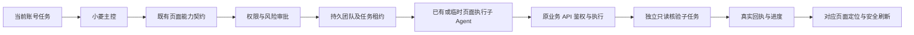

# 小菱全站混合执行与团队设计

受控执行输入：operation=execute_capability、scope=user/admin、capability 固定编码、params 按 OpenAPI。核验输入 operation=verify_results，只能读取本团队依赖任务已落账的结果，不能把核验变成写入。

界面事件 page_action 由服务端能力注册表生成，包含 page、capability、phase、mutation、result_route 与账号归属。submitted/pending 不触发完成刷新；completed 且 mutation 才通知已授权页面刷新。未知目标不猜测当前页面的第一个按钮；有未保存输入时延后刷新。

异常：路由拒绝保留真实HTTP类别；未知结果暂停写入重试；202/queued 返回未完成；不能把状态为创建团队当作业务完成。

## 浏览器桥与页面层级

新增当前会话内 `operate_current_page`；动作仅 inspect/navigate/scroll/click/fill/select/check。客户端先提交当前可见业务控件观察，服务端生成最新快照绑定的句柄，后续动作不能提供任意选择器、脚本或外部 URL。UI 认领 CAS 保证同账号多标签页只有一次执行；认领后失联记为 indeterminate，不重新排队。当前账号停用、令牌版本变化或运行结束立即停止。秘密字段不读值，文件选择需要本人。

`response.browser.required` 只由服务端动作桥签发，模型上游同名事件过滤；执行 nonce 和 claim_token 不进入模型或持久明文。动作账本使用 Alembic 063，新建账号/会话/运行与幂等请求索引；长文本 JSON 使用 MySQL LONGTEXT。客户端观察标为 client_observed，server_verified=false；完成 guard 明确拒绝以此声称业务写入成功。

层级分为页面、侧栏/页头、引导、聊天、团队、圆桌菜单、模态弹窗和弹窗内部下拉。菜单脱离玻璃页头 stacking context 传送 body，固定坐标参照触发按钮并限界视口。指针使用 pointer-events:none，仅在真实目标存在且可命中时显示，根据目标所在弹层同步更新层级；不为未知目标猜按钮，也不穿透遮罩。详细数值及全站扫描见 FRONTEND_LAYER_AUDIT.md。
