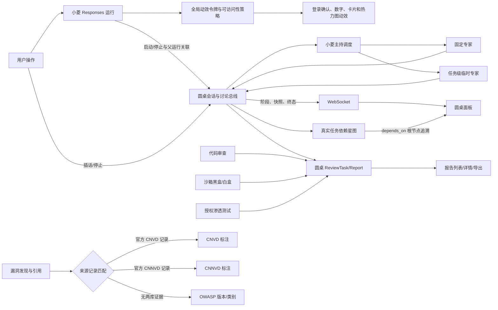
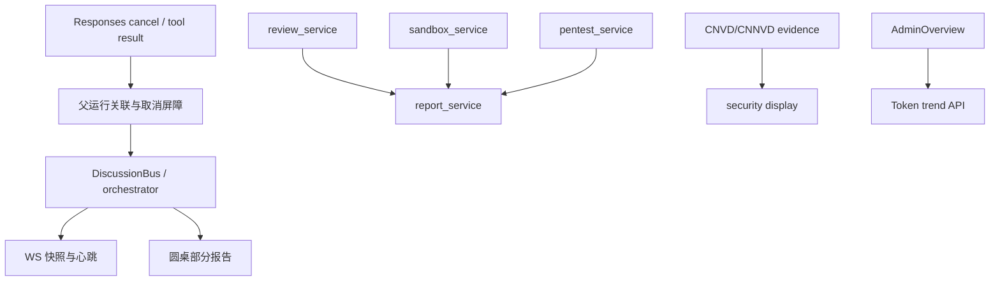

# 设计：小菱圆桌、报告闭环与漏洞来源优先级

## 整体架构

## 分层与组件

- **交互层**：小菱面板发送停止/插话；圆桌面板显示阶段、轮次、主持状态、参与者与报告结果；管理员总览继续使用现有每日 Token 图。
- **动效层**：优先复用全局运动令牌、`useCountUp` 和实际团队依赖；数字、节点、卡片、热力格变化均支持减少动态效果回退，不影响语义和响应式文档流。
- **编排层**：Responses 父运行保存圆桌/团队关联；DiscussionBus 保存活动状态和终态；小菱主持专家调度、插话优先处理和任务级临时专家。
- **审查层**：普通审查、圆桌、沙箱、渗透测试仍调用现有分析器；部分发现与覆盖证据进入统一收尾。
- **报告层**：现有 ReviewTask/ReviewReport 与报告服务承载完整、部分、失败、取消、未执行状态及覆盖范围；所有可读和导出入口按相同 task 归属校验。
- **来源层**：结构化 CNVD/CNNVD 官方记录证据优先；无匹配时才展示 OWASP 分类与版本。平台整理关系必须明确标为非官方，不作为 CNVD/CNNVD 匹配证据。

## 模块依赖

## 接口与数据契约

- 停止与父运行：父级 `run_id`、surface、session key 和 owner 必须一起用于定位可取消的子作业；取消后须以单调终态阻止迟到事件、队列回执或自动续会覆盖。
- 圆桌状态快照：至少包括 `status`、`terminal_status`、`round`、`total_rounds`、`speaker`、`phase`、`updated_at`、`report_task_id`；订阅/重连先发送快照，再回放后续事件。
- 圆桌主持/成员：主持人使用“小菱”身份与单一责任；固定专家来自现有 profile 配置；临时成员有临时来源标记、任务归属和清理边界，禁止写入永久 Agent 库。
- 报告：读取响应必须包括真实 task status、coverage、failure/stop reason、未执行/排除项和证据引用。报告 `success` 仅用于达到完整成功条件；可达的失败/取消/部分终态仍发布可读报告。
- 分类：每个 CNVD/CNNVD 条目标注 source、原始官方记录 ID/URL、来源时间/版本（若真实提供）、核验态；OWASP fallback 标注 OWASP 版本和类别。缺少官方记录不得静态伪匹配。
- Token：管理员每日图表保留 UTC 日聚合和已记录/未知用量区分；不改动现有 API 契约，除非测试确认现契约有缺陷。
- 星图：顶点来源为真实团队/成员/任务；有向边只来源于 `depends_on` 或明确的因果记录。点击节点沿依赖链高亮其根节点与父路径；没有可验证关系时显示孤立节点或空态。
- 用量热力图：复用已核实的每日 Token 序列，未知与零分开；颜色强度只表达真实计数区间，逐日波浪显现可被减少动态效果设置关闭。
- 卡片展开与重排：使用 Grid/Flex 正常布局与 Vue transition，卡片高度变化由布局引擎带动邻卡让位，不改变数据顺序或省略内容。
- 登录成功反馈：认证成功后展示短暂收束与节点对勾动画，再按现有角色路由跳转；减少动态效果时快速结束，登录失败路径不变。

## 异常策略

- 用户取消优先级高于自动收尾、tool retry 和续会；取消任务可产生取消报告，但不能继续消耗模型或标成成功。
- WebSocket 中断不自动取消已启动的后端任务；客户端重连查询快照。普通 REST pending 尚未启动的会话须显示“等待连接”，不得伪报运行；如设计了过期清理则显式终结。
- 分析部分完成时保留有效发现，同时报告已完成/未完成范围和错误；没有任何有效分析仍应产生状态报告，标注“未执行/无有效结果”。
- 报告持久化失败需记录并返回失败态，不能发出报告成功事件。
- 官方 CNVD/CNNVD 来源不可用时保留 OWASP 结果和明确的来源可用性信息，不将其他来源伪装为中国漏洞库命中。
