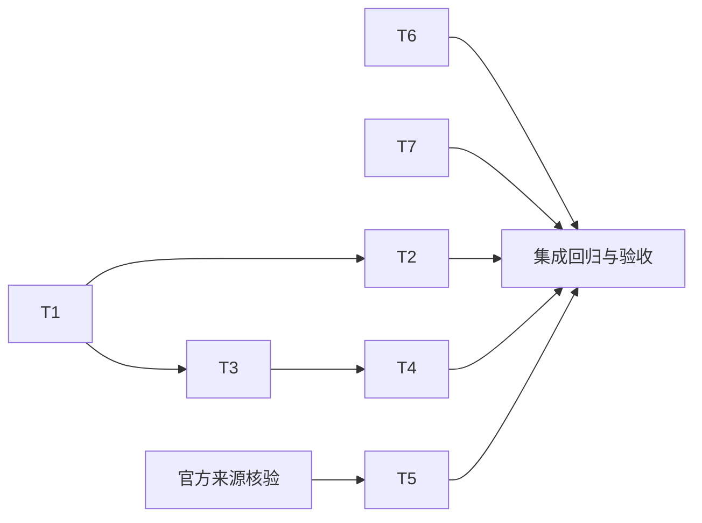

# 任务：小菱圆桌、报告闭环与漏洞来源优先级

## 任务列表

### T1：停止与续会屏障

- 输入：父 Responses 运行、owner、surface/session 以及已启动的 DiscussionBus/AgentTeam 关联。
- 输出：取消响应时同归属的圆桌与派生团队取消；取消终态不可被迟到结果覆盖；用户后续明确要求继续时创建独立续会。
- 验收：父运行取消、报告回投、自动评价和重复 stop 的组合测试通过；跨用户/跨 session 不受影响。
- 依赖：无。

### T2：小菱主持、插话和实时状态

- 输入：现有固定 profile、任务范围、用户插话及 WS 连接。
- 输出：小菱主持和优先处理用户指示；固定专家参与；任务需要的临时专家留在当前任务；阶段心跳与可恢复快照。
- 验收：插话会进入主持优先调度；重连能恢复真实轮次/发言人；前端明确区分 success/partial/failed/cancelled；临时成员不入永久库。
- 依赖：T1 的终态契约。

### T3：代码审查报告闭环

- 输入：ReviewTask 的结果、coverage、issues 与错误/取消原因。
- 输出：成功、部分、失败、取消均有可读报告记录；报告和导出体现未扫描范围。
- 验收：报告列表、详情和受支持格式导出对所有终态一致，异常不丢失覆盖事实。
- 依赖：统一报告契约。

### T4：沙箱与渗透报告闭环

- 输入：沙箱黑盒/白盒结果与浏览器证据、渗透阶段/探测线结果。
- 输出：失败、停止、超时、部分阶段完成均发布可读报告；不把未执行部分写成通过。
- 验收：异常收尾与报告中心持久化失败有定向测试；失败/取消/跳过线列入报告。
- 依赖：T3 报告契约。

### T5：漏洞来源优先级

- 输入：现有 Finding 引用与可核实官方来源标识。
- 输出：CNVD/CNNVD 有原始记录证据时分别优先标注；无证据时标为 OWASP fallback。
- 验收：无证据时不匹配、不生成虚假 ID；来源与版本在 UI/报告中明确，旧 CNNVD 平台映射声明被纠正。
- 依赖：官方来源审计。

### T6：管理员每日 Token 图表回归

- 输入：既有 AdminOverview、Token 用量 API 与现有测试。
- 输出：保留每日图表、周期切换、未知用量、错误/空态和可访问性语义。
- 验收：当前组件/API 测试通过；除非找到明确缺陷不重复造图。
- 依赖：无。

### T7：全局交互动效与 Token 热力可视化

- 输入：现有运动令牌、`useCountUp`、登录页、管理员每日 Token 数据和 Agent 团队真实任务依赖。
- 输出：登录成功光球/对勾、数字滚动、Token 热力波浪、真实任务星图与根路径溯源、卡片原位展开及布局让位。
- 验收：登录成功/失败路径测试；数字复用 composable；星图只绘制 `depends_on` 真实边并可交互追溯；热力格保留 0 与未知区分；减少动态效果下快速静止；布局支持窄屏与键盘交互。
- 依赖：T6 的现有用量数据、T2 的真实任务关系。

## 执行状态

- T1：已完成并通过定向测试。父运行取消会收敛同归属 AgentTeam 与 DiscussionBus 圆桌；取消后自动结果回投不能续会。只有同一用户/会话的后续明确继续输入才会创建新会话。
- T2：部分完成。WebSocket 进度心跳与重连快照已覆盖；真实小菱模型主持和按任务创建临时专家尚未实现，固定专家配置保持不变。
- T3/T4：已实现可达的失败、取消、超时和部分覆盖报告；审查专用执行器没有独立 stopped/expired 状态转换入口。Sandbox/Pentest 继续遵循现有 JSON 导出契约，不支持的格式会明确拒绝。
- T5：界面按 CNVD、CNNVD 分别标明官方来源证据要求，并将无官方记录证据项标为 OWASP fallback。当前接口未提供 CNVD/CNNVD 原始记录标识或详情链接，未实现实时官方数据同步。
- T6/T7：管理员 Token 日历热力格、真实 0/未知区分、渐进波浪动画、计数动画、登录成功光球与对勾、真实依赖星图根路径追溯和文档流展开已实现并通过目标测试。
- 整体验收：本地目标测试、生产构建、类型检查、ESLint 与布局 E2E 通过；受影响后端回归 696/696 通过。候选部署、备份恢复、运行镜像与真实浏览器验收待发布后记录。

## 依赖图

## 执行约束

- 先添加可复现失败用例，再修改实现。
- 多模块仅在边界清晰时并行；修改共享文件前须检查当前 diff。
- 不清理原仓库或服务器中其他未提交变更；生产写入仅限用户授权的完整发布事务和其自动备份/迁移步骤，不做业务数据修改。
