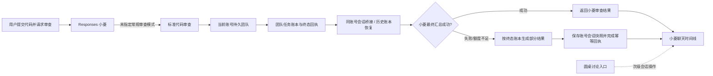

# 小菱自动审查与圆桌层级设计

## 目标

用户提交代码并请求常规审查后，系统默认采用标准模式，自动调度审查团队并在原小菱会话回传结果。圆桌讨论保留为会话内的次级工具。模型汇总不可用时，仍自动展示可验证的团队账本摘要，并明确标记尚未完成小菱终审。

## 架构

## 模块职责

- `agent_responses_service.py`：为未指定模式的常规代码审查提供标准模式规则；安全审计模式选择及审批门保持原样。
- `temporary_agent_runtime.py`：按可信来源约束证据位置；只接受团队服务写入且与当前任务、租约、尝试次数相符的自动重试提示；返回可定位的结构化失败类别。
- `agent_team_service.py`：清除调用方伪造的内部团队执行元数据。
- `agentTeamFallback.ts`：只从同账号、同入口、同会话的终态团队数据生成明确标注的部分结果；失败 run 通过其 Mesh 消息 ID 或同 run 的团队创建完成事件关联终态回执；任务失败不升级为通过。
- `AgentChatDrawer.vue`、`AdminCopilot.vue`：实时回执路径在汇总失败时显示并保存部分结果、幂等完成回执；历史恢复路径从服务端 run、团队创建事件和 Mesh 账本重建未持久化到本地的部分结果，不重跑模型或再次确认已完成回执。
- `GlobalDiscussionHost.vue`：复用全局圆桌能力，将标题、图标、计数和按钮样式降为小菱会话中的次级操作。

## 数据和异常处理

- 结果绑定 `team_id + surface + session_id + message_id`，并要求关联到当前失败 run；校验不匹配或团队未到终态时不生成替代答复。
- 自动整理摘要说明上游失败类别、完成与失败任务数、子 Agent 发现及未核验状态；超出摘要上限的内容仍保留于团队详情。
- 402 等模型服务失败不被当作审查通过或漏洞结果；失败子任务仍逐项标明。
- 团队结果和原消息仍受既有账号隔离、工具权限、租约和审批约束。

## 验收边界

单元/组件/集成测试验证自动路由提示、证据契约、元数据边界、自动回执和结果恢复；浏览器真实点击及发布后生产行为需单独记录，不能由本地构建替代。
