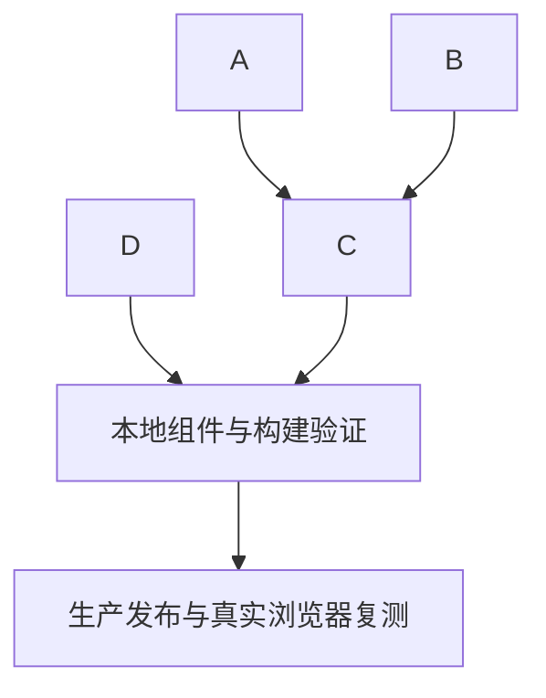

# 小菱自动审查与圆桌层级任务拆分

## 原子任务

### A. 默认审查流程

- 输入：用户在小菱会话提交源码并请求常规代码审查，未给模式。
- 输出：默认标准审查指引，不因模式选择暂停；安全审计缺少必要扫描范围时仍按现有确认规则处理。
- 验收：Responses 指令测试确认标准默认值和安全审计确认门没有被放宽。

### B. 子 Agent 证据与重试

- 输入：团队生成的源码文件、代码片段或依赖分析结果。
- 输出：符合来源坐标规则的结构化发现；可信自动重试将固定纠偏提示送入有效上下文。
- 验收：真实文件仍要求真实文件/行号；片段不要求虚构坐标；调用方不能注入内部执行策略。

### C. 终态结果自动回传

- 输入：同账号、同会话团队终态回执；Responses 最终汇总成功或失败。
- 输出：成功时展示模型结果；失败时自动展示团队账本部分结果、保存快照并完成回执。
- 验收：用户端和管理员端均检查 402/额度失败路径、身份边界、重复回执、失败子任务和恢复顺序。

### D. 圆桌按钮层级

- 输入：全局圆桌面板槽位及现有主题令牌。
- 输出：保留圆桌功能，但采用小菱会话内的低强调次级样式和独立 popover 层级。
- 验收：组件测试、构建通过；桌面与手机真实页面的视觉层级仍需发布后复核。

## 依赖关系

## 执行约束

- 不触碰数据库、正式项目源码或生产业务数据作为测试夹具。
- 不以测试模型生成内容冒充生产模型结果。
- 不静默吞掉 402、团队失败、受阻节点或模型终审缺失。
- 任何高风险页面操作和文件写入继续走既有审批流程。
