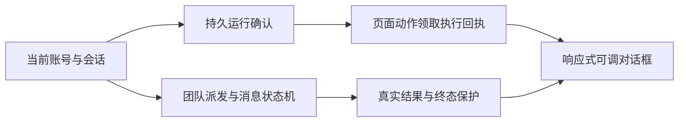

# 小菱运行与布局修复设计

沿用持久化Responses、AgentMesh状态机、页面桥和浮窗定位。读取运行必须确认归属与持久化；回执锁定后读取当前状态并保护终态；路由发现与实际Router/RBAC一致；浮窗尺寸受视口约束，内容容器按可用宽高布局。

异常：不存在与未持久化区分，权限拒绝不隐藏；可恢复网络失败续接同运行，人工停止不恢复。

## 执行与异常契约

- 团队任务由团队执行器管理租约。独立Mesh调度器的候选、认领、租约回收和到期处理统一排除团队归属及历史团队ID；单请求回执与终态同事务提交。
- 业务运行结果与投递回执分离：业务终态落库后，回执失败只回滚并重试回执；周期补偿包含取消态，不能重新调用模型。
- 页面桥在恢复pending动作前通过既有会话查询确认当前账号、surface、session和run。账号、token、会话、运行和停止意图变更使旧异步响应失效；后端仍独立检查动作归属和路由权限。
- 导航从登记路由与权限解析；同名业务入口优先，明确管理目标不会悄悄替换为其它页面。实际跳转后核对目标才记录成功。
- 确定性本地导航记录与Responses运行记录分开，按账号、surface、会话保存和恢复，不将未创建服务端运行的本地动作解释成发送失败，也不将本地记录当作服务端业务成功凭据。
- `get_agent_team`复用原分页服务，新增`result_scope=team_summary/team_error`，默认`task`兼容。引用必须可到达完整脱敏原值，禁止自引用回到同一截断摘要。

## 布局契约

沿用浮窗位置组合函数，增加八方向缩放、键盘16像素步长及Shift加速；缩放尺寸、位置均限制在视口。共享样式以面板宽高作为响应式条件，标题、会话入口、进度、正文和输入操作各自保有空间。聊天内禁用动画与过渡，保留菱形形象和真实进度；过程默认折叠不删除审计数据。

## 生产复验后的补充契约

页面桥由正式 `site_operator` 成员接入。团队创建时必须绑定已落库的父运行，账号、会话和界面一致；动作领取、等待和回执均复核团队租约与停止意图。客户端观察只说明页面实际呈现，业务写入仍须独立业务接口读回。协调器继续只负责编排。

本地导航结果恢复须等待当前账号资料就绪，并保留已结算动作标识；真实未送达提问仍提供重试。导航匹配覆盖正式菜单名称，明确管理目标继续校验管理权限。新建会话清理旧运行过程和恢复状态。
