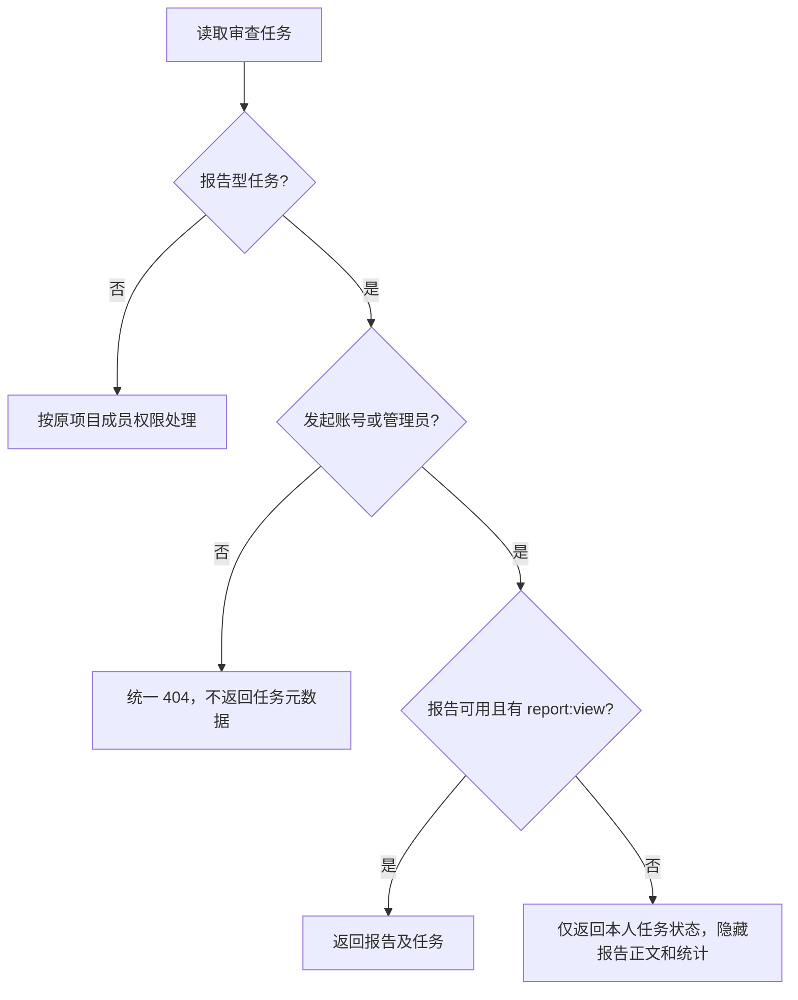

# 报告任务账号隔离设计

## 访问流程

## 模块与接口

- `review_service` 提供同一元数据可见策略和 SQL 过滤条件，供审查列表、详情读取使用。
- `project_service` 复用 SQL 过滤条件，让项目列表的最近审查摘要和项目近期任务不会泄漏他人报告型任务。
- 现有报告内容授权继续由 `report_service` 控制；此设计不扩大 report:view 权限。

## 异常处理

- 缺失、已删除、无项目权限或无报告型任务所有权均使用统一 404。
- 数据库或权限服务异常沿用现有错误处理，不降级为可见或空统计。

## 测试面

真实 JWT + SQLite API 测试覆盖发起人、管理员、同项目成员、无关账号；列表分页、直接访问、项目摘要、普通代码审查及权限缺失状态均有断言。
