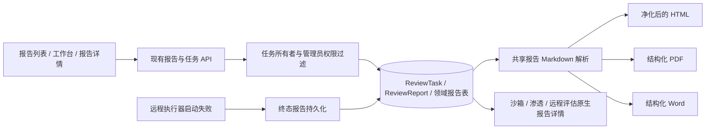
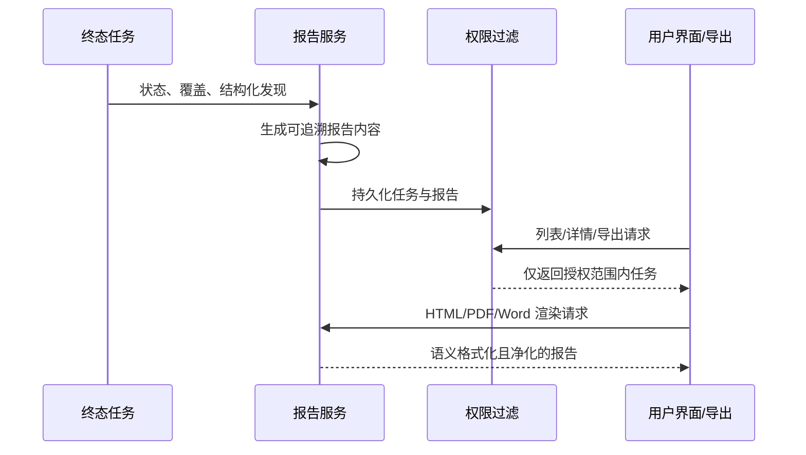

# 报告全链路质量修复设计

## 整体架构

## 分层设计

- 权限层：工作台统计和近期任务 SQL 复用报告任务元数据可见过滤；报告列表分页前过滤；详情、问题及导出保留所有者/管理员与当前项目校验。
- 任务层：远程评估终态失败统一由 `_persist_terminal_report` 写入报告和阶段状态。
- 内容层：共享解析器把 Markdown 分解成标题、段落、强调、列表、引用和代码块；HTML仍走现有 Bleach 净化器，PDF/Word转换成原生结构。
- 展示层：列表和详情显示任务终态、错误与覆盖；领域报告仅暴露可用格式。
- 渗透报告：展示全部非排除发现及完整字段；超过存储限制时切换显式标注的索引摘要，并保留结构化发现记录。

## 数据流

## 异常策略

- 缺少权限统一按既有 404 处理，不返回泄露任务存在性的卡片或元数据。
- 渲染失败保留原始报告访问能力并返回明确错误；不以未经排版的文件冒充成功导出。
- 远程执行器启动失败记录 `worker_start_failed`、未执行阶段及失败报告，不发起目标请求。
- 报告容量超限时使用明确提示的紧凑报告并保留结构化详情；不静默截断发现列表。

## 接口契约

不新增或改变 API 路径。保持 `ReportListItem` 中已有任务状态、错误、覆盖和来源字段；标准报告仍支持其现有导出格式；领域报告仍只支持 JSON 原始结构和原生详情页面。
