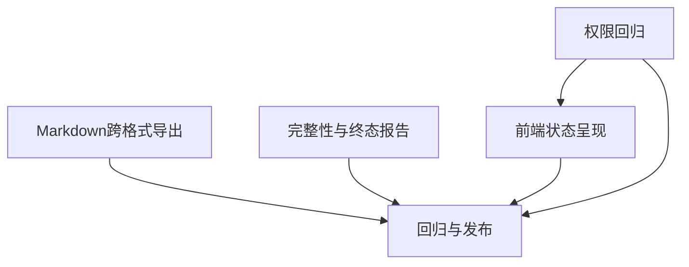

# 报告全链路质量修复任务

| 编号 | 输入契约 | 输出契约与验收 | 状态 |
| --- | --- | --- | --- |
| 1. 权限隔离 | 现有 `task_metadata_access_filter`、工作台和报告测试 | 工作台计数/近期任务不包含非所有者私有报告；所有者、管理员及标准代码审查权限不回归 | 已完成，测试通过 |
| 2. 导出排版 | Jinja、ReportLab、python-docx 与报告模板 | Markdown语义格式在 HTML/PDF/Word 可读显示，语法符号不作为文字；代码保真 | 已完成，定向测试通过 |
| 3. 报告完整性 | 渗透结构化发现、沙箱覆盖和远程观测 | 不静默删减发现；报告明确失败、覆盖及远程检查边界 | 已完成，定向测试通过 |
| 4. 状态呈现 | 报告列表/详情数据契约 | 失败、取消、过期、未完成状态及原因/覆盖清楚呈现 | 已完成，前端测试通过 |
| 5. 回归与发布 | 定向测试、全量相关测试和已有发布流程 | 自动化验证通过；发布 4.1.0 并只读核对线上版本、SHA、健康状态 | 4.1.0 与 4.1.1 均已正式部署；健康、就绪、浏览器页脚核验通过；两条旧远程失败记录待回填，白盒/审计/远程成功报告生产抽样待完成 |

## 原子任务依赖

## 执行约束

- 先增加或调整回归断言并运行失败复现，再修复实现。
- 不生成真实生产测试任务；使用隔离 SQLite/测试用户和临时导出文件。
- 导出格式修复不得绕过 HTML 消毒或领域报告限制。
- 独立复核本轮变更文件、测试结果、发布证据和任务范围。
