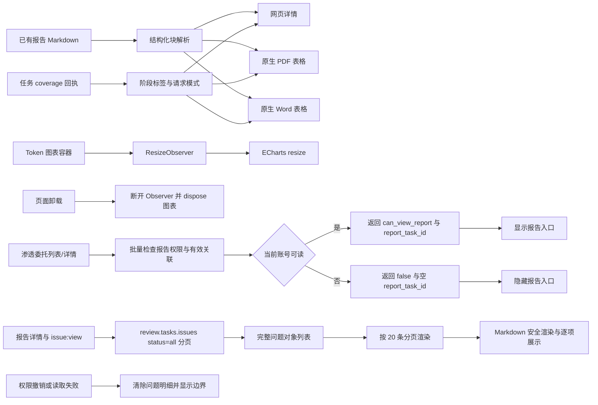

# 报告排版与覆盖口径修复设计

## 数据与呈现路径

## 模块职责

- `report_markdown.py`：识别 GFM 管道表格，同时保护围栏代码；输出统一 `table` 块。
- `report_pdf_exporter.py`、`report_word_exporter.py`：将表格块转为原生布局，提供表头样式、边框、长文本换行与分页支持。
- `domain_report_exporter.py`：输出请求模式、各验证阶段状态与覆盖边界；未记录具体未扫描项时不宣称“无遗漏”。
- `ReportDetail.vue`：展示阶段明细，区分未纳入与通过；限制 Markdown 内容宽度并折行。
- `ReportDetail.vue`：在已有 `report:view`、来源访问及 `issue:view` 门禁内，以 `status=all` 分页加载问题对象；逐条显示标题、严重度、状态、位置、证据和复核状态，以及已有的描述、建议、修复方案和代码；Markdown 通过现有 DOMPurify 渲染工具消毒并排版。
- `AdminOverview.vue`：观察图表自身容器，按变化重排，卸载时释放 observer。
- `report_service.py`：按报告查看权限、来源权限、项目范围、发起人/管理员对象范围和有效报告快照批量判定渗透委托报告可见性。
- `pentest_service.py` 与 `PentestEngagementOut`：序列化 `can_view_report`；无权时不向响应返回 `report_task_id`。
- `PentestList.vue`、`PentestDetail.vue`：只有服务端确认当前账号可读时才渲染报告入口。

## 失败处理

- 非表格 Markdown 保持原解析流程；代码围栏内看似表格的内容不转为表格。
- 未知 coverage 状态显示原状态或“未记录”，不映射为通过。
- 问题明细读取无权限时不请求或不展示问题内容；读取失败不视为零条；权限变化时清除已加载详情。`status=all` 与分页总数不一致时拒绝显示部分列表并给出重试状态。
- ResizeObserver 不存在或图表已销毁时安全跳过重排。
- 发布事务失败时由正式部署脚本按上一应用镜像尝试回滚；数据库不自动降级。
