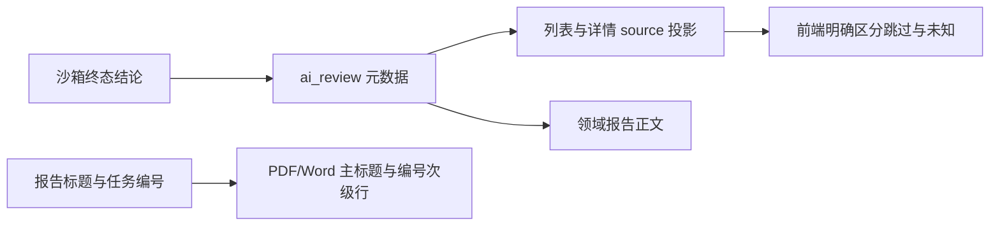

# 报告状态与导出呈现设计

## 数据流

## 模块设计

- 持久化层：`ai_review` 沿用现有 JSON 字段，增加可选 `skip_reason`；未知字段不推定为 skipped。
- 投影层：`load_task_issue_stats` 是列表和详情的共同来源，透传三种状态及对应原因。
- 前端层：列表以信息标签标明策略跳过；详情明确说明未运行 AI 审查。incomplete 与 unknown 继续使用各自的提示。
- 导出层：仅当标题末尾是足够长的安全任务标识时拆分标题和编号；PDF 正文只对超过 40 字符的连续 ASCII 标识插入换行，避免拆开普通项目名、短任务编号和短摘要。

## 异常策略

- 缺少 `skip_reason`：显示通用但准确的策略跳过说明。
- 缺少状态：保留未知文案，不从报告文本猜测状态。
- 标题不匹配公开任务 ID 格式：保持完整原标题，不拆分。
- 报告正文和执行回执只读复用；导出失败仍由现有 API 错误处理返回，不影响持久化报告。
