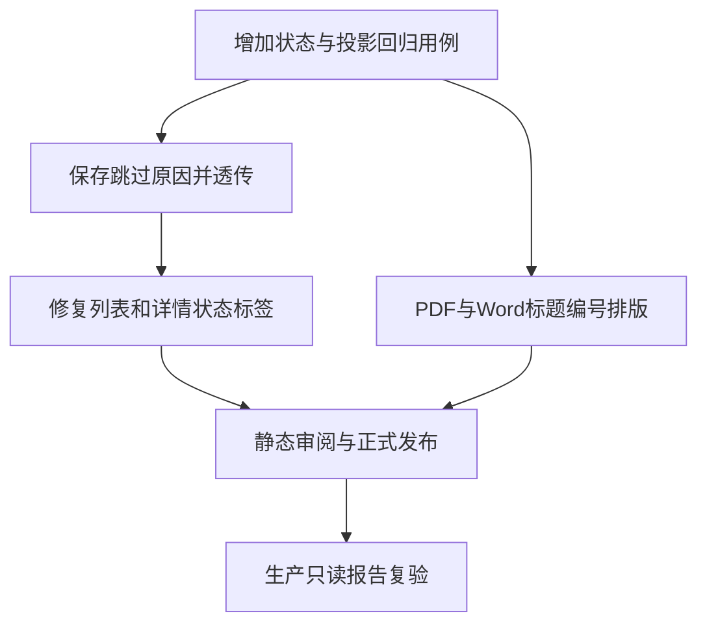

# 报告状态与导出呈现任务拆分

## T1：回归用例

- 输入：已复现的 skipped→unknown 投影和长任务编号断行。
- 输出：后端、前端与导出测试覆盖状态及标题格式。
- 验收：测试明确区分 skipped 和 unknown，并要求编号连续。

## T2–T3：状态链修复

- 输入：`ai_review` JSON 终态事实。
- 输出：保留 `skip_reason` 并使报告列表/详情一致显示。
- 验收：skipped 绝不落到未知或失败标签。

## T4：导出标题

- 输入：领域报告任务标题与公开任务编号。
- 输出：PDF/Word 使用独立标题与编号次级行。
- 验收：编号完整连续，正文内容不变。

## T5–T6：发布与验收

- 输入：固定版本、提交与部署清单。
- 输出：一次全量正式部署及现有生产报告的只读核验。
- 验收：版本、SHA、健康检查一致；不重新运行黑盒靶场。
