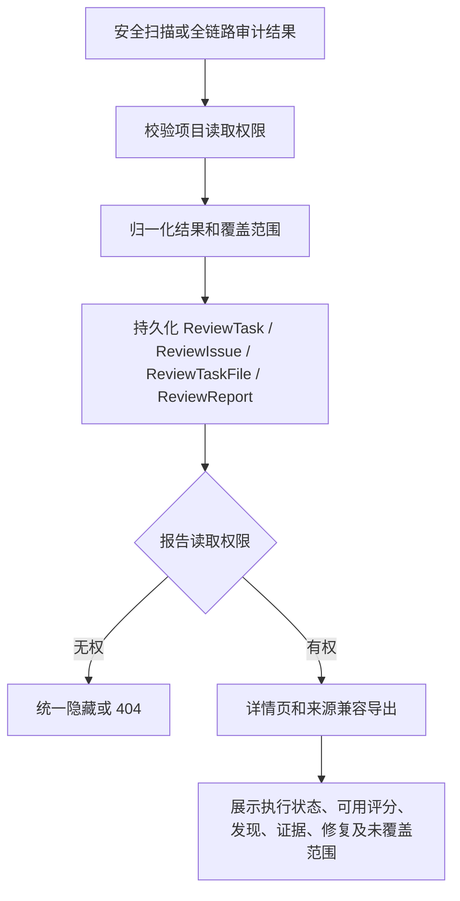

# 报告生成与小菱停止修复设计

## 执行与消息流

## 报告写入与读取

## 组件职责

- `agent_team_service`：按父运行取消子团队，并保留审计事件。
- `AgentChatDrawer`：忽略已取消运行的迟到回执，避免触发自动恢复。
- `security_report_service`：将安全扫描和全链路审计的结构化结果写入现有报告表，记录 `execution_status`、`coverage_status` 和 `score_available`。
- `review_service`、`project_service`、`report_service`：统一报告任务的账号可见性，并在详情、项目摘要和报告列表过滤字段。
- `ReportDetail`、`SecurityScanModal`：按真实执行状态呈现报告，清理 Markdown 装饰符，不丢失证据代码。
- 远程网站评估沿用 `remote_pentest` 自己的任务、归属校验与领域报告导出，不通过标准审查空报告兜底。

## 异常处理

- 授权在运行期间被撤销时不持久化给当前账号不可见的数据，返回权限错误。
- 扫描失败仍保存可用的部分事实并明确列出未扫描范围；完全无有效结果时报告标记失败。
- 非有限或缺失评分均为不可用；不会写成“100”或伪装成真实 0 分。
- 发布失败按当前部署协议停止并执行经验证的应用镜像回滚，不自动降级数据库。
