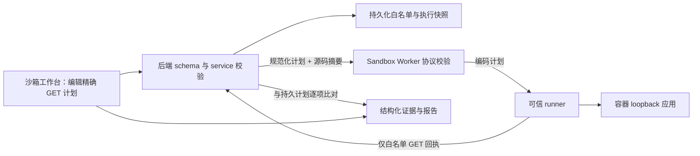
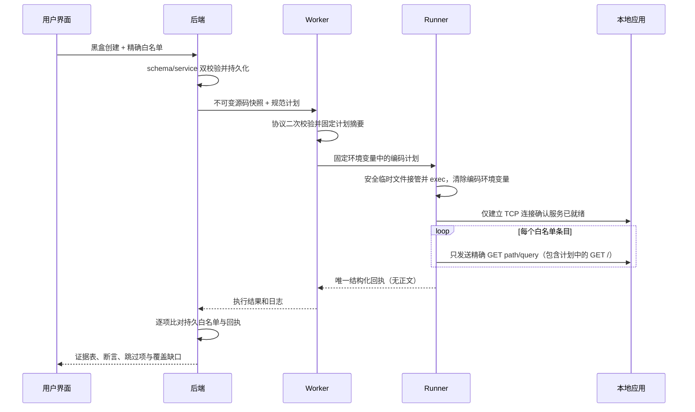

# 沙箱精确 HTTP 白名单架构设计

## 系统分层

## 模块与契约

### 白名单条目

`{method: "GET", path: string, query: Record<string,string>, expected_statuses: number[]}`。仅允许固定 origin `http://127.0.0.1:<preview_port>`；路径必须是以单个 `/` 开始的精确安全路径，不允许 fragment、路径穿越段、通配符或控制字符。查询键值只允许未编码 ASCII 安全字符并受 2048 字节序列化上限约束。空 `expected_statuses` 表示只记录回包、不执行状态断言。

### 创建请求

本地 test 且模式为 `blackbox` 时 `http_scope` 必填，包含 1–20 项，并且必须包含唯一的 `{method: GET, path: /, query: {}}`。组合测试会运行项目测试脚本，不开放白名单模式。远程目标、白盒、部署请求不接受该字段，避免两种权限模型混用。

### Worker 执行协议

`http_scope` 是固定 execute schema 的字段之一，进入请求摘要。Worker 再验证字段、条数、方法、路径和根探活条目，之后生成 base64 编码的只读行协议传给容器。Runner 在任何目标代码启动前把编码计划移入权限为 0600 的临时文件并通过 exec 替换原进程，移除原始编码环境变量；计划被 runner 读入内存并删除后才启动应用，目标进程不继承计划内容或 runner 内部模式标记。调用方不能设置任意环境变量、命令或镜像参数。

### Runner 回执

唯一 `PRISM_BLACKBOX_DONE` 回执使用 `basis=exact_http_allowlist`，含每项的精确目标、HTTP 状态码、读取字节数、耗时和状态断言结果。Runner 不记录响应正文，不跟随重定向，不做路由发现，不运行 `_prism_poc.sh`、`_agent_tests/*` 或 `_prism_verify.sh`。回执计划在应用启动前读入 runner 内存并删除临时计划文件；白名单模式跳过归档内启动补丁及 Agent 脚本；Worker 日志发生截断时后端拒绝采信回执。

后端用保存的计划校验回执请求次序和目标，不匹配、重复、缺失、状态/字段越界时失败关闭。

## 数据流

## 异常策略

- 白名单无效或缺失：创建/执行前拒绝。
- runner 计划缺失、回执不唯一或与持久化计划不一致：失败关闭。
- 探活或任一请求无响应：测试失败；状态断言不匹配：失败；未配置断言：记录结果但明确未证明业务正确性。
- 响应读取最多保留计数字节（上限 64 KiB），不保存 body；重定向只记录原始响应，不跳转。
- AI 动态用例状态标记为跳过；整体报告至少注明动态覆盖不完整。
