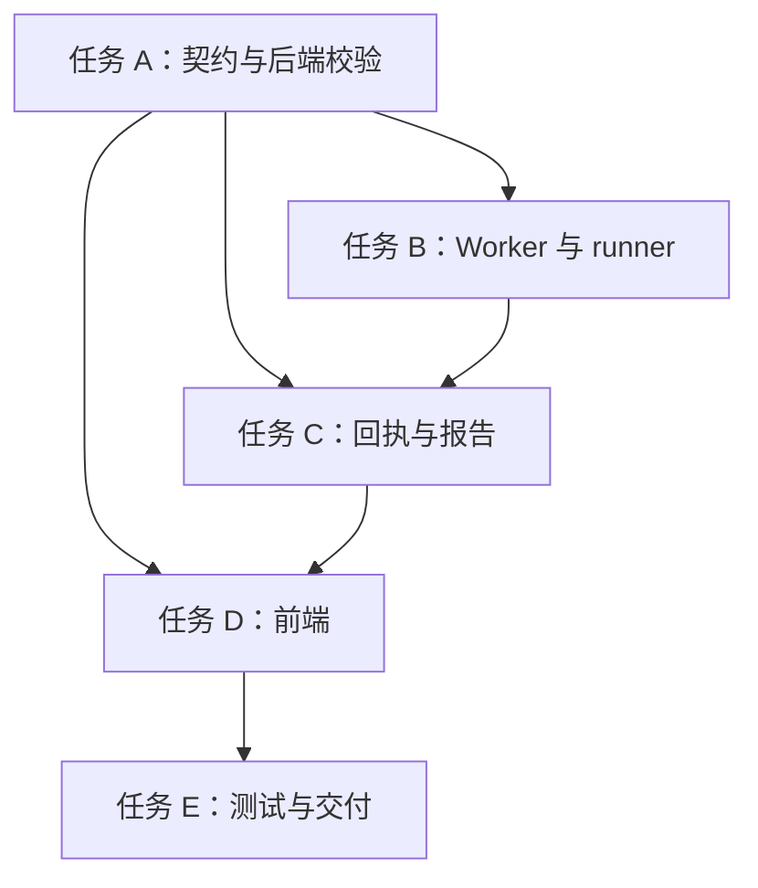

# 沙箱精确 HTTP 白名单任务拆分

## 任务 A：后端契约与服务端强制校验

状态：已完成。

- 输入：共识文档；现有 `SandboxCreateIn`、`create_environment`。
- 实现：规范条目 schema、白名单必填/排除规则、服务端规范化与持久化。
- 验收：缺失、非法、重复、超量、非 GET 均拒绝；不含根路径的真实入口可通过；远程/白盒/部署不受影响。
- 依赖：无。

## 任务 B：Worker 协议和 runner 执行

状态：已完成。

- 输入：任务 A 的规范格式；现有固定 executor 与 runner。
- 实现：Worker 复核、请求摘要、编码环境变量、受限 runner 分支、五镜像摘要更新。
- 验收：只发白名单 GET；不执行动态/注入脚本；越权计划无法通过 Worker；查询串严格限字符与长度；回执包含有限证据且日志截断时失败关闭。
- 依赖：任务 A。

## 任务 C：后端回执核验与报告

状态：已完成；后端回执与报告回归测试通过，见验收记录。

- 输入：任务 B 的可信结构化回执。
- 实现：精确比对、结构化证据、覆盖状态、确定性 Markdown 报告。
- 验收：缺失/伪造/错序回执失败关闭；报告呈现请求、响应状态、断言和缺口且无正文。
- 依赖：任务 A、B。

## 任务 D：前端配置与证据呈现

状态：已完成。

- 输入：白名单和报告契约。
- 实现：本地黑盒表单、客户端易用校验、结果证据展示；组合模式不显示白名单编辑器。
- 验收：表单提交准确；不可配通配符；结果区域不展示响应体；移动窄屏可阅读。
- 依赖：任务 A、C。

## 任务 E：整体测试与验收文档

状态：原始实现的本地代码、测试、五种镜像构建和 PHP 容器 runner 验收已完成；生产证据发现根路径必选过严，相关契约、执行器、前端和回归用例已修订。本轮未运行本地功能测试，修订版尚未重新部署。

- 输入：任务 A–D。
- 实现：运行目标测试、核对 runner 摘要、记录结果和待部署事项。
- 验收：根路径可选且摘要回执校验一致；相关测试需在获准环境验证，Acceptance/Final/TODO 文档准确。
- 依赖：任务 A–D。

## 实现约束

只修改隔离工作树；靶场只使用已授权的固定提交、沙箱 loopback 白名单和禁网容器。生产发布与产品 UI/数据库闭环需要另行依照现有发布门禁完成；本次未执行生产发布。
