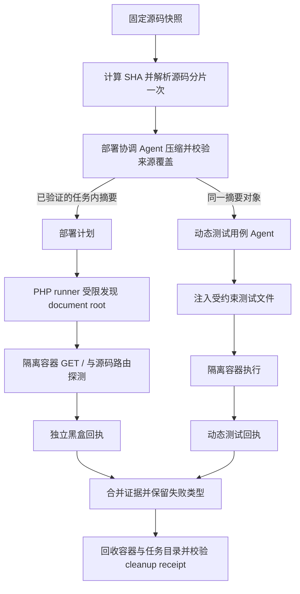

# 沙箱黑盒入口与上下文复用设计

## 模块边界

- `sandbox_service.py`：一次解析源归档，将同一个任务作用域 summary 传递给部署规划和动态用例生成；序列化结构化阶段结果。
- `deployment_coordinator_agent.py`：优先消费已完整核验的上下文，生成部署入口计划；只有没有共享摘要时才自行压缩。
- `test_case_generator_agent.py`：沿用现有共享摘要，不重新压缩源码；遇到压缩失败标记时立即跳过并写明原因。
- `deploy/sandbox/runner.sh`：在 PHP 项目根内受限发现文档根；只选择可唯一确定的入口，避免多层目录误把仓库根当站点根。

## PHP 根目录选择顺序

1. 当前根 `index.php` / `index.html`。
2. 当前根 `public/index.php` / `public/index.html`。
3. 原有唯一一级子目录入口。
4. 受限递归扫描常见 PHP 项目目录，剔除被更浅入口覆盖的子目录。若唯一命名目录（如 `app`、`public`、`web`、`www`、`htdocs`）可消除歧义则选用；剩余多候选返回明确启动诊断，不猜测。

扫描忽略 `.git`、`vendor`、`node_modules`、测试、缓存和执行器临时目录，不跟随符号链接；限制深度和候选数，避免大型归档拖垮 runner。

## 异常策略

- 压缩前校验归档和全部分片；压缩后确认来源 ID 顺序与集合、哈希、逐来源引文和受保护事实账本。
- 如果第一次共享压缩失败，写入任务内失败标记；后续 Agent 不再对原文重复发起昂贵的压缩调用。
- 应用就绪检查、源码路由探测、AI 动态断言分别记录状态与 HTTP 码；总体状态只在必需证据成功时通过。
- Worker 回执 `cleanup_confirmed` 缺失或为 false 时，不将资源回收标记为成功。

## v4.0.89 候选补充

- 源码压缩批次根据模型配置的上下文 token 窗口计算预算，同时限制单批最多 120,000 字符、32 个来源；摘要预算为 1,200 字。输入源码、来源 ID、引文和模型摘要均不静默截断，验证失败仍拒绝继续。
- PHP 文档根确定后，路由探测按 `/`、固定 PHP 入口白名单、源码明确声明路由的顺序构造候选。白名单仅含 `index.php`、`login.php`、`home.php`、`dashboard.php`、`admin/index.php`，不会请求任意安装、重置或写操作脚本。
- 生产 bWAPP 样本证明“文档根选对”不等于“黑盒路由可用”；候选必须分别验证上下文完整性与 HTTP 路由，不合并两种结论。
