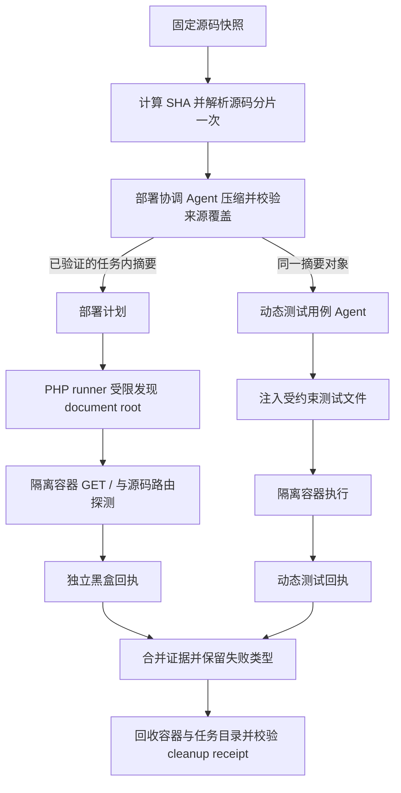
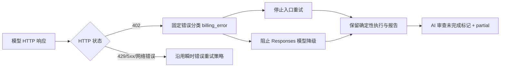

# 沙箱黑盒入口与上下文复用设计

## 模块边界

- `sandbox_service.py`：一次解析源归档，将同一个任务作用域 summary 传递给部署规划和动态用例生成；序列化结构化阶段结果。
- `deployment_coordinator_agent.py`：优先消费已完整核验的上下文，生成部署入口计划；只有没有共享摘要时才自行压缩。
- `test_case_generator_agent.py`：沿用现有共享摘要，不重新压缩源码；遇到压缩失败标记时立即跳过并写明原因。
- `deploy/sandbox/runner.sh`：在 PHP 项目根内受限发现文档根；只选择可唯一确定的入口，避免多层目录误把仓库根当站点根。

## PHP 根目录选择顺序

1. 当前根 `index.php` / `index.html`。
2. 当前根 `public/index.php` / `public/index.html`。
3. 原有唯一一级子目录入口。
4. 受限递归扫描常见 PHP 项目目录，剔除被更浅入口覆盖的子目录。若唯一命名目录（如 `app`、`public`、`web`、`www`、`htdocs`）可消除歧义则选用；剩余多候选返回明确启动诊断，不猜测。

扫描忽略 `.git`、`vendor`、`node_modules`、测试、缓存和执行器临时目录，不跟随符号链接；限制深度和候选数，避免大型归档拖垮 runner。

## 异常策略

- 压缩前校验归档和全部分片；压缩后确认来源 ID 顺序与集合、哈希、逐来源引文和受保护事实账本。
- 如果第一次共享压缩失败，写入任务内失败标记；后续 Agent 不再对原文重复发起昂贵的压缩调用。
- 应用就绪检查、源码路由探测、AI 动态断言分别记录状态与 HTTP 码；总体状态只在必需证据成功时通过。
- Worker 回执 `cleanup_confirmed` 缺失或为 false 时，不将资源回收标记为成功。

## v4.0.89 候选补充

- 源码压缩批次根据模型配置的上下文 token 窗口计算预算，同时限制单批最多 120,000 字符、32 个来源；摘要预算为 1,200 字。输入源码、来源 ID、引文和模型摘要均不静默截断，验证失败仍拒绝继续。
- PHP 文档根确定后，路由探测按 `/`、固定 PHP 入口白名单、源码明确声明路由的顺序构造候选。白名单仅含 `index.php`、`login.php`、`home.php`、`dashboard.php`、`admin/index.php`，不会请求任意安装、重置或写操作脚本。
- 生产 bWAPP 样本证明“文档根选对”不等于“黑盒路由可用”；候选必须分别验证上下文完整性与 HTTP 路由，不合并两种结论。

## v4.0.90 候选补充

- 完整校验源码分片后，先按既有模型上下文预算确定批次，再对同一归并层的独立批次使用最多 4 个线程并行调用模型；全进程共享有界信号量，避免多个沙箱任务叠加造成无界模型请求。
- 归并层之间仍按层串行，`executor.map` 保持输入批次顺序；哈希、来源 ID、逐来源引用、受保护事实、512 次调用硬上限与共享 deadline 不变。等待并发配额也计入 deadline，超时继续 fail-closed。
- v4.0.92 以生产调用账本校准首轮输出预算：默认配置允许时首轮用 4,096 token（最高仍受 4,096 上限约束），不先发已多次以 `finish_reason=length` 失败的 2,048 token 请求；4,096 仍无法满足时继续对原始输入递归无损拆分。
- 生产 v4.0.89 复测已证明 PHP 路由 `/login.php` 返回 200 且容器回收，但 AI 动态补充因源码压缩超过 300 秒时间预算而跳过。因此整体只记“部分通过”；v4.0.90 必须在真实 481 片样本中同时证明源码压缩完成、动态用例阶段执行，以及 PHP 黑盒/白盒各自的终态与 cleanup 回执。

## v4.0.91 候选补充

- v4.0.90 生产回归完成 481 片压缩预算内 138 次模型调用，其中 55 次因输出达到模型上限而截断、4 次请求读超时；引文校验还拒绝了 19 条确实是源码子串、但超过旧 80 字硬上限的返回。源码覆盖仍 fail-closed，确定性 PHP 路由单独通过。
- 将单批上限收紧为 8 个来源与 40,000 字符，减少模型在一次响应中复述大量 ID/引文的压力；摘要提示目标收紧到 600 字。逐字源码校验不放宽，真实引文允许至多 160 字，以匹配模型实际返回的精确子串长度。
- 生产验收必须同时记录压缩调用数/耗时、动态用例数量与执行、独立路由结果、最终状态和 `cleanup_confirmed`。命中确定性路由不能代替 AI 动态覆盖。

## v4.0.93 修复补充

- v4.0.92 生产真实任务 `sbx_eb4ec5deea23402bbdd0fd8f` 在 481 个源码分片上压缩失败；事件记录 `model_calls=131`、`elapsed_ms=300254`，原因仍为 `finish_reason=length`。确定性黑盒 `/login.php` 返回 HTTP 200，但 AI 动态用例未生成，因此该任务只能算部分通过。
- 根因核对 `BaseAgent.call()` 的请求体构造与 DeepSeek 官方 API 文档：调用方未传 `thinking` 时保留供应商默认值，而 DeepSeek 默认启用思考模式，隐藏推理 token 也计入 `max_tokens`。结构化源码摘要的 4,096 token 输出预算因此可能被隐藏推理消耗，JSON 结果在长度上限处截断；失败后递归拆分继续消耗共享 300 秒期限。
- `_context_call()` 现显式传 `thinking=False`，只作用于需要保真校验的结构化压缩请求；其他 Agent 的思考模式保持原行为。摘要仍需通过来源 ID、哈希、原文引文和受保护事实完整性校验，不放宽截断处理、不缩减源码覆盖、不把失败降级为成功。
- 依据：[DeepSeek 思考模式文档](https://api-docs.deepseek.com/guides/thinking_mode/)；[DeepSeek Chat Completions API](https://api-docs.deepseek.com/api/create-chat-completion/)。

## v4.0.94 摘要超限修复

生产模型对 481 源片项目返回过最长 2,075 字的摘要；旧 1,200 字阈值使已摘要的节点继续递归拆并，最终撞到拆分深度上限。v4.0.94 把有限单层上限调整为 2,400 字，提示仍要求精炼并优先保留入口、调用、鉴权、数据流与异常；较长摘要只作为下一层压缩输入。

来源 ID 顺序、精确引文校验、源 SHA、关键事实账本和最终上下文预算保持原样。宽批次引文错误仍通过两次校验失败后无损拆分恢复；超过 2,400 字、关键事实账本超预算、来源不完整或最终上下文超限继续 fail-closed。

## v4.0.95 精确引文提示修复

v4.0.94 对同一 481 源片 bWAPP 项目的真实复测不再以输出超限失败，但最终仍因模型返回的来源引文不能从对应来源原文逐字核验而跳过 AI 动态用例。v4.0.95 在每条来源输入中增加由程序从原文抽取的短 `source_quote_hint`，要求模型逐字回显为唯一引文，降低长批次中模型改写、漏标点或引用错位的概率。

提示字段只作为模型输出引导；校验仍针对未修改的原始 payload，来源 ID 顺序、引文必须是对应来源原文子串、SHA、受保护事实、预算上限及 fail-closed 语义均保持不变。不能回显有效引文时仍拒绝该压缩批次并继续按原逻辑无损拆分。

## v4.0.96 计费拒绝与生成代码导入校验

- `BaseAgent` 将 HTTP 402 归类为 `billing_error`，只保留安全固定错误，不读取或写出供应商错误正文；该错误不可重试。
- 源码压缩将 `billing_error` 转换为非重试上下文错误，并设置本次压缩共享 abort event。尚在信号量队列的任务会停止等待且不开始请求，已取得并发槽的请求允许完成，数量受既有上限约束；源码覆盖仍不完整时继续 fail-closed。
- 沙箱动态用例生成层保留 `failure_kind`，对计费/额度拒绝停止 Agent 和外层重试，并按实际尝试次数写进度事件。确定性 runner 的成功不会覆盖 AI 动态测试未运行状态。
- Python 标准库 `from module import name` 通过运行时导入确认模块属性或合法子模块；错误模块/不存在符号被反馈给生成器。真实源码与非标准库来源解析逻辑保持不变。
- 回归应覆盖 HTTP 402 单次调用、并行压缩收到 402 后排队任务不再发送、供应商正文不泄露、合法与非法标准库导入，以及沙箱级不再重试；外部服务仍拒绝计费时，生产任务只能记录为部分通过。

## v4.0.96 用量审计失败传播补充

- `UsageAccountingError` 表示模型请求已经发出、用量审计事务提交失败；该错误跨源码压缩、部署规划、文件读取、用例生成与沙箱调度传播时必须保留 `usage_accounting_error`，不能转成可重试的通用模型失败。
- 部署规划阶段遇到 `billing_error` 或 `usage_accounting_error` 时，在共享源码摘要上写入失败类型与错误状态；后续动态用例阶段必须读取该状态并短路，不得重新压缩或再次请求模型。
- 本次沙箱任务遇到计费拒绝或用量审计失败后，停止后续模型修复及多 Agent 报告调用；继续运行确定性 Worker 检查，并以确定性报告兜底，保留停止原因与实际阶段。
- PHP 并行语法修复以最多 2 个在途文件为窗口；`billing_error` 或 `usage_accounting_error` 后不再提交后续文件，等待已在途调用收敛，不返回部分修复源码，并将原始失败类型回传沙箱任务 fuse。
- Agent Mesh 将两类不可重试失败写入消息错误、死信事件和 `task.error` 回执，不按 `max_attempts` 重新排队；未分类瞬时错误继续沿用已有退避重试。
- 压缩并行任务须通过屏障测试证明最多只有已进入并发槽的请求继续；队列中的批次在不可重试失败后不得启动。日志记录实际失败类型与阶段，不把普通确定性 runner 结果提升为动态 AI 通过。

## v4.0.97 HTTP 402 防重试设计

- `NativeResponsesTransport` 将结构化状态码附在 `ObservedResponseError` 上；runtime 对 402 优先执行不可降级判断，避免模型名文本导致额外请求。用户可见的 402 错误固定化，不回传供应商正文。
- 聊天与旧 DeepSeek 请求入口直接将 402 归类为不可重试计费错误。沙箱只有在角色总数、成功执行数及有效 AI 报告均满足契约时，才发布“多 Agent AI 审查完成”；确定性 fallback 保留但明确区分。
