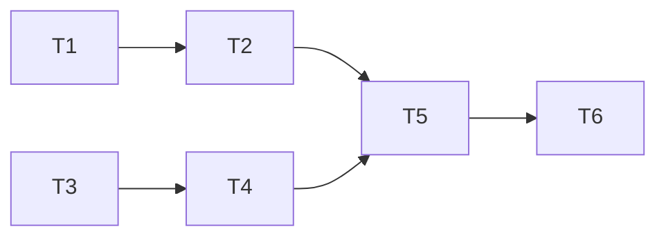

# 沙箱黑盒入口与上下文复用任务

| 子任务 | 输入契约 | 输出契约与验收 | 依赖 |
|---|---|---|---|
| T1 复现 PHP 文档根 404 | 生产回执入口 `bWAPP-master/app/index.php`、候选 runner | 修复前等价 fixture 的 readiness 404、路由候选 0 | 无 |
| T2 修复 PHP 文档根发现 | T1 复现夹具、`runner.sh` | 多层入口能唯一选根；歧义失败关闭；简单根和 `public/` 不回归 | T1 |
| T3 复用源码压缩结果 | 沙箱服务及两个 Agent 接口 | 一任务一次完整压缩、同 SHA 与来源账本被两阶段复用；失败不二次压缩 | 无，可与 T2 并行 |
| T4 补齐上下文审计事件 | 压缩结果与事件写入方式 | 记录 source/chunk 数、模型压缩调用数、耗时与 failure kind，不输出代码正文/密钥 | T3 |
| T5 回归与交付 | T2/T3/T4 完成代码 | 定向测试、全量后端、脚本门禁、构建上下文 clean/hash 验证通过；记录差异与未测边界。v4.0.89 候选全量后端 6,601 passed、6 skipped，部署脚本门禁通过 | T2/T3/T4 |
| T6 生产发布验收 | T5 候选 SHA、完整 bundle、备份/恢复和运行门禁 | 部署后 SHA/version/health/Worker profile 一致，生产 Safari 黑盒 PHP、白盒 PHP 回执与清理证据完整 | T5 |

## 依赖图

