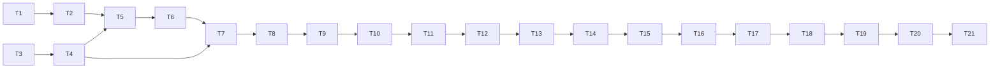

# 沙箱黑盒入口与上下文复用任务

| 子任务 | 输入契约 | 输出契约与验收 | 依赖 |
|---|---|---|---|
| T1 复现 PHP 文档根 404 | 生产回执入口 `bWAPP-master/app/index.php`、候选 runner | 修复前等价 fixture 的 readiness 404、路由候选 0 | 无 |
| T2 修复 PHP 文档根发现 | T1 复现夹具、`runner.sh` | 多层入口能唯一选根；歧义失败关闭；简单根和 `public/` 不回归 | T1 |
| T3 复用源码压缩结果 | 沙箱服务及两个 Agent 接口 | 一任务一次完整压缩、同 SHA 与来源账本被两阶段复用；失败不二次压缩 | 无，可与 T2 并行 |
| T4 补齐上下文审计事件 | 压缩结果与事件写入方式 | 记录 source/chunk 数、模型压缩调用数、耗时与 failure kind，不输出代码正文/密钥 | T3 |
| T5 回归与交付 | T2/T3/T4 完成代码 | 定向测试、全量后端、脚本门禁、构建上下文 clean/hash 验证通过；记录差异与未测边界。v4.0.89 候选全量后端 6,601 passed、6 skipped，部署脚本门禁通过 | T2/T3/T4 |
| T6 生产发布验收 | T5 候选 SHA、完整 bundle、备份/恢复和运行门禁 | 部署后 SHA/version/health/Worker profile 一致，生产 Safari 黑盒 PHP、白盒 PHP 回执与清理证据完整 | T5 |
| T7 压缩延迟复现与有界并行 | v4.0.89 生产任务 `sbx_f55815302ddf42859d1c4291` 的 481 片/300 秒超时证据 | 确认批次并发受进程级上限约束，保留归并顺序与共享截止时间；并发回归验证多个请求重叠且不超过 4 | T3/T4 |
| T8 v4.0.90 回归与生产复测 | T7 实现及测试 | 定向、后端全量、部署门禁；并发线程传递模型用量归因并记录每次 token；发布后用 Safari 对 bWAPP/PHP 重复黑盒并运行白盒，记录 AI 压缩/动态用例、路由、审查报告、终态和 cleanup receipt | T7 |
| T9 v4.0.91 修正输出截断与引文误拒 | v4.0.90 生产调用账本：481 片、138 次调用、55 次输出截断、4 次读超时、19 条精确但超 80 字引文 | 批次限制为 8 个来源/40,000 字符；模型摘要目标 600 字；仍验证来源 ID 顺序、逐字子串和 SHA；大样本本地回归证明 481 片有界归并；全量后端通过 | T8 |
| T10 v4.0.91 发布与线上复测 | T9、完整候选 SHA、发布包、备份/恢复和容量门禁 | 已发布 v4.0.91；Safari 真实复测 `sbx_b0e1448463804dcea6a696f3` 确认黑盒确定性路径通过，但源码压缩达到共享 deadline，AI 动态用例跳过；据生产调用账本继续修正预算 | T9 |
| T11 v4.0.92 预算修正与发布 | v4.0.91 真实调用证据、定向回归、完整后端和发布脚本测试 | 已发布 v4.0.92；生产容量与发布验收见 ACCEPTANCE，版本发布不代表 AI 动态覆盖通过 | T10 |
| T12 v4.0.92 生产黑盒复现 | v4.0.92 生产 bWAPP/PHP 黑盒真实任务 | `sbx_eb4ec5deea23402bbdd0fd8f` 确定性 `/login.php` 返回 200，但 481 片压缩在 300,254 ms 后因 `finish_reason=length` 失败，动态用例 0；只判部分通过 | T11 |
| T13 v4.0.93 隐藏推理预算修复 | v4.0.92 生产失败记录、DeepSeek 官方请求语义、BaseAgent 请求体实现 | 结构化压缩调用显式禁用 thinking；回归先复现缺参再验证 `thinking=False`；全量后端、部署门禁、前端构建通过 | T12 |
| T14 v4.0.93 发布与生产复测 | T13、容量门禁、完整 bundle、备份/恢复和真实浏览器 | 发布后对同一 481 片 bWAPP/PHP 运行两次黑盒和一次白盒；逐项记录压缩完成、动态用例执行、路由、终态及 cleanup receipt，不将部分通过写为全通过 | T13 |

| T15 v4.0.94 摘要硬边界修复 | v4.0.93 任务 `sbx_f207b9e313f5499cb0fd3ca1`：178 次压缩调用、481 源片、最大摘要 2,075 字；精确引文失败统计 | 将摘要硬上限调整到 2,400 字，来源引文校验仍严格；回归覆盖生产长摘要、坏引文拆分、超上限 fail-closed 与多层归并 | T14 |
| T16 v4.0.94 候选全量验证 | T15 代码与回归 | 后端全量、前端 lint/test/build、Ruff、发布/回滚故障注入通过；生成干净完整 SHA 与 bundle，发布前核对数据库备份恢复与主机容量 | T15 |
| T17 v4.0.94 生产发布与业务复测 | T16、普通 Chrome 登录会话、用户已授权生产发布与实测 | 发布后核对 running SHA、APP_RELEASE、镜像、Alembic、HTTPS/health、资产；同一 PHP 项目做两次黑盒和一次白盒，分别记录源码压缩、AI 动态用例执行、确定性结果、worker receipt；只报告实测范围 | T16 |
| T18 v4.0.95 引文复现与提示修复 | v4.0.94 真实黑盒回执 `sbx_e32876716e62433cb3eeb8fc`：确定性路由通过，AI 用例 0，来源引文核验失败 | 逐来源加入原文精确短引文提示；保留原 payload 严格校验；增加成功与坏引文回归；后端全量通过 | T17 |
| T19 v4.0.95 发布与重复验收 | T18、已批准清理范围、容量门禁、备份/隔离恢复 | 按精确 SHA 发布；重复真实黑盒并做白盒，记录动态用例生成/执行、源覆盖、路由、终态、清理回执；不把局部通过写成全通过 | T18 |
| T20 v4.0.96 生产失败复现与快速停止修复 | v4.0.95 生产 bWAPP 黑盒/白盒任务、HTTP 402 观察、Python 导入误判样本及用量审计事务错误路径 | 计费/额度拒绝只调用一次并安全分类；用量审计写入失败跨压缩/部署规划/用例生成/并行 PHP 修复/Agent Mesh 保留不可重试类型；队列停止新请求，Mesh 立即终止重排；部署规划或语法修复失败后阻止后续模型阶段；多 Agent 报告失败时保留确定性报告；标准库 `from-import` 成员真实校验；保留 fail-closed 与任务隔离 | T19 |
| T21 v4.0.96 发布与生产复测 | T20 全量验证、精确提交、≥12 GiB 容量、正式备份与隔离恢复、普通浏览器会话 | 仅按正式发布脚本部署；核对运行 SHA/版本、健康、账本、镜像和 Worker；重复原 bWAPP 黑盒/白盒，记录压缩、AI 动态用例、确定性结果和 cleanup receipt；上游额度拒绝时如实标为部分通过 | T20 |

## 依赖图

