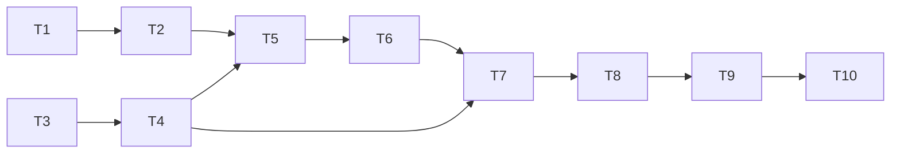

# 沙箱黑盒入口与上下文复用任务

| 子任务 | 输入契约 | 输出契约与验收 | 依赖 |
|---|---|---|---|
| T1 复现 PHP 文档根 404 | 生产回执入口 `bWAPP-master/app/index.php`、候选 runner | 修复前等价 fixture 的 readiness 404、路由候选 0 | 无 |
| T2 修复 PHP 文档根发现 | T1 复现夹具、`runner.sh` | 多层入口能唯一选根；歧义失败关闭；简单根和 `public/` 不回归 | T1 |
| T3 复用源码压缩结果 | 沙箱服务及两个 Agent 接口 | 一任务一次完整压缩、同 SHA 与来源账本被两阶段复用；失败不二次压缩 | 无，可与 T2 并行 |
| T4 补齐上下文审计事件 | 压缩结果与事件写入方式 | 记录 source/chunk 数、模型压缩调用数、耗时与 failure kind，不输出代码正文/密钥 | T3 |
| T5 回归与交付 | T2/T3/T4 完成代码 | 定向测试、全量后端、脚本门禁、构建上下文 clean/hash 验证通过；记录差异与未测边界。v4.0.89 候选全量后端 6,601 passed、6 skipped，部署脚本门禁通过 | T2/T3/T4 |
| T6 生产发布验收 | T5 候选 SHA、完整 bundle、备份/恢复和运行门禁 | 部署后 SHA/version/health/Worker profile 一致，生产 Safari 黑盒 PHP、白盒 PHP 回执与清理证据完整 | T5 |
| T7 压缩延迟复现与有界并行 | v4.0.89 生产任务 `sbx_f55815302ddf42859d1c4291` 的 481 片/300 秒超时证据 | 确认批次并发受进程级上限约束，保留归并顺序与共享截止时间；并发回归验证多个请求重叠且不超过 4 | T3/T4 |
| T8 v4.0.90 回归与生产复测 | T7 实现及测试 | 定向、后端全量、部署门禁；并发线程传递模型用量归因并记录每次 token；发布后用 Safari 对 bWAPP/PHP 重复黑盒并运行白盒，记录 AI 压缩/动态用例、路由、审查报告、终态和 cleanup receipt | T7 |
| T9 v4.0.91 修正输出截断与引文误拒 | v4.0.90 生产调用账本：481 片、138 次调用、55 次输出截断、4 次读超时、19 条精确但超 80 字引文 | 批次限制为 8 个来源/40,000 字符；模型摘要目标 600 字；仍验证来源 ID 顺序、逐字子串和 SHA；大样本本地回归证明 481 片有界归并；全量后端通过 | T8 |
| T10 v4.0.91 发布与线上闭环 | T9、完整候选 SHA、发布包、备份/恢复和容量门禁 | 普通 Safari 真实重跑至少两次 PHP 黑盒和一次 PHP 白盒；黑盒需有动态用例实际执行，记录 AI 调用归因、路由、终态、清理回执及任何偶发失败 | T9 |

## 依赖图

