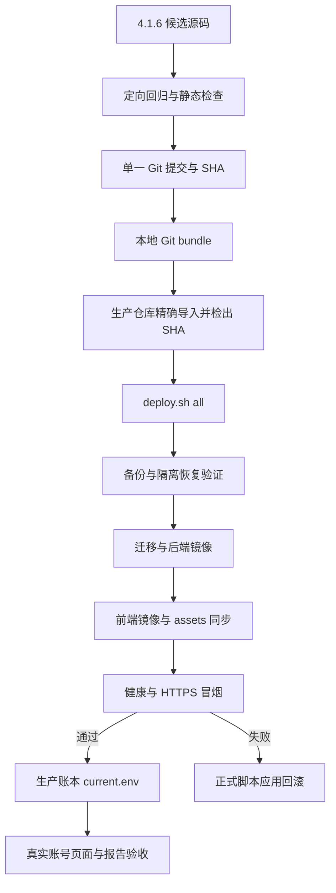
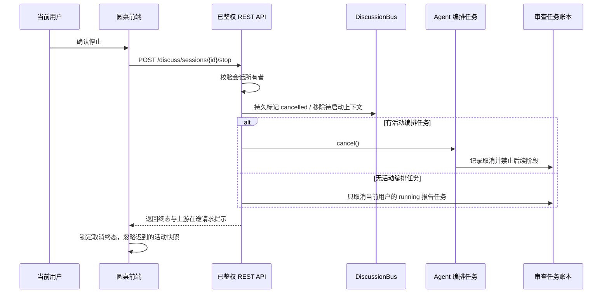
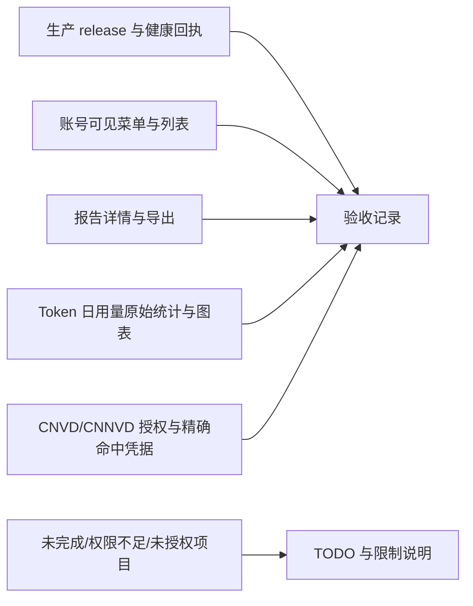

# 稳定部署与生产验收设计

## 发布架构

## 控制流修复

## 报告可见性

- 代码审查/报告型任务继续使用既有对象所有者、项目成员和 `report:view` 策略。
- 远程网站评估列表以账号与角色先过滤再 count、排序和分页：管理员 `scope=all`；审批人 `scope=all` 只包含本人任务与待审批申请；其他请求按本人任务过滤。
- 待审批申请是审批工作项，不代表审批人拥有结果报告访问权；报告接口继续执行单独的对象所有者/管理员校验。

## 生产验收数据流

## 异常处理

- bundle 导入、精确 SHA 检查或正式部署预检失败时不切换服务，记录实际阻断项。
- 正式脚本在切换后遇到健康/冒烟失败时按脚本的应用镜像回滚；数据库迁移不自动降级，依据备份和迁移状态单独核对。
- REST 停止失败且 WebSocket 也无法送达时，前端恢复可重试状态并显示停止未送达，不伪装成已停止。
- 报告列表过滤、详情或导出任一权限检查不一致时，停止该类型的“已通过”结论并记录任务/账号/路由证据。
