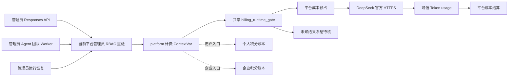

# 管理员小菱平台计费作用域设计

## 架构

## 数据与状态

- `PlatformModelCostAttempt` 记录 request key、管理员 user id、可选运行 id、模型、官方供应商身份、定价版本、价格来源与核对日期、输入/输出费率、预占 Token 上界、预占/实际成本、输入/输出 Token、开始和结算时间。
- 状态机：`reserved → settled`；`reserved → unknown`；仅确认尚未发送时可到 `not_sent`。`unknown` 保留最大预占成本并阻止同一运行自动恢复重放。
- 同一运行允许多个已预占请求并发，适配一个任务同时拆分多个模型请求；每个请求键独立唯一。运行中只要出现 `unknown` 就阻止后续发送；即使另一个请求更早预占、但尚未发送，也会在发出前被标为 `not_sent`。恢复或人工重试时，旧预占中未开始的请求释放为 `not_sent`，已开始的请求冻结为 `unknown`。
- 成本单位为整数 CNY 微元。输入、输出分别按请求开始时官方峰时、缓存未命中上界计价；既有个人账本不参与平台费用结算。

## 请求流程

1. 请求入口读取服务端账号和管理员 RBAC；后台路径同样重验账号有效性、运行/团队租约和权限。
2. DeepSeek 端点先执行请求级协议归一化，再将同一个归一化 payload 交给计量门和供应商；兼容层只移除官方文档明确不支持的 reasoning `summary` 与 `encrypted_content`。其他未知字段仍由计量门拒绝。BYOK 沿用调用方自付语义，不记成平台供应商成本。
3. 发请求前固定价格快照与最大 Token 成本。模型、端点、输出上界或计价数据不匹配即拒绝。
4. 成功只用供应商返回且通过上界校验的 usage 结算。传输异常/usage 不可信写入 `unknown`，禁止自动重试；同一请求的发送状态只能从未开始变为已开始一次。人工重试仅在运行处于可重试终态且没有后台恢复任务时先冻结旧预占，再原子认领检查点。
5. 平台管理员每轮调用继续写 `AiCallLog`，不创建个人或企业钱包预占。

协议依据：[DeepSeek Responses API 输入项说明](https://api-docs.deepseek.com/guides/responses_api/)说明 reasoning 回传支持纯文本 content，不支持 summary 与 encrypted_content。归一化在计量预占之前运行，确保计价上界与实际发送内容一致。

## 失败处理

- 权限/租约在发送前变化：标记 `not_sent`，不产生模型外呼。
- 请求可能已发送但结果不明：冻结预占为 `unknown`，同一运行保持阻断；当前版本没有管理员账单核对 UI/API，需平台运维通过供应商账单与成本流水核对，不能通过自动重发消除未知状态。
- 未支持模型、非 DeepSeek 官方地址、未知凭据来源、未定价服务端工具：发送前拒绝。
- 不启用旧的全局未计量兼容开关作为回退。
