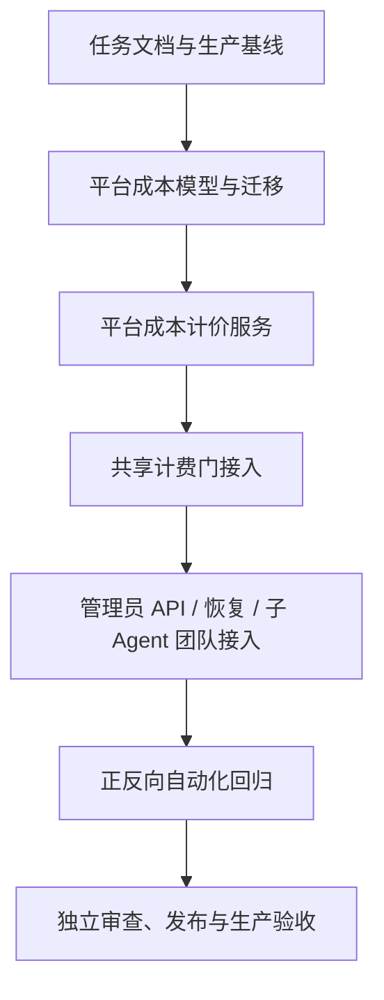

# 管理员小菱平台计费作用域任务拆分

## 依赖图

## 原子任务

| ID | 输入/前置 | 输出 | 验收 |
|---|---|---|---|
| A | 生产 4.1.55，migration 121 | 本 ALIGNMENT、CONSENSUS、DESIGN、TASK 文档 | 基线、边界、费用规则和迁移父节点一致 |
| B | 121 唯一 head | 平台模型成本 ORM 与 122 迁移 | 状态/费率/金额约束、SQLite 与 MySQL 兼容 |
| C | 官方费率与成本流水模型 | 整数成本预占、结算、未知冻结 | 幂等、Token 上界、权限/主体隔离 |
| D | 当前 billing_runtime_gate | platform scope 的流式及缓冲 Responses 生命周期 | 无个人/企业钱包；用户和企业原路径不变 |
| E | API、恢复与团队调度器 | 三类管理员入口统一平台计量 | 权限撤销、未知重试与 ContextVar 生命周期安全 |
| F | 项目既有 pytest/迁移流程 | 端到端/隔离回归记录 | 正向、拒绝、串账、未知结果均通过 |
| G | PR 与生产部署流程 | 发布核验、ACCEPTANCE、FINAL、TODO | 版本/提交/迁移/镜像/健康和管理员真实浏览器调用逐项留证 |

## 执行进度

- A–F 的本地实现与隔离验证已完成：管理员 Responses、恢复、管理员团队、计量隔离、权限撤销、手动重试和同运行未知结果并发拦截均有覆盖。
- SQLite 迁移升级、回退、再升级通过；生产 MySQL 迁移、生产发布和真实管理员 Safari 调用须在发布后核验。
- DeepSeek 官方价格于 2026-11-17 核对，来源、费率和定价版本写入每条平台成本记录。
