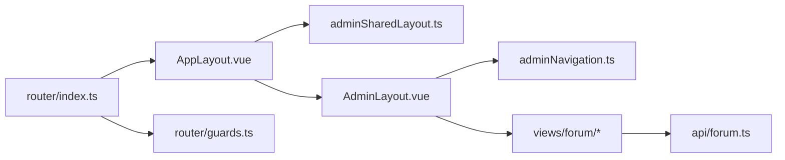

# 统一管理员页面外壳：设计

## 整体架构

```mermaid
flowchart TD
    R[Vue Router 路由与现有权限守卫] --> A[AppLayout]
    A -->|管理员且路径为 /forum 或其子路径| S[现有 AdminLayout]
    A -->|其他角色或普通页面| U[现有用户 AppLayout 内容]
    S --> M[管理员导航与管理控制台框架]
    S --> F[论坛路由页面]
    F --> L[论坛列表 / 搜索 / 分类 / 排序]
    F --> P[发帖 / 帖子详情 / 编辑 / 回复]
    R --> G[personalAccountOnly 与企业成员守卫]
    G -->|拒绝企业账号访问公开论坛| E[/enterprise 重定向]
    G -->|允许| A
```

## 分层和核心组件

- **路由层**：`frontend/src/router/index.ts` 继续声明原有论坛路由。
- **授权层**：`frontend/src/router/guards.ts` 继续决定登录、角色、workspace 与企业成员资格。
- **外壳选择层**：`frontend/src/utils/adminSharedLayout.ts` 判断管理员共享页面路径；`frontend/src/components/layout/AppLayout.vue` 已依据该判断和管理员角色切换到 `AdminLayout`。
- **管理员壳层**：`frontend/src/components/admin/AdminLayout.vue` 提供现有管理导航、账户、小菱入口和路由容器。
- **业务页面层**：论坛 Vue 页面及 `frontend/src/api/forum.ts` 保持原样。

## 模块依赖



## 接口契约

本任务不新增接口。共享布局函数输入为当前 `route.path`，输出是否属于管理员共享页面；它只决定展示外壳，不修改角色、权限、workspace 或业务 API。

## 数据流

1. Vue Router 先执行现有守卫；论坛路由仍按登录状态和企业成员限制处理。
2. 守卫允许后，`AppLayout` 读取当前路径和 user store 的管理员角色。
3. 管理员位于论坛主路由或帖子子路由时，`isAdminSharedRoute` 返回真，`AppLayout` 渲染 `AdminLayout`。
4. `AdminLayout` 的 `<router-view>` 渲染原论坛页面；论坛业务仍调用原 API。
5. 非管理员访问同一路径时，继续渲染原 `AppLayout` 和论坛页面。

## 异常处理

- 无法加载用户资料时由现有守卫转登录，不新增布局回退逻辑。
- 企业成员访问论坛时由现有守卫重定向，不因管理员外壳判断改变。
- 未知路径仍由现有 404 路由处理。
- 定向测试失败时停止发布；生产发布失败时遵循部署脚本的同版本回滚门禁。
