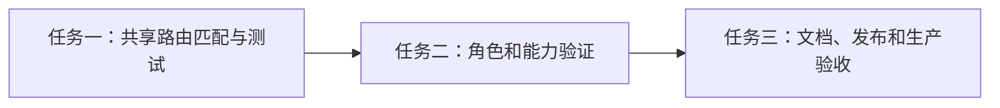

# 统一管理员页面外壳：原子任务

## 任务一：扩展管理员共享页面路由匹配

- **输入契约**：干净基线 `34f9fb71f9aa0c0d56f4fdbc805471b98959b3d3`；现有 `/billing`、`/support` 共享布局规则。
- **输出契约**：`/forum` 和全部 `/forum/*` 路径能匹配管理员共享壳；不匹配无关前缀。
- **实现约束**：仅调整现有 `isAdminSharedRoute`，保留原路径行为。
- **验收**：精确路径、帖子子路径、无关前缀的单元测试通过。

## 任务二：验证角色与论坛能力保持

- **输入契约**：任务一的共享路径匹配。
- **输出契约**：管理员切换外壳；非管理员维持 AppLayout；论坛路由、权限、企业成员拦截不变。
- **实现约束**：不修改论坛视图、API、守卫或后端。
- **验收**：组件分流回归、论坛路由能力清单和授权守卫检查通过。

## 任务三：更新文档并发布

- **输入契约**：代码与测试完成；版本 `4.1.57`；精确完整提交。
- **输出契约**：任务文档、发布说明和生产验收证据；健康端点与站点显示相同版本和 SHA。
- **实现约束**：按 `deploy/README.md` 和 `deploy/RELEASE_CHECKLIST.md`；只使用 `deploy.sh all`；不带入旧工作区变更。
- **验收**：CI、备份、隔离恢复、发布前后检查及生产浏览器验收均有结果记录。

## 依赖关系

