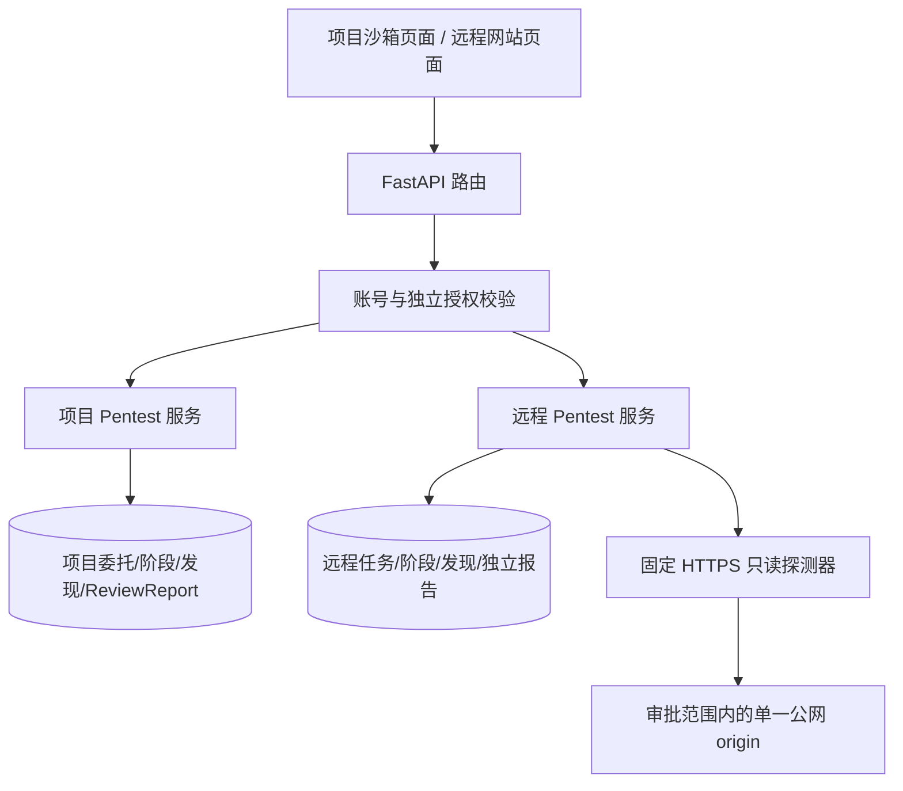
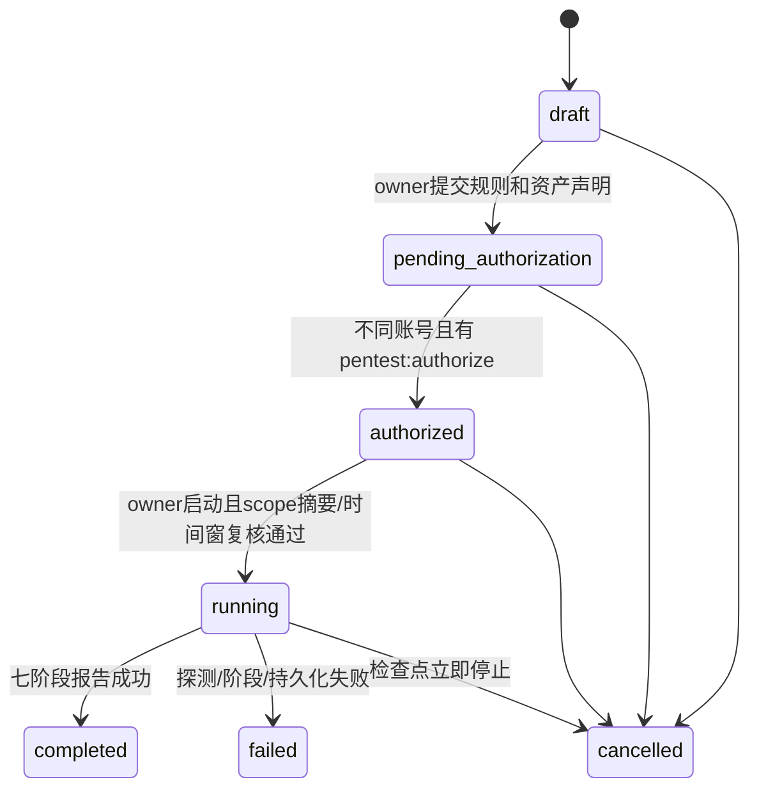

# 设计：远程渗透链路与沙箱失败诊断

## 分层

## 数据模型

- `remote_pentest_engagement`: owner、规范化 URL、资产授权依据、scope digest（含授权时长）、规则版本/确认、独立审批人、有效时间窗、状态、失败码、阶段摘要。
- `remote_pentest_phase_run`: 远程任务 ID、固定阶段键、状态、开始/结束时间、结构化摘要、失败码。
- `remote_pentest_finding`: 远程任务 ID、证据摘要、严重度、状态和唯一指纹；不存完整响应正文。
- `remote_pentest_report`: 独立任务 ID、owner、scope digest、报告结构、生成状态、时间戳；详情读取二次执行 owner/admin ACL。

## 授权状态机

每次启动重算 scope digest；与审批快照不同即拒绝。权限撤销和授权时间窗在每个网络动作前复查。

## 固定远程探测器

`https` + 443 only；拒绝 URL userinfo、IP literal、非公网 DNS 结果、localhost、私网、链路本地、混合/多目标和重定向；禁用代理与凭据；首次解析后的公网 IP 随情报收集阶段证据持久化并保留 Host/SNI。第二次请求重新解析域名，仅当所选公网 IP 与首轮一致时才连接，否则在创建 HTTP 客户端前终止。最多 2 次 `GET`，响应正文不读取、不保存；连接/总时限有上限。目标 URL 仅 origin/root 路径，不接收用户自定义路径/查询参数。

非 2xx 根路径响应不自动标成漏洞或覆盖成功：任务显示实际流程终态，报告 `status=partial` 并说明响应状态与应用路由覆盖未确认。配置状态使用“待复核配置观察/已复核配置观察/未重复观察”，不使用“漏洞已确认”。

## 报告与前端

- `/pentests` 保持“项目沙箱”语义；远程模式新增 `/remote-pentests` 列表、`/remote-pentests/start` 创建和 `/remote-pentests/:publicId` 详情（详情内显示报告）。独立报告由 `/api/v1/remote-pentest/tasks/{public_id}/report` 读取。
- 远程报告不生成伪造 `ReviewTask`，避免项目 ACL、任务列表和报告统计交叉污染。
- 发起账号与管理员的任务详情显示服务端保存的七阶段状态和证据摘要；仅有授权权限的审批账号只查看任务状态和申请范围，不渲染空白阶段卡片或报告证据。审批前确认窗口长度、目标、申请人授权声明和范围。
- 原报告查看提示继续解释账号隔离；权限不足只返回安全提示，不返回评分、问题数或报告正文。

## 失败证据

项目沙箱报告写入失败时记录结构化 `failure_code` 与 `report_persisted=false`；详情仅向报告可见者提供来源证据推导的失败原因。旧记录不得被猜测性回填。远程阶段和报告错误仅展示安全分类与可操作提示，不回显响应正文、token、Cookie、内部解析地址或异常堆栈。进程重启、阶段间取消、权限撤销及审批并发均需收敛；恢复只保存部分报告，绝不重放公网请求。
