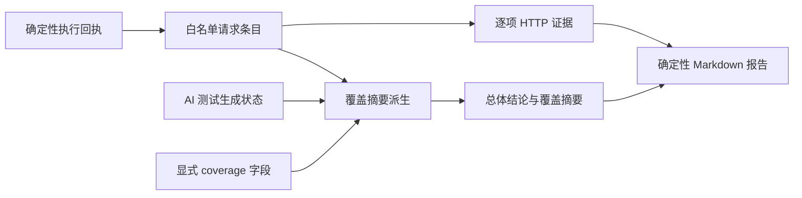

# 黑盒白名单报告摘要一致性设计

## 总体数据流

## 分层设计

- 执行事实层：继续使用已持久化的 `evidence.blackbox_execution` 与 `evidence.agent_test_generation`，不改变请求协议或数据库。
- 报告摘要层：`_sandbox_execution_disclosure()` 先读取显式 `coverage`；精确白名单时将可信请求回执转换为已测试范围，补充白名单外路径未扫描项；AI 生成明确为 skipped 时生成对应跳过项及原因。
- 历史报告修复：创建者重复请求现有终态 stop 时，仅当持久化精确白名单回执非空且报告摘要含旧版矛盾文案，才调用终态报告生成器。精确白名单报告从保存的结论重新生成，不追加旧正文；不触发 Worker、HTTP 或模型调用。
- 逐项证据层：保留现有实际请求表述、状态断言、响应字节计数、耗时、正文不落盘提示。
- 结论层：保持 `_sandbox_verification_coverage()` 的确定性状态与 partial 判定，不因摘要增加而提升为完整通过。

## 异常处理

- 请求回执缺失或为空：摘要不声称存在已测试路径，并如实提示应用未就绪或执行器未返回可核验证据。
- 已有报告正文缺失但存在精确白名单回执：可根据保存的结论重建确定性报告；无回执时不可刷新。
- 白名单执行但请求清单为空：不得推断路径已测；列明白名单请求未完成的事实。
- AI 状态缺失：不擅自声明已运行或已跳过，保留未知状态。
- 任务终止且未扫描清单缺失：继续使用现有的“终止时剩余范围未知”说明。
